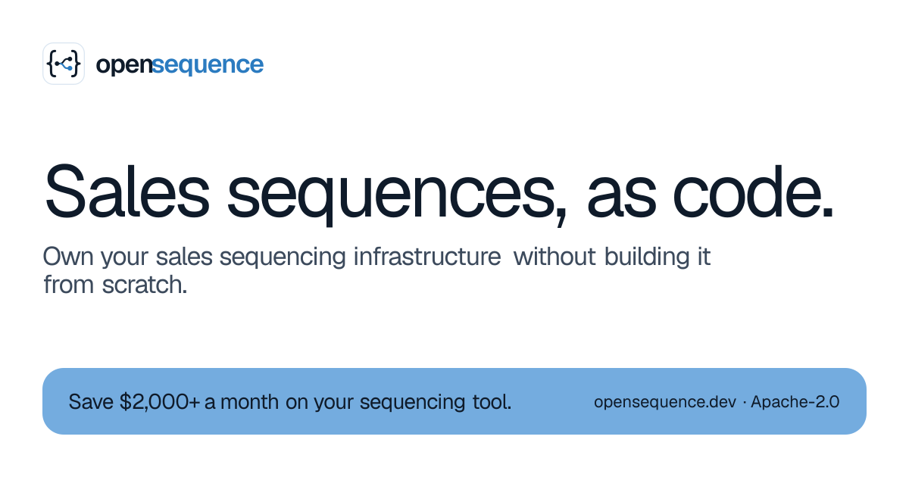
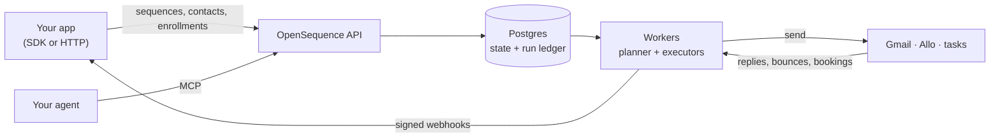

<p align="center">
  <a href="https://opensequence.dev"></a>
</p>

<p align="center">
  <b>The open-source, self-hosted engine for sales sequences.</b><br>
  Your app makes a few API calls. OpenSequence does the rest.
</p>

<p align="center">
  <a href="https://opensequence.dev">Website</a> ·
  <a href="https://docs.opensequence.dev">Docs</a> ·
  <a href="https://docs.opensequence.dev/docs/self-hosting/install">Self-hosting</a> ·
  <a href="https://docs.opensequence.dev/api">API reference</a> ·
  <a href="../../issues">Issues</a>
</p>

<p align="center">
  <a href="LICENSE"></a>
  <a href="../../actions/workflows/ci.yml"></a>
  
</p>

---

## What is OpenSequence?

OpenSequence runs multi-step outreach (emails, threaded follow-ups, texts, call tasks, LinkedIn
steps) for any CRM, with the shape of a self-hosted [Svix](https://github.com/svix/svix-webhooks):
one Docker image, a Postgres you own, per-project API keys, and signed webhooks back to your app.

You register **senders**, **contacts** and **sequences** (versioned JSON definitions), **enroll**
people, and read what happened. OpenSequence handles everything in between: scheduling in each
lead's time zone, sending from each rep's own inbox, throttling, replies, bounces, opt-outs,
meetings booked, exits, analytics, and a webhook when something changes.

It is headless. Bring your own UI, your own CRM and your own infrastructure.

## Why own your sequencing

- **No per-seat pricing.** Sequencing tools bill per rep, every month. This is a container and a
  database you already run.
- **Headless by design.** Every sequence, enrollment and result is an API call, so it lives inside
  your CRM instead of next to it.
- **The hard parts are done.** Idempotent sends, an append-only run ledger, crash-safe workers,
  reply and bounce detection, time zones and quiet hours, daily caps per sender.
- **Your stack.** Postgres for state, and the queue you choose (Postgres, Redis or in-memory). Run
  the API and the workers together or scale them apart.
- **Agent-ready.** An MCP server ships in the box, so Claude Code, Cursor or any MCP client can
  build sequences, enroll leads and read results with a scoped key.

## Quickstart

Run it locally with mock providers (no Google, Allo or Attio account needed):

```bash
git clone https://github.com/lguerberg/open-sequence && cd open-sequence
docker compose up
```

That starts Postgres and the service on `http://localhost:8080`. Create a project and its API key
with the development operator token:

```bash
curl -X POST http://localhost:8080/v1/admin/projects \
  -H "Authorization: Bearer dev-admin-token" \
  -d '{"slug":"acme","name":"Acme CRM"}'
# -> { "project": "prj_...", "api_key": "sk_live_..." }   (the key is shown once)
```

## Use it from your code

The TypeScript SDK ([`packages/sdk`](packages/sdk)) is typed from the OpenAPI file. Create and
publish a sequence:

```ts
import { OpenSequence } from '@opensequence/sdk';

const oseq = new OpenSequence({ baseUrl: process.env.SEQ_URL!, apiKey: process.env.SEQ_KEY! });

const { sequence, version } = await oseq.sequences.create({
  name: 'UK intro',
  definition: {
    entry: 'hi',
    exit_on: ['reply'],
    nodes: {
      hi: {
        type: 'outreach',
        channel: 'email',
        action: 'send',
        params: { subject: 'Hi {{ contact.first_name }}', body: 'Quick question…' },
      },
    },
  },
});
await oseq.sequences.versions.publish(sequence.id, version.id);
```

Then, in the same file, enroll someone as one of your reps:

```ts
await oseq.senders.upsert('max', { name: 'Max Rivera', email: 'max@acme.com' });
await oseq.contacts.upsert('dana', { first_name: 'Dana', email: 'dana@example.com' });
await oseq.sequences.enroll(sequence.id, { contacts: ['dana'], sender: 'max' });
```

Hear back when something happens, signed with [Standard Webhooks](https://www.standardwebhooks.com):

```ts
import express from 'express';
import { OpenSequence, verifyWebhook } from '@opensequence/sdk';

const oseq = new OpenSequence({ baseUrl: process.env.SEQ_URL!, apiKey: process.env.SEQ_KEY! });
const { secret } = await oseq.webhooks.create({
  url: 'https://crm.acme.com/hooks/seq',
  event_types: ['enrollment.exited'],
});

const app = express();
app.post('/hooks/seq', express.raw({ type: '*/*' }), (req, res) => {
  const event = verifyWebhook({ secret, headers: req.headers, body: req.body });
  console.log(event.type, event.data.exit_reason); // enrollment.exited reply
  res.sendStatus(204);
});
app.listen(3000);
```

Prefer plain HTTP? Every call above is one request; see the [API reference](https://docs.opensequence.dev/api).

## Let your agent drive

Run the MCP server ([`packages/mcp`](packages/mcp)) next to the service and connect any MCP client
with a project key:

```bash
claude mcp add --transport http opensequence https://mcp.your-domain.com/mcp \
  --header "Authorization: Bearer sk_live_..."
```

The agent gets tools to validate sequence definitions, check sender readiness, preview and enroll
contacts, follow a contact's journey, work tasks and read analytics. A key scoped to `enroll`
cannot touch senders or settings, and the engine refuses double enrollment for agents too.

## What's in the box

|                |                                                                                                                                                             |
| -------------- | ----------------------------------------------------------------------------------------------------------------------------------------------------------- |
| **Channels**   | Email (sent from the rep's own Gmail, threaded follow-ups), SMS and calls via [Allo](https://withallo.com), LinkedIn and anything else as tasks for a human |
| **Steps**      | `outreach`, `wait`, `wait_for` (a reply, a meeting, a call outcome), `condition`, `task`, `end`                                                             |
| **Signals**    | Replies, bounces, opt-outs, meetings booked (Google Calendar), call outcomes, and your own events                                                           |
| **CRM facts**  | Conditions can read the person, company and open deal live from [Attio](https://attio.com) at decision time                                                 |
| **Webhooks**   | Signed outbound events with retries and secret rotation                                                                                                     |
| **Interfaces** | REST API with an OpenAPI file, TypeScript SDK, MCP server, the `oseq` operator CLI                                                                          |
| **Operations** | One image, roles split by env (`api`, `workers`), migrations at boot, Prometheus metrics, encrypted secrets                                                 |

Providers are a registry: adding a channel or a provider never touches the planner or the API.

## How it works



The planner claims due steps with `SKIP LOCKED`, executors run them once (every send is keyed and
recorded), and signals from providers advance or exit each enrollment. The full design is in
[`docs/ARCHITECTURE.md`](docs/ARCHITECTURE.md).

## Self-hosting

`docker compose up` is for development. For production, build `apps/server/Dockerfile`, point
`SEQ_DB_DSN` at your Postgres, turn off `SEQ_DEV_MOCK_PROVIDERS`, and set real values for
`SEQ_ENCRYPTION_KEYS` (`oseq secrets new-key`) and `SEQ_ADMIN_TOKEN`. Every variable is listed in
[`.env.example`](.env.example) and the [configuration docs](https://docs.opensequence.dev/docs/self-hosting/configuration).

## Repository

```
apps/server          Fastify API, workers, the oseq CLI, openapi.json (the composition root)
apps/site            opensequence.dev, the landing page (Next.js, static export)
packages/core        the pure domain: sequence definitions, validation, templating, interpreter, ports
packages/engine      entities, use cases and Drizzle persistence
packages/queue       queue adapters: Postgres, Redis, in-memory
packages/providers   Google, Allo, Attio and a mock
packages/auth        provider credentials and the OAuth token lifecycle
packages/sdk         @opensequence/sdk, the TypeScript client and webhook verification
packages/mcp         @opensequence/mcp, the MCP server (hosted HTTP or local stdio)
packages/docs        docs.opensequence.dev (Fumadocs)
```

Every package is split into `domain`, `application` (one file per use case) and `infrastructure`,
and `pnpm lint` enforces the import direction.

## Development

Node 22 and pnpm 10.

```bash
pnpm install
scripts/test-db.sh start   # a throwaway Postgres on port 54329 (or set SEQ_TEST_DB_DSN to any Postgres 14+)
pnpm build                 # packages resolve each other through dist/
pnpm typecheck && pnpm lint && pnpm test
pnpm dev                   # the server with mock providers
```

`apps/server/src/quickstart.test.ts` is the acceptance test: the quickstart calls through the real
HTTP app, the planner and the executors, an inbound reply, the exit and the analytics.

## Status

OpenSequence is pre-1.0. The API is stable enough to build on, but may still change between minor
versions. The SDK and MCP packages are not on npm yet; use them from this repository until they are.

## Contributing

Issues and pull requests are welcome. Before opening a PR, run `pnpm typecheck && pnpm lint && pnpm test`;
CI runs the same checks and fails when `apps/server/openapi.json` is stale
(`pnpm --filter @opensequence/server openapi` regenerates it).

## License

[Apache-2.0](LICENSE). Use it, fork it, run it for your whole sales team. No seats.
