# OpenSequence: a standalone sequences service (design and architecture)

Status: draft v7, 2026-10-20. Version 7 removes Google: email goes through each sender's own mailbox over SMTP and IMAP, there is no OAuth flow and no calendar reading, and the client reports booked meetings as contact events. Version 6 removes LinkedIn from the product: the channels are email and SMS, and everything a human does is a `task` (a call through Allo, or any kind the client defines). Version 5 fixes the provider set and the repositories: two repositories in the `open-sequence` organization from day one (`opensequence`, the service with every package inside, and `auth`, the provider-connection and token module), **Google** for email and calendar (the project brings its own OAuth client; the service owns the token lifecycle), **Allo** for SMS and call tasks, **Attio** as the CRM behind a port, and a `mock` provider for development and CI. Version 4 applied the review of v3: the correctness fixes (planner and executor hand-off, time zones for SMS, Gmail privacy, idempotent migrations and `Idempotency-Key` storage), the pieces an independent release needs (operator bootstrap, channel connection, hosted opt-out, templating), the pieces an open-source release needs (a default provider set anyone can use, a generic `task` node, outbound webhooks early), and the simplifications (three loops, two roles, fewer node and run states, no rollup until it is needed). Items marked **verify** were inferred and must be confirmed at kickoff. The first client, Harpoon, appears only in section 13.

## 1. What this system does, in one page

**OpenSequence** is a self-hosted service that runs multi-step outreach flows for any CRM or sales tool. Your application uses a small HTTP API:

| You do | With |
|---|---|
| Register the people who send (a **sender**: a user with a mailbox reached over SMTP and IMAP and an Allo number) | `senders` |
| Register the people who receive (a **contact**: email, phone, free attributes, SMS consent) | `contacts` |
| Design flows as JSON (a **sequence**, versioned, immutable once published) | `sequences` and `versions` |
| Start a contact on a sequence as a sender, or stop them | `enrollments` |
| Let senders do the manual steps (a call, anything the client defines) | `tasks` |
| Read what happened: replies and meetings per sequence, channel and step, and one contact's path | `analytics`, `enrollments/{id}` |
| Branch on what the CRM knows (an open deal, its stage, a company attribute) | `conditions` on `crm.*` facts, read live from Attio |
| Get told when something happens | outbound `webhooks` |

Everything else happens **inside the service**: it schedules each step, sends the email or the text through the sender's own accounts, pushes calls into the sender's dialer, throttles, listens for replies, bounces, opt-outs and call outcomes, reads the CRM when a condition asks, exits contacts by rule, and records every decision. The client never calls a provider, never runs a timer and never reads the service's database.

Design goals, in priority order:

1. **Never double-send and never lose a contact.** Side effects are idempotent or at-most-once; the database is the source of truth; queues carry hints only.
2. **Scale to dozens of live sequences** with thousands of contacts without a workflow engine. Throughput is easy; external limits (mailbox caps, SMS lines) are the real constraint, so throttling and fairness are first-class.
3. **Self-contained.** Own database, own queue, own workers, own provider connections. A client only needs HTTP.
4. **JSON-first.** A sequence is one document, so a canvas, a script or an agent all edit the same thing through the same API.
5. **Debuggable.** Every decision stores the facts it read and the branch it took.
6. **Independently deployable.** One image, a Postgres you connect, a queue you choose; deployable and rollable back without touching any client.
7. **Generic and open.** Tenant-aware (`project_id` on every table, one API key per project), providers behind ports, no knowledge of any client's domain, so it can be published and used by anyone.

Non-goals for v1: a built-in UI (clients build their own on the API; a minimal admin page is planned later), providers beyond SMTP and IMAP, Allo and Attio (Microsoft 365, Twilio and HubSpot come later behind the same ports), reading calendars, SMS without consent, A/B on content, open and click tracking, WhatsApp, holidays in business-day math, a hosted workflow engine.

### 1.1 One contact's life, in ten lines

1. Your app upserts a sender (`PUT /v1/senders/u_42`) and saves their mailbox (`PUT .../channels/email` with SMTP and IMAP settings); the service signs in to both before it stores them.
2. Your app upserts a contact with an email, a time zone and some `attrs` (`PUT /v1/contacts/p_7`).
3. Someone publishes a sequence version: an email, a two-day wait, a condition, a text, a call task.
4. Your app enrolls the contact as that sender (`POST /v1/sequences/seq_x/enrollments`). The service refuses if the contact is already in any sequence.
5. The planner sees the enrollment is due, runs the pure interpreter, and queues the email step.
6. The email executor checks the gates (consent, suppressions, caps, send window), gets the mailbox settings from the auth module, sends through the sender's SMTP server, records the message and the run, and schedules the wait.
7. Two business days later the planner evaluates the condition: it asks Attio for the contact's open deal and reads its stage, records the facts it read, and takes a branch.
8. The text step is skipped (`no_consent`) because the contact never opted in; the skip is recorded and the flow continues.
9. The call step creates a task and pushes the number into the sender's Allo dialer; when Allo reports the call, the task completes itself with the outcome, which wakes the flow.
10. The contact replies to the first email, or books a meeting your app reports with `POST /v1/contacts/{id}/events`. The signal is attributed to the email step, the enrollment exits with `replied` or `meeting_booked`, and a webhook `enrollment.exited` reaches your app.

### 1.2 Quickstart: six calls

```bash
# 0. Run it: docker compose up (Postgres + the service, with mock providers on). Create a project and key with the operator token.
curl -X POST $SEQ/v1/admin/projects -H "Authorization: Bearer $SEQ_ADMIN_TOKEN" -d '{"slug":"acme","name":"Acme CRM"}'
# -> { "project": "prj_...", "api_key": "sk_live_..." }  (shown once)

# 1. A sender, and their mailbox (both logins are checked first; with mock providers they are not)
curl -X PUT  $SEQ/v1/senders/u_42 -H "Authorization: Bearer $KEY" -d '{"name":"Max Rivera","email":"max@acme.com","timezone":"America/New_York"}'
curl -X PUT  $SEQ/v1/senders/u_42/channels/email -H "Authorization: Bearer $KEY" -d '{"provider":"smtp","smtp":{"host":"smtp.gmail.com","port":465,"secure":true,"user":"max@acme.com","password":"app-password"},"imap":{"host":"imap.gmail.com","port":993,"secure":true,"user":"max@acme.com","password":"app-password"}}'
# -> { "channel": "email", "address": "max@acme.com", "status": "active", ... }

# 2. A contact
curl -X PUT  $SEQ/v1/contacts/p_7 -H "Authorization: Bearer $KEY" \
  -d '{"first_name":"Dana","email":"dana@example.com","timezone":"Europe/London","attrs":{"company":{"country":"UK"}}}'

# 3. A sequence (creates draft v1), save the definition, publish
curl -X POST $SEQ/v1/sequences -H "Authorization: Bearer $KEY" -d '{"name":"UK intro"}'
curl -X PUT  $SEQ/v1/sequences/seq_x/versions/ver_1/draft -H "Authorization: Bearer $KEY" -d @definition.json
curl -X POST $SEQ/v1/sequences/seq_x/versions/ver_1/publish -H "Authorization: Bearer $KEY"

# 4. Enroll
curl -X POST $SEQ/v1/sequences/seq_x/enrollments -H "Authorization: Bearer $KEY" -d '{"contacts":["p_7"],"sender":"u_42"}'

# 5. Read
curl $SEQ/v1/enrollments/enr_1 -H "Authorization: Bearer $KEY"          # the journey
curl $SEQ/v1/sequences/seq_x/analytics/summary -H "Authorization: Bearer $KEY"
```

### Glossary

| Term | Meaning |
|---|---|
| Project | A tenant. Owns its senders, contacts, sequences, provider credentials, webhook endpoints and API keys. |
| Sender | The acting user an enrollment runs as. Has channels (email from a mailbox over SMTP and IMAP, sms from an Allo number); plus a time zone and limits. |
| Connection | A sender's mailbox: its SMTP and IMAP settings, with the passwords encrypted, owned by the auth module. API-key providers (Allo, Attio) have no connections: one workspace key per project. |
| Contact | The person who receives a sequence. Has email, phone, country, time zone, `sms_consent`, and free `attrs` JSON. |
| Sequence | A named container of versions. |
| Version | One immutable JSON definition once published. Has a tag (`v1`, `v2`, free text). |
| Node (step) | One box in the definition. Types: `start`, `outreach`, `wait`, `wait_for`, `condition`, `task`, `end` (+ `split` later). |
| Outreach step | A node with `channel` email or sms and an `action`. |
| Enrollment | One contact running one version, as one sender. |
| Run | One execution of one node for one enrollment. Append-only ledger. |
| Message | One email or text the service sent or received. |
| Task | A manual step for a human (a call, anything the client defines), created by a `task` node and completed through the API. |
| Signal | A normalized fact from outside (reply, bounce, meeting booked, call outcome, opt-out), produced by provider webhooks and polls, task completions or the client. |
| CRM facts | Values a condition reads live from the CRM (Attio) at decision time: the contact's person, company and open deal. |
| Facts | The data a condition reads at evaluation time, stored on the run. |
| Webhook endpoint | A URL of the client that the service calls when something happens. |

## 2. System context and deployment

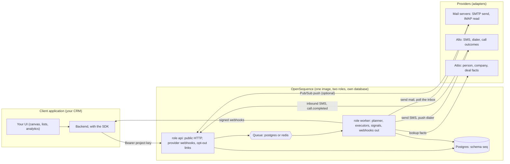

Four rules:

1. **Clients talk only to the API**, with a project API key. A browser never calls the service directly; the client's backend does.
2. **Providers talk to the API** (inbound webhooks, opt-out clicks) and are called by the **worker** (sends, polls, lookups). Project credentials (an Allo API key, an Attio API key) and per-sender mailbox passwords are encrypted; the **auth module** (section 3.2) owns every secret.
3. **The database and queue belong to the service.** No client has a connection string; nothing outside the service reads or writes `seq.*`.
4. **The worker has no public surface** except health checks.

### 2.1 Roles

One Docker image, one process, three settings of `SEQ_ROLES`:

| `SEQ_ROLES` | Runs | Public |
|---|---|---|
| `api` | the public API, inbound provider webhooks, opt-out links, `/healthz`, `/readyz`, `/metrics` | yes |
| `worker` | the scheduler, planner, executors (email, SMS), the IMAP poller, CRM fact reader, signal processor, outbound webhook delivery, reaper, retention | no (health only) |
| `all` | both, in one process; local development and small installs | yes |

| | `api` | `worker` |
|---|---|---|
| Writes | projects, keys, senders, channels, contacts, (credentials and connections through `@opensequence/auth`), sequences, versions, new enrollments, manual status changes, task completions, `signals` (insert), `webhook_deliveries` (insert, as an outbox for the events it raises), idempotency records | runs, enrollment progress, messages, `signal_effects`, tasks (create), `webhook_deliveries` (insert for engine events, attempts, status) |
| Never | runs the engine | serves clients |

### 2.2 Svix mapping

The shape is deliberately the shape of a self-hosted Svix: a server image, a Postgres you own, a queue you choose, an operator token that creates tenants, per-tenant API keys, signed outbound webhooks, an SDK generated from OpenAPI.

| Svix | OpenSequence |
|---|---|
| Application | Project |
| Endpoint | Webhook endpoint (the client's URL) |
| Message | Event (`enrollment.exited`, `task.created`, …) |
| Message attempt | Webhook delivery |
| Event types | The event catalogue in section 9.2 |
| Server JWT | Operator token (`SEQ_ADMIN_TOKEN`) |
| Application API key | Project API key with scopes |
| `SVIX_DB_DSN`, `SVIX_QUEUE_TYPE` | `SEQ_DB_DSN`, `SEQ_QUEUE` |

### 2.3 Packages

Strict boundaries, enforced by an import-lint rule: `core` imports nothing with I/O; `engine` imports `core` and the ports only; adapters import nothing from `engine` and get tokens only from `@opensequence/auth`; `auth` knows nothing about sequences (owners are opaque ids); nothing in any package knows any client's tables or ids.

Two repositories in the `open-sequence` GitHub organization:

| Repository | Publishes | Owns |
|---|---|---|
| **`open-sequence/opensequence`** | `@opensequence/core`, `engine`, `queue`, `providers`, `sdk`, the image `opensequence/server`, the `oseq` CLI, the docs | the sequences service: everything in this document except the next row |
| **`open-sequence/auth`** | `@opensequence/auth` | provider secrets: project credentials (an Allo key, an Attio key), per-owner connections (a sender's mailbox settings), encryption and key rotation, health checks, revocation, and its own schema and migrations (section 3.2). Usable by any application that keeps third-party secrets, not only by the service |

`opensequence` depends on a pinned release of `@opensequence/auth`; the two are versioned and released independently, and `oseq migrate` applies both migration sets.

```text
open-sequence/opensequence
packages/
  sequences-core/        (@opensequence/core) PURE. Definition schema (zod), validate, interpret, condition evaluator, templating, timing math, simulate.
  sequences-engine/      Postgres engine over `seq`: planner, advance, ledger, signals and attribution, throttles, reaper, webhook delivery.
                         Depends on core and on the provider ports (interfaces). No provider code.
  sequences-queue/       Queue interface and backends: postgres (default), redis, memory.
  sequences-providers/   Adapters behind the ports: smtp (email over SMTP and IMAP), allo (sms + calls), attio (crm), mock (dev and CI).
                         Later, behind the same ports: smtp-imap, twilio, hubspot, unipile.
  sequences-sdk/         Typed client generated from the OpenAPI file.
  docs/                  The documentation site (docs.opensequence.dev): MDX guides, generated API reference, SDK and CLI pages (section 19).
apps/
  sequences/             The deployable: HTTP API, webhooks, workers (SEQ_ROLES). Dockerfile, migrations, openapi.json, the `oseq` CLI.

open-sequence/auth
  src/                   (@opensequence/auth) password connections (smtp), api-key providers (allo, attio);
                         crypto (AES-256-GCM, key ids, rotation); store (schema `seq_auth`, migrations);
                         the public API: registerCredential, credentialsFor, savePasswordConnection, connectionSecrets, health, revoke, rotateKeys
  migrations/            seq_auth.credentials, seq_auth.connections (section 4.3)
```

Folder names and published names: `sequences-core` is `@opensequence/core`, `sequences-engine` is `@opensequence/engine`, `sequences-queue` is `@opensequence/queue`, `sequences-providers` is `@opensequence/providers` (one entry point per adapter), `sequences-sdk` is `@opensequence/sdk`, `docs` is `@opensequence/docs` (private), and `apps/sequences` builds the image `opensequence/server` and the `oseq` CLI. GitHub organization: `open-sequence`.

Both repositories exist from day one; nothing is developed inside a client's monorepo. Clients, Harpoon included, install `@opensequence/sdk` from npm and never share code with the service. CI in each repository publishes its packages (and, for `opensequence`, the image) on a tagged release.

**Stack (decided, so nobody has to choose):** TypeScript strict, Node 22 LTS, pnpm workspace. HTTP: **Fastify** with `fastify-type-provider-zod`, so every route's Zod schema is also its OpenAPI entry (`@fastify/swagger` writes `openapi.json` at build). Database: `postgres` (postgres.js) with **Drizzle** for the schema and typed queries, raw SQL for the planner, the queue and the analytics queries; migrations are the hand-written idempotent SQL files of section 4, run by the service itself. Ids: ULID. Time zones: `@date-fns/tz` (or Luxon) with the IANA database; phone parsing: `libphonenumber-js`. Mail: `nodemailer` (SMTP), `imapflow` (IMAP) and `mailparser`. Logging: Pino. Tests: Vitest, Testcontainers for Postgres and Redis, the `mock` provider for engine tests and recorded fixtures (`msw`) for adapter contract tests. Lint: ESLint with `eslint-plugin-boundaries` for the package rules. Crypto: Node `crypto` (AES-256-GCM, HMAC-SHA256), no extra library. Queue: the `postgres` backend is plain SQL; the `redis` backend uses `ioredis` streams. Docker: multi-stage image, non-root, `node dist/index.js`.

### 2.4 Deployment topology

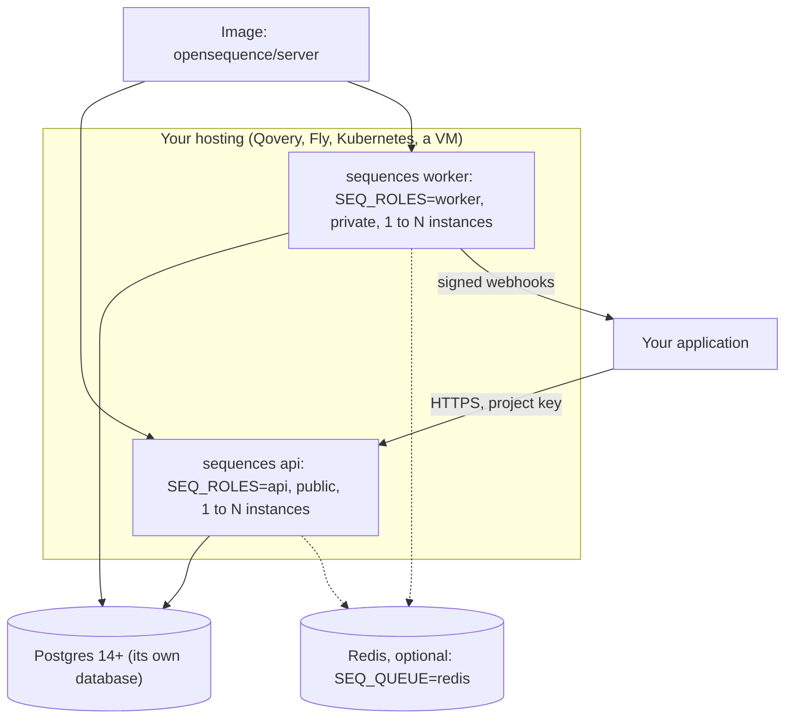

Both roles are built from one image and deployed together by default (they share a schema); either can be rolled back alone because contracts are additive (section 15.4). Any replica count is safe: queue visibility timeouts, row locks and lease rows arbitrate.

### 2.5 Modules inside the service

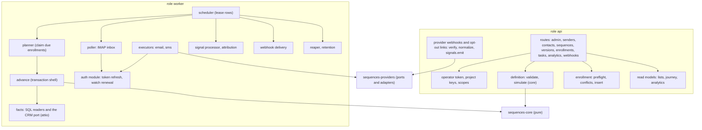

The rule that keeps the engine testable is **functional core, imperative shell**: `interpret` in `sequences-core` is a pure function `(definition, enrollmentState, facts, now) => { effects, facts }`; the state change travels inside a `goto` effect, so every branching and timing rule is a unit test without a database. `advance` and the executors are the shell that touches the world.

## 3. Runtime architecture: three loops

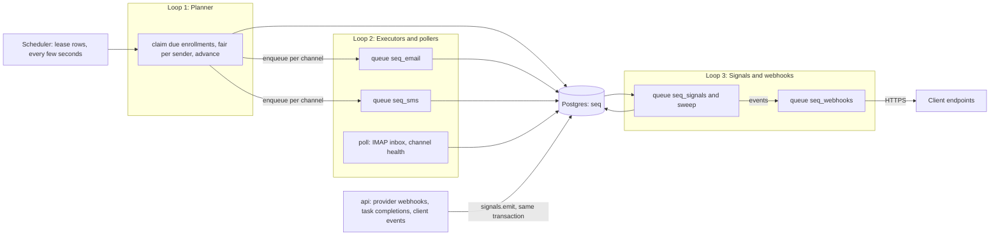

Properties:

- Loops talk only through **tables and queues**, never by calling each other. Any loop can be stopped, restarted or scaled alone.
- **The database is the truth, queue messages are hints.** A lost or duplicated message costs a delay at most, because the planner re-finds anything due and every step re-checks state under a row lock.
- **Transactional outbox.** With the `postgres` queue the enqueue is an `INSERT` in the same transaction as the state change, so "run recorded" and "message queued" cannot diverge. With `redis`, the reaper re-enqueues anything recorded but not queued.
- **Timers are database rows, not process timers.** `enrollments.next_run_at` is the timer; the scheduler wakes the planner every few seconds. Nothing is lost on restart.
- Logic steps (wait, condition, end, task creation) run **inline** in one transaction; a condition on `crm.*` makes one Attio call inside that step (cached per contact for 60 seconds). Only steps with an external side effect (email, SMS) hop to a queue.

### 3.1 The scheduler (pooler-safe leader election)

No cron extension is needed. Each periodic job has a row in `seq.job_locks` and runs on whichever worker takes its lease:

```sql
update seq.job_locks
   set locked_until = now() + :ttl, holder = :me
 where job = :job and locked_until < now()
returning job;       -- a row means this replica runs the job now
```

| Job | Period | What it does |
|---|---|---|
| `plan` | 5 s | claim due enrollments fairly and `advance` them |
| `signals` | 30 s | process unprocessed signals (safety net for a lost message) |
| `poll` | 60 s | for every active email channel: the IMAP inbox from the stored UID cursor; every 15 minutes `health()` on each connection (raises `sender_channel_status` on a change) |
| `reap` | 60 s | expired executor ownership, resume `paused_until`, expire tasks, reconcile unknown outcomes, re-enqueue recorded-but-unqueued runs and deliveries, re-enqueue deliveries whose `next_attempt_at` is due, disable failing webhook endpoints |
| `retention` | daily | prune old runs, messages, signals, deliveries and idempotency records per project settings |

A lease is a few times the period, so a crashed leader is replaced within seconds; each job is idempotent, so an overlap is harmless. This works behind a transaction pooler because it uses plain statements, never session-level advisory locks.

### 3.2 The auth module: `@opensequence/auth` (its own repository)

Providers authenticate in two ways, and the module treats them as two methods:

| Method | Providers | Tenant level | Sender level | Lifecycle |
|---|---|---|---|---|
| **Password connection** | SMTP and IMAP (any mailbox that allows password sign-in, Gmail and Google Workspace with an app password) | none | one **connection** per sender, holding the server settings in plain config and the passwords encrypted | the host checks both logins before saving; a refused login at `health()` or at send time sets the channel `credentials_needed`; removing the email channel deletes the passwords |
| **API key** | Allo, Attio (later: HubSpot and others) | one **workspace key** per tenant, validated with a probe call (Allo `GET /v2/api/me`, which also returns the key's scopes; Attio `GET /v2/self`) before it is stored | none; the sender's identity at the provider (an Allo user id and number) is plain data on the sender's channel | rotate by storing a new key; a failing probe at `health()` marks the credential `invalid` and pauses the steps that need it |

Secrets are the service's problem, not the client's, and the code that handles them is generic enough to be its own package: **`@opensequence/auth`** from `open-sequence/auth`. It stores credentials and connections in its own schema (`seq_auth`), exposes a small API (`registerCredential`, `credentialsFor`, `savePasswordConnection`, `connectionSecrets`, `health`, `revoke`, `rotateKeys`), and is configured with a Postgres database and `SEQ_ENCRYPTION_KEYS`. The service calls it; the adapters never read a secret table.

| Step | What the auth module does |
|---|---|
| Mailbox | `PUT /v1/senders/{id}/channels/email` sends the SMTP and IMAP settings; the server signs in to both, then `savePasswordConnection` stores the passwords encrypted and the hosts, ports and user names as plain config, one connection per sender (saving again replaces it). The service then creates the `email` channel. |
| Failures | A refused login (at the 15-minute health check or at send time) sets the email channel `credentials_needed`, which pauses that sender's email steps; readiness says `email_credentials_needed`. An unreachable server is transient. |
| Disconnect | `DELETE /v1/senders/{id}/channels/email` deletes the passwords, marks the connection `disconnected` and removes the channel. |
| Allo and Attio (API key) | `registerCredential(tenant, 'allo', {api_key, webhook_secret})` probes the key, then stores it encrypted in `seq_auth.credentials`. `credentialsFor(tenant, provider)` (API-key providers) and `connectionSecrets(connection)` (mailboxes) are the only two ways an adapter obtains a secret. |
| Write-only | Every secret (a mailbox password, an Allo or Attio key, a webhook signing secret) is encrypted with `SEQ_ENCRYPTION_KEYS` the moment it arrives and **can never be read back through any API**: `GET /v1/project` and `GET /v1/senders/{id}/connections` return only the provider, its status, the key id that encrypted it, the last four characters and the timestamps. Secrets are decrypted in memory, only inside the auth module, only to make a provider call, and are never logged. Rotating a provider secret means sending a new one; losing the encryption key means re-entering every secret, which the docs say in bold. |
| Reuse | Owners are opaque strings (`owner_id`, here a sender id) and tenants are opaque strings (`tenant_id`, here a project id), so another application can use the same package with no sequences in sight. |

## 4. Data model

Everything lives in the **service's own database** (Postgres 14 or newer) in two schemas: `seq` (the service, migrations in `apps/sequences/migrations`) and `seq_auth` (owned by `@opensequence/auth`, migrations shipped inside that package). Both sets are hand-written, idempotent, and applied on boot when `SEQ_RUN_MIGRATIONS=1` (or by `oseq migrate`). The migration runner takes a row lock on `seq.migration_lock` inside a transaction, never a session-level advisory lock, so replicas do not race and a transaction pooler is fine. Every statement is re-runnable: `create ... if not exists`, enum creation and constraint additions wrapped in `do $$ ... exception when duplicate_object then null $$`.

**Ids.** Every externally visible row has a `text` primary key that is already the public id: a short prefix and a ULID (`ctc_01J9X…`), generated by the service, sortable by time, with no mapping layer between the database and the API. Prefixes: `prj_` project, `key_` API key, `snd_` sender, `ctc_` contact, `seq_` sequence, `ver_` version, `enr_` enrollment, `run_` run, `msg_` message, `sig_` signal, `tsk_` task, `wep_` webhook endpoint, `wdl_` delivery, `con_` connection, `evt_` event (the stable id a webhook event carries). Internal-only tables (`queue_messages`, `idempotency_keys`, `job_locks`) use plain serials.

**Tenancy.** `project_id` is on every tenant-owned table and on every unique index that could otherwise collide across projects; every query is scoped by it. There are **no foreign keys to any client table**: clients are referenced only by the `external_id` they supply. `updated_at` is set on every change; multi-row writes are transactions.

### 4.1 Entity relationships

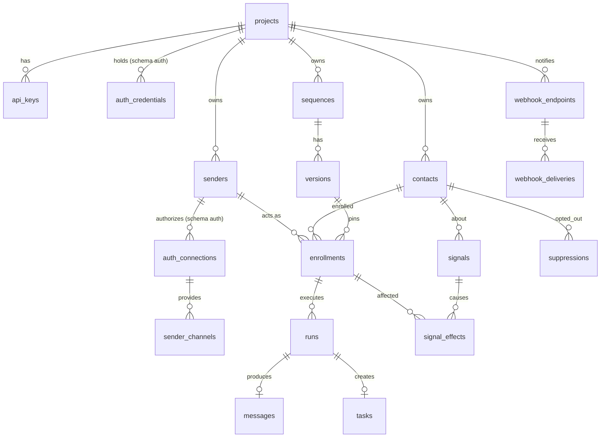

### 4.2 Enums

```sql
create schema if not exists seq;

do $$ begin create type seq.sequence_status as enum ('active','paused','archived');
exception when duplicate_object then null; end $$;
do $$ begin create type seq.version_status as enum ('draft','published','archived');
exception when duplicate_object then null; end $$;
do $$ begin create type seq.enrollment_status as enum
  ('active','paused','waiting_limit','completed','exited','failed');
exception when duplicate_object then null; end $$;
do $$ begin create type seq.run_status as enum
  ('running','waiting','done','deferred','skipped','failed','needs_review','skipped_dry_run');
exception when duplicate_object then null; end $$;
do $$ begin create type seq.signal_kind as enum
  ('reply','bounce','complaint','opt_out','ooo','task_completed','call_connected','meeting_booked',
   'sender_channel_status','contact_suppressed','crm_changed');
exception when duplicate_object then null; end $$;
```

### 4.3 Projects, keys, credentials, webhook endpoints

```sql
create table if not exists seq.projects (
  id          text primary key,                       -- prj_...
  slug        varchar(48) not null unique,            -- used in webhook and opt-out URLs
  name        varchar(120) not null,
  settings    jsonb not null default '{}',            -- section 10.2: attribution_days, sms_countries, send_window, attrs_schema, retention_days, store_inbound_bodies
  created_at  timestamptz not null default now(),
  updated_at  timestamptz not null default now()
);

create table if not exists seq.api_keys (
  id          text primary key,                       -- key_...
  project_id  text not null references seq.projects(id) on delete cascade,
  name        varchar(80) not null,
  key_hash    text not null unique,                   -- sha256 of the key; the key is shown once
  prefix      varchar(12) not null,                   -- first characters, for display
  scopes      text[] not null,                        -- read | enroll | admin (section 14)
  last_used_at timestamptz,
  revoked_at  timestamptz,
  created_at  timestamptz not null default now()
);

-- Provider credentials and connections are OWNED BY @opensequence/auth, in its own schema `seq_auth` (its migrations, its code).
-- Shown here so the whole picture is in one place; `tenant_id` is the project id and `owner_id` is the sender id, both opaque to auth.
create schema if not exists auth;
create table if not exists seq_auth.credentials (                -- tenant-level: the Allo API key, the Attio API key
  id          text primary key,                       -- cred_...
  tenant_id   text not null,
  provider    varchar(24) not null,                   -- allo | attio | mock
  method      varchar(12) not null,                   -- api_key (workspace key)
  status      varchar(12) not null default 'active' check (status in ('active','invalid')),
  secret_enc  bytea not null,                         -- encrypted with the current SEQ_ENCRYPTION_KEYS entry
  key_id      varchar(16) not null,                   -- which encryption key encrypted it (rotation)
  webhook_secret_enc bytea,                           -- verifies inbound webhooks for this tenant
  config      jsonb not null default '{}',            -- non-secret settings (client id, pubsub topic, account ids)
  created_at  timestamptz not null default now(),
  updated_at  timestamptz not null default now(),
  unique (tenant_id, provider)
);
create table if not exists seq_auth.connections (                -- owner-level: a sender's mailbox (SMTP and IMAP settings)
  id            text primary key,                     -- con_...
  tenant_id     text not null,
  owner_id      text not null,                        -- the sender id, opaque to auth
  provider      varchar(24) not null,                 -- smtp
  account       text not null,                        -- the mailbox address
  scopes        text[] not null default '{}',
  secret_enc    bytea, key_id varchar(16),            -- the SMTP and IMAP passwords, as one JSON object
  status        varchar(24) not null default 'pending'
                check (status in ('pending','active','credentials_needed','reauth_needed','restricted','disconnected')),
  config        jsonb not null default '{}',          -- hosts, ports, user names and TLS settings
  last_ok_at    timestamptz, last_error text,
  created_at    timestamptz not null default now(),
  updated_at    timestamptz not null default now(),
  unique (owner_id, provider)
);

-- Where the client wants to be told what happened (section 9.2).
create table if not exists seq.webhook_endpoints (
  id          text primary key,                       -- wep_...
  project_id  text not null references seq.projects(id) on delete cascade,
  url         text not null,
  secret_enc  bytea not null, key_id varchar(16) not null,
  event_types text[] not null,                        -- ['*'] or a list from the catalogue
  status      varchar(16) not null default 'active' check (status in ('active','disabled')),
  disabled_reason text, disabled_at timestamptz,
  created_at  timestamptz not null default now(),
  updated_at  timestamptz not null default now()
);

-- Repeat-safe POSTs: the stored response is returned for 24 hours.
create table if not exists seq.idempotency_keys (
  project_id   text not null,
  key          varchar(128) not null,
  request_hash text not null,                         -- a different body with the same key is a 422
  status_code  smallint not null,
  response     jsonb not null,
  created_at   timestamptz not null default now(),
  primary key (project_id, key)
);

create table if not exists seq.migration_lock (id int primary key);
insert into seq.migration_lock (id) values (1) on conflict do nothing;
```

### 4.4 Senders and contacts

```sql
create table if not exists seq.senders (
  id           text primary key,                      -- snd_...
  project_id   text not null references seq.projects(id) on delete cascade,
  external_id  varchar(64) not null,                  -- the client's user id
  name         varchar(160) not null,
  email        varchar(320),                          -- display address, used in templates
  timezone     varchar(48) not null default 'UTC',
  status       text not null default 'active' check (status in ('active','disabled')),
  attrs        jsonb not null default '{}',
  created_at   timestamptz not null default now(),
  updated_at   timestamptz not null default now(),
  unique (project_id, external_id)
);

-- One row per outreach channel of a sender: email comes from the mailbox connection; sms is the sender's Allo number under the
-- project's Allo key (no connection, the Allo user id sits in config).
-- connection_id refers to seq_auth.connections by value, with no cross-schema foreign key, so the auth package stays separable.
create table if not exists seq.sender_channels (
  id             text primary key,
  sender_id      text not null references seq.senders(id) on delete cascade,
  project_id     text not null,
  connection_id  text,                                 -- seq_auth.connections.id for email (the mailbox); null for sms (API key)
  channel        varchar(16) not null check (channel in ('email','sms')),
  address        text not null,                       -- mailbox address | E.164 number
  status         varchar(24) not null default 'pending'
                 check (status in ('pending','active','paused','credentials_needed','restricted','disconnected')),
  daily_limit    integer,                             -- email: sends per rolling 24h; sms: per day
  weekly_limit   integer,
  min_gap_seconds integer not null default 0,
  opted_in_at    timestamptz,                         -- the sender's written acknowledgement for a channel; stored, not enforced
  config         jsonb not null default '{}',         -- sms: {allo_user_id, allo_number_id}; warm-up state, per-channel settings
  created_at     timestamptz not null default now(),
  updated_at     timestamptz not null default now(),
  unique (sender_id, channel)
);

create table if not exists seq.contacts (
  id            text primary key,                     -- ctc_...
  project_id    text not null references seq.projects(id) on delete cascade,
  external_id   varchar(64) not null,                 -- the client's person id
  first_name    varchar(120),
  last_name     varchar(120),
  email         varchar(320),
  phone         varchar(24),                          -- E.164 only; the client normalizes
  country       varchar(2),                           -- ISO 3166-1 alpha-2
  timezone      varchar(48),                          -- IANA zone; required for SMS (section 6.3)
  sms_consent   boolean not null default false,       -- set only with the admin scope
  sms_consent_at timestamptz,
  sms_consent_source text,                            -- free text: form, call, import
  attrs         jsonb not null default '{}',          -- free JSON the client supplies: anything conditions or templates read
  created_at    timestamptz not null default now(),
  updated_at    timestamptz not null default now(),
  unique (project_id, external_id)
);
create index if not exists contacts_email_idx on seq.contacts (project_id, lower(email));
create index if not exists contacts_phone_idx on seq.contacts (project_id, phone);

-- Per-channel opt-outs and bad addresses, written by the engine (STOP, unsubscribe click, hard bounce) or the client.
create table if not exists seq.suppressions (
  id          bigserial primary key,
  project_id  text not null,
  contact_id  text not null references seq.contacts(id) on delete cascade,
  channel     varchar(16) not null check (channel in ('email','sms','all')),
  reason      varchar(24) not null,                   -- opt_out | hard_bounce | complaint | bad_number | client
  created_at  timestamptz not null default now(),
  unique (contact_id, channel)
);
```

`attrs` is the bridge to the client's domain: the client puts whatever its conditions and templates need on the contact (`{"company":{"country":"UK","employees":120},"deal":{"stage":"contacting"}}`), and conditions read it as `attrs.company.country`. The service never fetches data from the client.

### 4.5 Sequences and versions

```sql
create table if not exists seq.sequences (
  id                 text primary key,                -- seq_...
  project_id         text not null references seq.projects(id) on delete cascade,
  external_id        varchar(64),                     -- optional client id
  name               varchar(160) not null,
  description        text,
  created_by         varchar(64),                     -- the client's user id, free text
  labels             jsonb not null default '{}',     -- anything the client wants to filter by
  status             seq.sequence_status not null default 'active',
  default_version_id text,                            -- FK added below (circular)
  created_at         timestamptz not null default now(),
  updated_at         timestamptz not null default now()
);
create unique index if not exists sequences_name_idx
  on seq.sequences (project_id, lower(name)) where status <> 'archived';

create table if not exists seq.versions (
  id               text primary key,                  -- ver_...
  project_id       text not null,
  sequence_id      text not null references seq.sequences(id) on delete cascade,
  tag              varchar(24) not null,              -- 'v1', 'v2', free text
  status           seq.version_status not null default 'draft',
  definition       jsonb not null,                    -- the whole sequence, section 5
  schema_version   integer not null default 1,
  lock_version     integer not null default 0,        -- optimistic concurrency, drafts only
  based_on_version_id text references seq.versions(id),
  created_by       varchar(64),
  published_by     varchar(64),
  published_at     timestamptz,
  archived_at      timestamptz,
  created_at       timestamptz not null default now(),
  updated_at       timestamptz not null default now(),
  unique (sequence_id, tag)
);
do $$ begin
  alter table seq.sequences add constraint sequences_default_version_fk
    foreign key (default_version_id) references seq.versions(id) on delete set null;
exception when duplicate_object then null; end $$;

-- A published or archived definition can never change.
create or replace function seq.version_immutable() returns trigger
language plpgsql as $$
begin
  if old.status <> 'draft' and new.definition is distinct from old.definition then
    raise exception 'version % is % and cannot be edited', old.id, old.status;
  end if;
  return new;
end $$;
drop trigger if exists version_immutable_t on seq.versions;
create trigger version_immutable_t before update on seq.versions
  for each row execute function seq.version_immutable();
```

Rules: creating a sequence creates `v1` as a draft; "new version" copies any version into a new draft; only drafts are editable and deletable; publishing sets `default_version_id`; published versions are only archived. The engine caches published definitions by version id forever (they cannot change).

### 4.6 Enrollments

```sql
create table if not exists seq.enrollments (
  id               text primary key,                  -- enr_...
  project_id       text not null,
  sequence_id      text not null references seq.sequences(id),
  version_id       text not null references seq.versions(id),
  contact_id       text not null references seq.contacts(id) on delete cascade,
  sender_id        text not null references seq.senders(id),
  enrolled_by      varchar(64),                       -- free text from the client: user id, agent name
  enrolled_by_kind text not null default 'user' check (enrolled_by_kind in ('user','agent','system')),
  status           seq.enrollment_status not null default 'active',
  current_node_id  varchar(64) not null,
  next_run_at      timestamptz,                       -- the timer. NULL while an executor owns the step or while waiting on an event with no timeout
  owner_run_id     text,                              -- the running run that owns this enrollment, if any (section 6.2)
  paused_until     timestamptz,
  pause_reason     text,                              -- manual | ooo | channel_limit | channel_status | step_failed
  exit_reason      text,                              -- replied | meeting_booked | opt_out | bounced | suppressed | manual | completed
  exit_signal_id   text,
  replied_at       timestamptz, replied_channel varchar(16),        -- first attributed reply (set once)
  meeting_booked_at timestamptz, meeting_channel varchar(16),       -- first attributed meeting (set once)
  touch_count      smallint not null default 0,
  last_touch_at    timestamptz,                       -- drives the attribution window
  enrolled_at      timestamptz not null default now(),
  finished_at      timestamptz,
  created_at       timestamptz not null default now(),
  updated_at       timestamptz not null default now()
);

-- One active sequence per contact (per project), enforced by the database.
-- A violation becomes HTTP 409 ALREADY_IN_SEQUENCE (section 10.6).
create unique index if not exists enrollments_one_active_idx
  on seq.enrollments (project_id, contact_id)
  where status in ('active','paused','waiting_limit');

create index if not exists enrollments_due_idx
  on seq.enrollments (sender_id, next_run_at) where status = 'active' and next_run_at is not null;
create index if not exists enrollments_seq_idx on seq.enrollments (sequence_id, status);
create index if not exists enrollments_contact_idx on seq.enrollments (contact_id, finished_at desc);
create index if not exists enrollments_contact_touch_idx on seq.enrollments (contact_id, last_touch_at desc);
create index if not exists enrollments_paused_idx on seq.enrollments (paused_until)
  where status = 'paused' and paused_until is not null;
```

**Enrollment status machine**

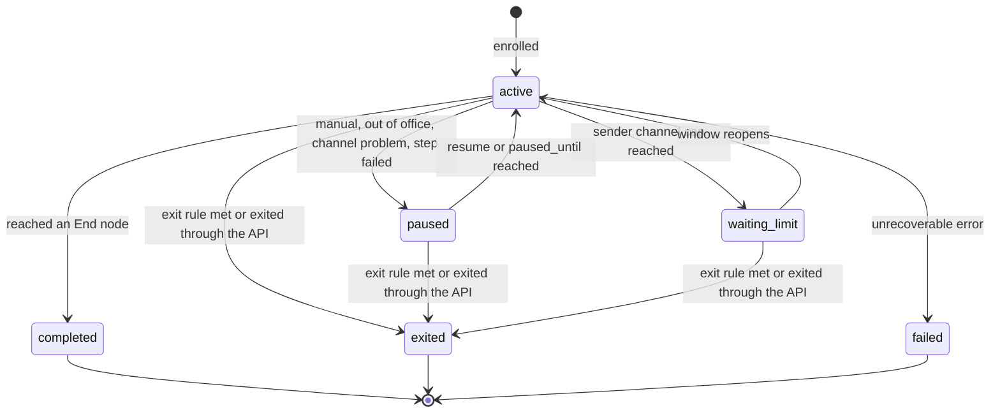

### 4.7 Runs (the execution ledger) and messages

```sql
create table if not exists seq.runs (
  id              text primary key,                   -- run_...
  project_id      text not null,
  enrollment_id   text not null references seq.enrollments(id) on delete cascade,
  sequence_id     text not null,
  version_id      text not null,
  node_id         varchar(64) not null,
  node_type       varchar(32) not null,
  channel         varchar(16),                        -- email|sms|null for logic and task nodes
  action          varchar(24),                        -- send|connect|message|null
  touch_number    smallint,                           -- nth outreach touch in this enrollment
  attempt         smallint not null default 1,
  status          seq.run_status not null,
  idempotency_key text not null unique,               -- seq:<enrollment>:<node>:a<attempt-scope>
  started_at      timestamptz,
  finished_at     timestamptz,
  provider        varchar(24),                        -- smtp|allo|mock
  provider_ref    text,                               -- provider message id
  thread_ref      text,                               -- provider thread id, for reply matching
  branch          varchar(32),                        -- transition key taken
  result          jsonb not null default '{}',        -- facts, branch, provider outcome (below)
  error           text,
  sender_id       text not null,
  created_at      timestamptz not null default now(),
  updated_at      timestamptz not null default now()
);
create index if not exists runs_enrollment_idx on seq.runs (enrollment_id, created_at);
create index if not exists runs_stuck_idx on seq.runs (status, started_at) where status in ('running','needs_review');
create index if not exists runs_provider_idx on seq.runs (provider, provider_ref);
create index if not exists runs_thread_idx on seq.runs (thread_ref) where thread_ref is not null;
create index if not exists runs_analytics_idx on seq.runs (sequence_id, version_id, node_id, created_at);

-- Every message the service sent, and every inbound message in a thread it started.
create table if not exists seq.messages (
  id            text primary key,                     -- msg_...
  project_id    text not null,
  contact_id    text not null references seq.contacts(id) on delete cascade,
  sender_id     text not null references seq.senders(id),
  run_id        text references seq.runs(id) on delete set null,   -- null for inbound
  channel       varchar(16) not null,
  direction     varchar(8) not null check (direction in ('out','in')),
  from_address  text, to_address text,
  subject       text,
  body          text,                                 -- inbound bodies only when settings.store_inbound_bodies
  status        varchar(16) not null,                 -- queued|sent|delivered|bounced|failed|received
  provider      varchar(24) not null,
  provider_id   text, thread_ref text,
  occurred_at   timestamptz not null default now(),
  unique (project_id, provider, provider_id)
);
create index if not exists messages_contact_idx on seq.messages (contact_id, occurred_at desc);
create index if not exists messages_sender_out_idx on seq.messages (sender_id, channel, occurred_at desc) where direction = 'out';
create index if not exists messages_thread_idx on seq.messages (thread_ref) where thread_ref is not null;
```

`runs.result` is the debugging and analytics payload, written when the run completes and patched as provider outcomes arrive:

```json
{
  "facts": [
    { "field": "history.last_task_outcome", "label": "Last task outcome", "value": "connected", "rule": "is voicemail", "matched": false },
    { "field": "attrs.deal.stage", "label": "Deal stage", "value": "contacting", "rule": "is contacting", "matched": true }
  ],
  "mode": "all",
  "branch": "no",
  "skip_reason": null,
  "provider": { "message_id": "<run_01J9…@seq.acme.com>", "thread_id": "18c2…", "mailbox": "max@acme.com" },
  "outcome": { "delivered_at": "2026-10-06T09:12:03Z", "bounced": null, "replied_at": null },
  "note": "Only 1 of 2 conditions matched, so the contact took No."
}
```

**Run status machine**

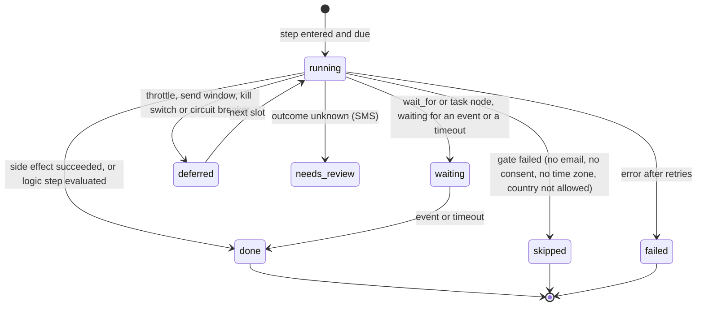

### 4.8 Tasks, signals, effects

```sql
-- Manual steps for a sender to do, created by a task node; the client renders them and completes them through the API.
create table if not exists seq.tasks (
  id            text primary key,                     -- tsk_...
  project_id    text not null,
  enrollment_id text not null references seq.enrollments(id) on delete cascade,
  run_id        text not null references seq.runs(id) on delete cascade,
  sender_id     text not null references seq.senders(id),
  contact_id    text not null references seq.contacts(id),
  kind          varchar(32) not null,                 -- call | anything the client defines
  title         text not null,
  body          text,                                 -- rendered template, ready to copy
  link          text,                                 -- deep link (profile URL, tel:)
  due_at        timestamptz,
  expires_at    timestamptz,
  status        varchar(16) not null default 'open' check (status in ('open','done','expired','cancelled')),
  outcome       varchar(32),                          -- free text chosen by the client: connected | no_answer | voicemail | sent | accepted | ...
  completed_at  timestamptz,
  created_at    timestamptz not null default now(),
  updated_at    timestamptz not null default now(),
  unique (run_id)
);
create index if not exists tasks_sender_open_idx on seq.tasks (sender_id, status, due_at);
create index if not exists tasks_contact_idx on seq.tasks (contact_id, kind, completed_at desc);

create table if not exists seq.signals (
  id               text primary key,                  -- sig_...
  project_id       text not null,
  contact_id       text not null references seq.contacts(id) on delete cascade,
  kind             seq.signal_kind not null,
  channel          varchar(16),
  source           varchar(24) not null,              -- smtp|allo|mock|task|optout_link|client
  external_id      text not null,                     -- provider event id, task id, client id
  occurred_at      timestamptz not null,
  received_at      timestamptz not null default now(),
  payload          jsonb not null default '{}',
  processed_at     timestamptz,
  attributed_run_id text references seq.runs(id) on delete set null,
  attribution      varchar(8) check (attribution in ('direct','assisted','none')),
  unique (project_id, source, external_id)            -- webhook replays are no-ops
);
create index if not exists signals_unprocessed_idx on seq.signals (received_at) where processed_at is null;
create index if not exists signals_contact_idx on seq.signals (contact_id, occurred_at desc);
create index if not exists signals_run_idx on seq.signals (attributed_run_id) where attributed_run_id is not null;

create table if not exists seq.signal_effects (
  signal_id     text not null references seq.signals(id) on delete cascade,
  enrollment_id text not null references seq.enrollments(id) on delete cascade,
  effect        varchar(16) not null,                 -- exit|pause|wake|attributed|ignored
  detail        jsonb not null default '{}',
  created_at    timestamptz not null default now(),
  primary key (signal_id, enrollment_id)              -- idempotent per (signal, enrollment)
);
```

### 4.9 Flags, webhook deliveries, scheduler, queue

```sql
-- Per-project kill switches. Platform-wide switches are environment variables (SEQ_DISABLED_CHANNELS, SEQ_PAUSED).
create table if not exists seq.flags (
  project_id text not null references seq.projects(id) on delete cascade,
  key        text not null,                           -- global | channel:email | channel:sms
  value      boolean not null,
  updated_by varchar(64),
  updated_at timestamptz not null default now(),
  primary key (project_id, key)
);

-- Outbound webhooks (section 9.2): one row per event per endpoint, with every attempt recorded.
create table if not exists seq.webhook_deliveries (
  id            text primary key,                     -- wdl_...
  project_id    text not null,
  endpoint_id   text not null references seq.webhook_endpoints(id) on delete cascade,
  event_id      text not null,                        -- evt_... stable across endpoints and retries
  event_type    varchar(48) not null,
  payload       jsonb not null,
  status        varchar(16) not null default 'pending' check (status in ('pending','delivered','failed','disabled')),
  attempts      smallint not null default 0,
  next_attempt_at timestamptz,
  last_status_code smallint, last_error text,
  created_at    timestamptz not null default now(),
  delivered_at  timestamptz,
  unique (endpoint_id, event_id)
);
create index if not exists webhook_deliveries_due_idx on seq.webhook_deliveries (next_attempt_at) where status = 'pending';

create table if not exists seq.job_locks (
  job text primary key, holder text, locked_until timestamptz not null default 'epoch'
);
insert into seq.job_locks (job) values ('plan'),('signals'),('poll'),('reap'),('retention') on conflict do nothing;

-- The default queue backend (SEQ_QUEUE=postgres). Redis implements the same three calls.
create table if not exists seq.queue_messages (
  id          bigserial primary key,
  queue       varchar(32) not null,                   -- seq_email | seq_sms | seq_signals | seq_webhooks
  payload     jsonb not null,                         -- {v, run_id} | {v, signal_id} | {v, delivery_id}
  visible_at  timestamptz not null default now(),
  read_ct     integer not null default 0,
  created_at  timestamptz not null default now()
);
create index if not exists queue_ready_idx on seq.queue_messages (queue, visible_at);
create table if not exists seq.queue_dead (
  id bigint primary key, queue varchar(32) not null, payload jsonb not null, read_ct integer not null,
  reason text, created_at timestamptz not null, dead_at timestamptz not null default now()
);
-- send:  insert (queue, payload, visible_at = now() + delay)      -- delay 0 by default; retries and webhook backoff use it
-- read:  select ... where queue = $1 and visible_at <= now() order by id limit $n for update skip locked,
--        then set visible_at = now() + vt, read_ct = read_ct + 1
-- done:  delete by id. After max reads: move the row to seq.queue_dead (kept for inspection, replayable from the API).
```

The queue interface is `send(queue, payload, delay?)`, `read(queue, visibilityTimeout, count)`, `archive(id, reason)`; every backend implements exactly these three.

## 5. The sequence definition (JSON)

One document holds the whole sequence: nodes, transitions, the exit choice and settings. It is stored in `seq.versions.definition`, validated with Zod (source of truth in `sequences-core`), and the JSON Schema served at `GET /v1/schema` is generated from those types. A client canvas reads and writes this document through two mutually inverse adapters (`definitionToFlow`, `flowToDefinition`). **No layout is stored**: positions are computed by a tidy-tree layout, so nothing about the picture can drift from the logic. `schema_version` is bumped only for breaking changes, and the service keeps reading every version it has ever published.

### 5.1 Document shape

```json
{
  "schema_version": 1,
  "entry": "email_intro",
  "settings": {
    "send_window": { "days": ["mon","tue","wed","thu","fri"], "from": "08:00", "to": "18:00", "tz": "contact" },
    "jitter": "15m",
    "reenroll": "after_90d"
  },
  "exit_on": ["reply", "meeting_booked"],
  "nodes": {
    "email_intro": {
      "type": "outreach", "channel": "email", "action": "send",
      "params": { "name": "Intro email", "subject": "Quick question, {{ contact.first_name | \"there\" }}", "body": "...", "reply_in_thread": false },
      "next": { "sent": "wait_2d", "skipped": "wait_2d", "failed": "end_failed" }
    },
    "wait_2d": { "type": "wait", "params": { "duration": "2bd" }, "next": { "then": "check_stage" } },
    "check_stage": {
      "type": "condition",
      "params": { "mode": "all", "rules": [
        { "field": "history.last_task_outcome", "op": "is", "value": "voicemail" },
        { "field": "attrs.deal.stage", "op": "is", "value": "contacting" } ] },
      "next": { "yes": "li_connect", "no": "sms_follow" }
    },
    "call_1": {
      "type": "task",
      "params": { "kind": "call", "title": "Call {{ contact.first_name }}", "due": "1bd", "expire": "3bd" },
      "next": { "completed": "wait_3d", "no_answer": "email_2" },
      "branches_by_outcome": { "connected": "end_connected" }
    }
  }
}
```

Conventions that make it safe to edit by hand or by an agent: human-readable string ids chosen by the author, a flat node map with named transitions, a closed vocabulary (node types, transition keys, signal kinds, field names, operators), durations from one grammar, and no expressions or code.

### 5.2 Node types, parameters and transitions

| Node `type` (+ `channel`, `action`) | Params | Transition keys | Executes via |
|---|---|---|---|
| `start` | none | `then` | inline |
| `outreach` email `send` | `subject`, `body`, `reply_in_thread` | `sent`, `skipped`, `failed` | queue `seq_email` |
| `outreach` sms `send` | `body` | `sent`, `skipped`, `failed` | queue `seq_sms` |
| `wait` | `duration` | `then` | inline timer |
| `wait_for` | `events[]` (`reply`, `reply:sms`, `reply:email`, `call_connected`, `meeting_booked`), `timeout` | one per event + `timeout` | timer + signal |
| `condition` | `mode` (`all`/`any`), `rules[]` | `yes`, `no` | inline |
| `task` | `kind` (free text: `call`, or the client's own), `title`, `body?`, `link?`, `due`, `expire?` (default `due + 7d`), `connected_outcomes?` (outcomes that count as a reply, default `["connected"]`); for `kind: call` also `dialer?: true` (push the number into the sender's Allo dialer) and `auto_complete?: true` (complete from Allo's call outcome, default true) | `completed`, `no_answer` (expired); plus `branches_by_outcome` (optional map from an outcome string to a node) | inline: creates a **task** for the sender, then waits |
| `split` (later) | `cohorts[{key,pct}]` | one per cohort | inline |
| `end` | `label` | none | inline |

Three things are deliberate here:

- **`task` is generic.** A call, a WhatsApp message typed by hand, a handwritten note, a visit: anything a human does is a `task` with a `kind` the client chooses to render. The engine only needs the outcome string the client sends back. `kind: call` has the one extra behaviour: the dialer push and completion from Allo's call outcome.
- **One wait node.** `wait_for` is the only event wait; the channel is part of the event name (`reply:sms`). A canvas is free to present "Wait for reply" inside the SMS group and "Wait for a connected call" inside the call group; the engine has one case.
- **Nothing writes to the client's world in v1.** Moving a deal or posting to Slack are the client's reactions to the events in section 9.2. The CRM port is **read-only** in v1 (facts for conditions); a `crm_action` node (create a note, update a deal attribute in Attio) is planned once the port has a second adapter (section 9.3). A `webhook` node (call a URL mid-flow and branch on the answer) is planned on top of the same delivery machinery (section 9.3).

**Duration grammar**: `^\d+(m|h|d|bd)$`. `m` minutes, `h` hours, `d` calendar days, `bd` business days (Monday to Friday in the contact's time zone, holidays not modelled).

### 5.3 Exit rules (deliberately simple)

The settings have one choice, **"Exit the sequence when"**, with two values: **Replied** (on any channel) and **Meeting booked**. That is the whole configuration: `"exit_on": ["reply", "meeting_booked"]`. Everything else is built in:

| Always on | Behavior | Who detects it |
|---|---|---|
| **Opt-out** (a STOP text, an unsubscribe reply, a click on the hosted opt-out link) | **exits**, writes a suppression for that channel | the service |
| Hard bounce, complaint | exits, suppresses the email | the service |
| Out-of-office auto-reply | **pauses** (resumes on the stated date or after 7 days), never exits | the service |
| Opt-out recorded elsewhere (a form, a verbal request, an email to the rep) | exits, suppresses the channel | **the client**, `events {type: opt_out}` |
| Do not contact, bad number, invalid email, left the company | exits | **the client**, `events {type: suppressed}` |
| Contact deleted or merged | exits and erases | **the client**, `DELETE /v1/contacts/{id}` |
| Sender disabled | pauses with `channel_status` | **the client**, `DELETE /v1/senders/{id}` |
| Exit through the API | exits with reason `manual` and the caller's label | **the client** |

**The service only sees its own channels.** Replies to emails it sent, bounces, STOP texts, unsubscribe clicks and out-of-office messages are detected without any help. Everything that happens in the client's world (a meeting booked in a calendar tool, a contact marked do-not-contact in the CRM, a person who left the company, a deletion) is invisible to it and **must be reported through the API**; section 8.1 and 10.4 list the calls. A client that forgets this will keep emailing people its own users have already excluded, so the integration tutorial treats these calls as mandatory, not optional.

An exit only ends the enrollment and emits `enrollment.exited`. **Re-enrollment** (`settings.reenroll`: `never`, `always`, `after_<n>d`) is enforced in the enrollment preflight by reading the contact's last enrollment in the same sequence.

### 5.4 Templates

Subjects, bodies, task titles and task bodies are rendered by one small engine in `sequences-core`. The optional helpers `definitionToFlow` and `flowToDefinition` (a canvas-friendly view of the document and its inverse) also live in core so every canvas shares them:

| Rule | Detail |
|---|---|
| Syntax | `{{ path }}` and `{{ path \| "fallback" }}`. Nothing else: no logic, no loops, no code. |
| Paths | `contact.<column>`, `attrs.<path>` (the contact's attrs, the same root conditions use; `contact.attrs.<path>` is accepted as an alias), `sender.<column>`, `sender.attrs.<path>`, `sequence.name`, `unsubscribe_url`. |
| Missing values | A missing value with no fallback **fails validation at publish** for `contact.first_name`, `contact.last_name` and `contact.email` (the common ones), and renders as empty for `attrs.*`. The run records every value it rendered. |
| Escaping | Email bodies are either `text` or `html` (`params.format`, default `text`; text bodies are also sent as the plain part of an HTML mail). In `html`, every rendered value is HTML-escaped. SMS and tasks are plain text. |
| Opt-out | `{{ unsubscribe_url }}` renders a signed link hosted by the service (`GET /u/{token}`) that writes an email suppression and exits the enrollment. Emails also carry `List-Unsubscribe` and `List-Unsubscribe-Post` headers pointing at the same token. Publishing an email step without it is a **warning**, not an error. |
| Preview | `POST /v1/sequences:simulate` renders every template for a sample contact and returns the text. |

### 5.5 Conditions: a closed field registry

A condition is a list of `{ field, op, value }` combined with `all` or `any`. The registry is defined once in `sequences-core` and served at `GET /v1/schema/fields`, so a client's picker, the validator and the evaluator cannot disagree. Fields come from data the **client supplied** (contact columns and `attrs`) and data the **service itself recorded** (history).

| Field key | Type | Source | Cost |
|---|---|---|---|
| `contact.country`, `contact.timezone`, `contact.has_email`, `contact.has_phone`, `contact.sms_consent` | enum / text / bool | `seq.contacts` | one row, memoized per step |
| `attrs.<path>` (any path under the contact's `attrs`; the project declares types and labels in `settings.attrs_schema` so pickers can show them) | text / number / bool / enum | `seq.contacts.attrs` | same row |
| `sender.timezone`, `sender.has_sms` | text / bool | `seq.senders`, `seq.sender_channels` | one row |
| `history.last_task_outcome`, `history.last_task_kind`, `history.days_since_last_task`, `history.tasks_last_14d` | enum / number | `seq.tasks` | one indexed query |
| `history.touches`, `history.days_since_last_touch`, `history.replied_since_enrollment`, `history.last_reply_channel`, `history.emails_sent` | number / bool / enum | `seq.runs`, `seq.messages`, `seq.signals` | one indexed query each |
| `crm.person.exists`, `crm.person.<attribute>`, `crm.company.exists`, `crm.company.<attribute>`, `crm.deal.exists`, `crm.deal.stage`, `crm.deal.<attribute>`, `crm.deal.count_open` | per the CRM schema | the **CRM port** (Attio): person by email, company by the email's domain, the open deal(s) linked to either (`settings.crm.deal_selection`: `newest_open`, `highest_value`, `any_open`) | one Attio lookup per contact per step, cached 60 s; the attribute list and types come from `GET /v1/project/providers/attio/schema`, fetched from Attio's attribute definitions and cached |

Operators by type: enum `is`, `is not`; number `=`, `≠`, `>`, `≥`, `<`, `≤`; text `is`, `contains`, `is empty`; bool `is true`, `is false`. **Missing data never matches** (the comparison is false, so the contact takes `no`), and the run records the fact as `null`. Evaluation is **lazy and recorded**: only the fields a rule names are loaded, and each `(field, value, rule, matched)` is stored in `result.facts` on the run.

`attrs.*` is what the client pushed; `crm.*` is what the CRM holds **right now**. The service never reads the client application's database, so `attrs` freshness is the client's job (`PATCH /v1/contacts/{id}`), while `crm.*` facts are live at decision time and need no sync. A CRM lookup that fails (Attio down, person not found) records the fact as `null`, so the rule does not match and the contact takes `no`; the run says why. Either way the values recorded on a run are what the journey shows.

### 5.6 Validation (warnings on save, errors on publish)

| Check | Code |
|---|---|
| Schema (types, required params, duration grammar, note length) | `INVALID_DEFINITION` with a JSON path |
| Every transition target exists; `entry` exists | `UNKNOWN_NODE` |
| Graph reachable from `entry`; no cycles except through a timed wait | `UNREACHABLE_NODE`, `CYCLE` |
| Every path ends (an `end`, or a `task` with an unwired branch) | `NO_END` |
| Condition fields and operators exist and values fit the type | `UNKNOWN_FIELD`, `BAD_VALUE` |
| `wait_for` events allowed; each has a transition | `BAD_EVENT` |
| `exit_on` contains only `reply` and `meeting_booked` | `BAD_EXIT` |
| Template paths exist; required ones have a fallback; `html` bodies parse | `BAD_TEMPLATE` |
| Email step without `{{ unsubscribe_url }}` | warning `NO_UNSUBSCRIBE` |
| Editing a non-draft version | `VERSION_NOT_EDITABLE` |

Errors are plain English with a path, for example `{"path":"nodes.sms_follow.params.body","code":"TOO_LONG","message":"The SMS is 412 characters (3 segments)."}`, so a person or an agent can fix them without reading a schema dump.

## 6. The interpreter (pure core) and `advance` (imperative shell)

### 6.1 Types (in `sequences-core`)

```ts
type EnrollmentState = {
  enrollmentId: string; versionId: string; contactId: string; senderId: string;
  currentNodeId: string; touchCount: number; lastTouchAt: Date | null;
  status: 'active' | 'paused' | 'waiting_limit';
};

/** What the interpreter asks the shell to do. Pure data, no I/O. */
type Effect =
  | { kind: 'record'; run: RunDraft }                           // ledger entry for a logic node
  | { kind: 'goto'; nodeId: string; at?: Date }                 // move on (optionally later)
  | { kind: 'enqueue'; queue: QueueName; run: RunDraft }        // side effect needs an executor
  | { kind: 'create_task'; task: TaskDraft; run: RunDraft }     // task node: a task for the sender, then wait
  | { kind: 'wait'; until: Date | null; events: EventName[]; run: RunDraft }
  | { kind: 'exit'; reason: string }
  | { kind: 'complete' };

type StepResult = { effects: Effect[]; facts: FactRecord[] };

declare function interpret(def: Definition, state: EnrollmentState, facts: FactReader, now: Date): StepResult;
declare function render(template: string, ctx: TemplateContext): { text: string; used: Record<string, unknown> };
```

`interpret` looks at the current node and returns effects. For a condition it asks the `FactReader` for the fields it needs, evaluates, records the facts, and returns `record` plus `goto`. For a wait it returns `wait` with a computed time. For an email it returns `enqueue`. It never touches the database, the clock (it receives `now`) or a provider, so every rule is a unit test.

### 6.2 `advance(enrollmentId)`: the shell

```text
advance(enrollmentId):
  BEGIN
    e = SELECT ... FROM seq.enrollments WHERE id = $1 FOR UPDATE
    if e.status != 'active' or e.owner_run_id is not null -> ROLLBACK, return   # exited meanwhile, or an executor owns it
    def = definitionCache.get(e.version_id)                # published definitions are immutable
    steps = 0
    loop:
      if steps++ >= 25 -> e.next_run_at = now(), break      # guard against long logic chains
      result = interpret(def, state(e), factReader(tx), now)
      apply each effect in order:
        record      -> INSERT seq.runs (status done/skipped, branch, result.facts)
        goto        -> e.current_node_id = nodeId ; if at -> e.next_run_at = at ; break if at > now
        create_task -> INSERT seq.runs (waiting) ; INSERT seq.tasks ; e.next_run_at = expires_at ; break   # expire defaults to due + 7d
        enqueue     -> UPSERT seq.runs by idempotency_key (a deferred run with the same key goes back to running) ; queue.send(queue, {v, run_id})
                       e.owner_run_id = run.id ; e.next_run_at = NULL ; break    # the executor owns it now
        wait        -> INSERT seq.runs (waiting) ; e.next_run_at = until (NULL if no timeout) ; break
        exit        -> e.status = 'exited', e.exit_reason = reason, finished_at = now() ; break
        complete    -> e.status = 'completed', finished_at = now() ; break
    UPDATE seq.enrollments SET ..., updated_at = now()
  COMMIT
```

**One run per step.** A step keeps one run across deferrals: `enqueue` upserts by idempotency key, so a `deferred` run is re-used when the planner re-enters the node; `attempt` (and the key suffix) increments only after a `failed` run when the flow retries the node.

**Ownership, the rule that prevents a double send.** While a run is `running`, the enrollment's `owner_run_id` points at it and `next_run_at` is `NULL`, so the planner cannot see the enrollment at all. Only the executor that finishes that run (success, skip, defer or failure) clears `owner_run_id`, sets the next timer and calls `advance` inline. If the executor dies, the message reappears after its visibility timeout and another executor finishes the same run under the same idempotency key. Only when the message has exhausted its retries does the **reaper** mark the run `failed`, clear the owner and hand the enrollment back to the planner. There is no lease that can expire while work is in flight.

Everything inside `BEGIN`/`COMMIT` is atomic. With the `postgres` queue the enqueue is in the same transaction, so a crash between "run inserted" and "message enqueued" is impossible; with `redis` the reaper re-enqueues any `running` run whose message is missing (it records `queue.send` success on the run). After an executor finishes it calls `advance` again inline, so a chain "send, wait, condition, send" does not cost one planner tick per hop. The planner only handles **wake-ups**: timers that came due and deferred runs.

### 6.3 Timing and time zones

```text
computeNextAt(now, duration, ctx):
  base   = now + duration                    # 'bd' skips Saturday and Sunday in the contact's tz
  tz     = ctx.settings.send_window.tz == 'contact' ? contactTz : senderTz
  at     = base moved forward to the next instant inside the send window in tz
  at     = at + random(0..jitter)            # jitter avoids bursts on the hour
  return at
```

**The contact's time zone** is `contacts.timezone` when set; otherwise, for countries with a single zone, that zone; otherwise the sender's zone for email. **SMS is stricter**: a text is sent only when the recipient's local time is known with certainty, because the 8:00 to 21:00 recipient-local window is a legal requirement in the US. Resolution order for SMS: `contacts.timezone`, then a zone derived from the phone number (NANP area codes and other national numbering plans map to a single zone in most cases), otherwise the step is **skipped** with `no_timezone` and the skip is visible in analytics. The SMS window cannot be configured away.

Timing is computed **when a step is entered** (the stored `next_run_at`) and **re-checked when it runs** (the window, caps and kill switch can have changed). Tasks and logic nodes ignore the send window; only automatic outreach respects it.

## 7. Runtime flows

### 7.1 Enrollment

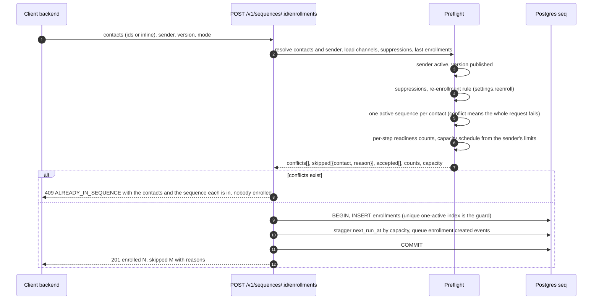

The **one-active-per-contact unique index** is the real guard. If any selected contact is already in a sequence, the request **fails with HTTP 409 `ALREADY_IN_SEQUENCE`**, names each contact and the sequence they are in, and enrolls nobody (section 10.6). Other findings (suppressed, re-enrollment too soon, no usable channel for the first step) are excluded with a visible reason and do not block the rest. For bulk enrollments `next_run_at` is **staggered** from the sender's limits and send window, so 5,000 contacts never fire at once and the preview can say "first touches finish in about 17 working days".

### 7.2 The planner and queue consumption

**Fair claiming.** One big enrollment must not starve other senders, and follow-ups (`touch_count > 0`) go before first touches. The planner takes up to *k* due rows **per sender**:

```sql
select e.id
from (select distinct sender_id
      from seq.enrollments
      where status = 'active' and next_run_at <= now()) u
cross join lateral (
  select id
  from seq.enrollments e
  where e.sender_id = u.sender_id
    and e.status = 'active' and e.next_run_at <= now() and e.owner_run_id is null
  order by (e.touch_count > 0) desc, e.next_run_at
  limit 50                      -- per sender, per tick
  for update skip locked        -- safe with several replicas
) e;
-- each claimed id is advanced in its own transaction (section 6.2)
```

A per-project cap (`settings.max_steps_per_tick`, default 500) keeps one noisy project from starving another. **Queue consumption.** Each executor runs a small consumer loop: `read(queue, vt, qty)` with a short poll interval and backoff when empty, a concurrency limit per queue (`SEQ_CONCURRENCY`, one number, applied per queue), the message's `read_ct` as the attempt counter, and `archive` after the maximum reads.

### 7.3 Executing an email step (the service sends it itself)

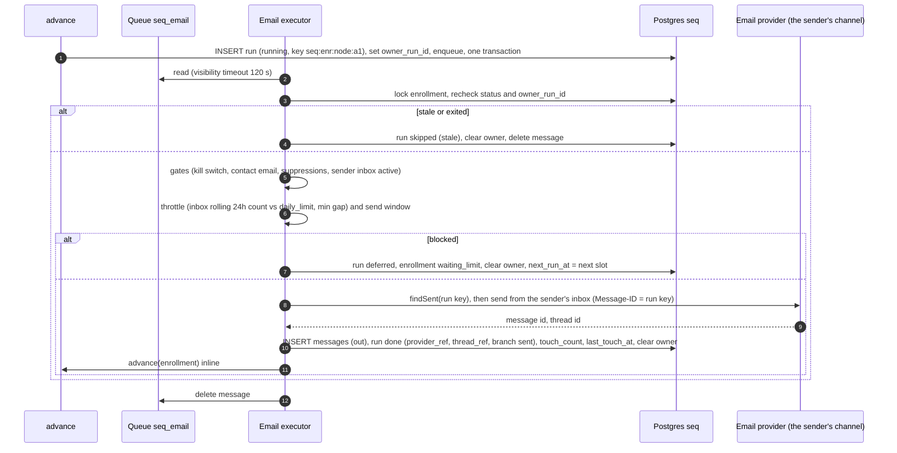

If the executor crashes after the provider accepted the email but before it recorded the result, the retry first calls `findSent` with the run key and only sends if nothing is found. Every outgoing email carries a `Message-ID` derived from the run key, so the SMTP adapter answers that question with an IMAP header search of the Sent folder, then the inbox. Retries: the message's `read_ct` is the attempt counter. Transient errors leave the message to reappear after the visibility timeout with exponential backoff and jitter. After 5 attempts the message is archived, the run is `failed`, and the enrollment takes the node's `failed` branch if wired, otherwise it pauses with `step_failed`. A per-channel **circuit breaker** (error rate over the last five minutes) pauses that queue's consumers when a provider is unhealthy.

### 7.4 Per-channel executors

| Executor | Gates, in order | Throttle | Side effect | Unknown outcome |
|---|---|---|---|---|
| **Email** (SMTP) | kill switch, contact has email, no email suppression, email channel `active` | sender channel `daily_limit` (rolling 24h), min gap, send window; the mail provider's own limit sits above it | SMTP send through the sender's server, settings from the auth module, a copy filed in Sent | safe to retry (`findSent` by `Message-ID`) |
| **SMS** (Allo) | kill switch, `contact.sms_consent`, contact country in `settings.sms_countries` (default `["US"]`), known recipient time zone, E.164 phone, no SMS suppression, sender has an Allo number | 8:00 to 21:00 recipient-local, per-number rate | Allo send from the sender's number | **`needs_review`, never auto-retry** |
| **Task** (inline in `advance`) | none | none | create a task; for `kind: call` with `dialer: true`, push the number into the sender's Allo dialing queue (deduped by E.164); the client shows the task | the dialer push is idempotent by task id |

**Skips are first-class.** A step whose gate fails is `skipped` with the first failing reason (`no_email`, `no_consent`, `no_timezone`, `country_not_allowed`, `no_phone`, `no_sms_number`, `sender_channel_down`). The engine then follows the `skipped` transition if wired, otherwise continues like `sent`, so a missing channel never stalls a contact. Skips are not touches and are excluded from reply rates, but are counted and shown.

### 7.5 A reply, bounce or booking exits a contact

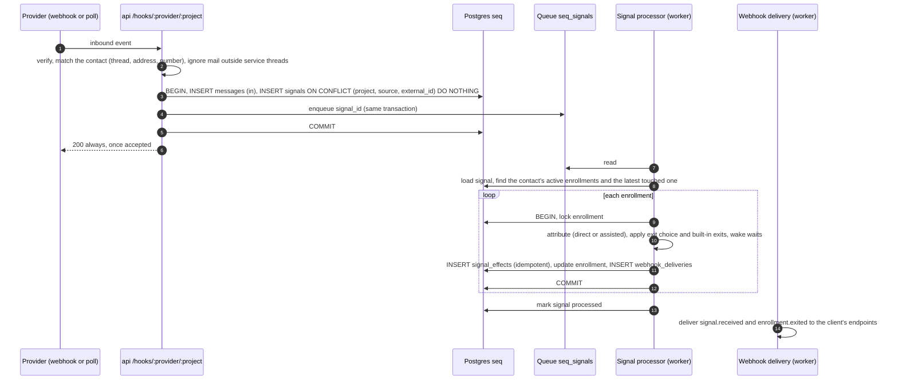

The client can also report what the service cannot see: **a meeting booked**, a suppression, a reply seen elsewhere. These arrive through `POST /v1/contacts/{id}/events` (section 10.4) and enter the same signal table, so one pipeline handles every source.

### 7.6 Condition evaluation (what a decision looks like)

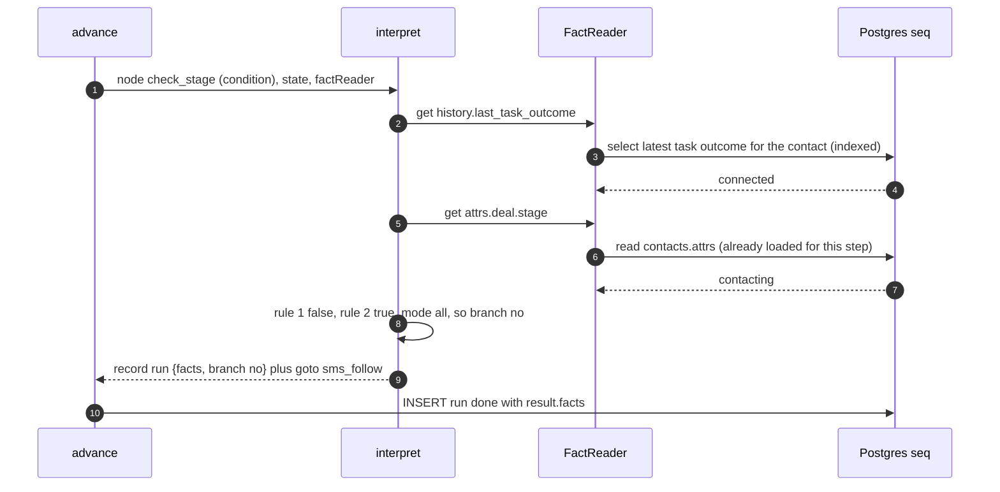

### 7.7 Task lifecycle

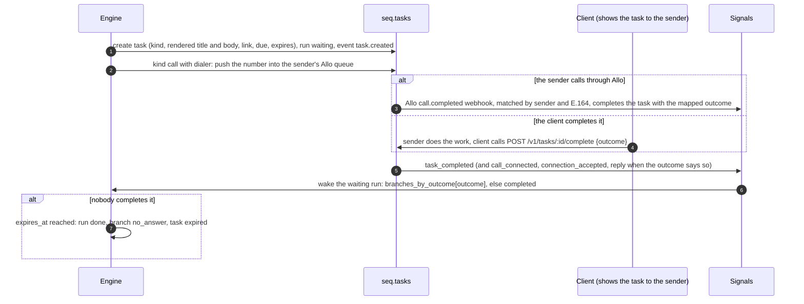

**Allo call outcomes map to task outcomes** (`settings.allo.outcome_map`, default: answered → `connected`, no answer and busy → `no_answer`, voicemail → `voicemail`); a call to the contact's number by the acting sender after the task was created completes it, so a rep who simply dials from the Allo app never has to mark anything. What the client does besides (post to Slack, show the task in its own list) is its own reaction to `task.created`.

## 8. The signal pipeline

### 8.1 Producers

| Producer | Emits | Notes |
|---|---|---|
| IMAP inbox (the `poll` job) | `reply` (email), `bounce`, `ooo` | only messages whose `In-Reply-To` or `References` name an email the service sent are considered (section 9.1); auto-replies become `ooo`, never `reply`; bounces are parsed from delivery-status messages matched by `Message-ID` |
| Allo webhooks (`/hooks/allo/{project}`) | `reply` (sms), `opt_out`, `task_completed` and `call_connected` from `call.completed` | match the contact by E.164 and the sender's number; `STOP`, `QUIT`, `END`, `CANCEL`, `UNSUBSCRIBE`, `OPT OUT` become `opt_out`; a completed call completes the open call task for that sender and contact (section 7.7) |
| Hosted opt-out link (`GET /u/{token}`) | `opt_out` (email) | signed token names the contact, project and run |
| Task completion endpoint | `task_completed`, plus `call_connected`, `connection_accepted` or `reply` depending on kind and outcome | section 7.7 |
| Client events endpoint (`POST /v1/contacts/{id}/events`, `:events` batch) | `meeting_booked`, `opt_out`, `contact_suppressed`, `reply` (seen elsewhere) | the only way the service learns what happens outside its own channels: calendars, CRM do-not-contact lists, deletions |

### 8.2 Processing one signal

```text
process(signal):
  enrollments = SELECT * FROM seq.enrollments
                WHERE contact_id = signal.contact_id
                  AND ( status IN ('active','paused','waiting_limit')
                        OR last_touch_at >= signal.occurred_at - attribution_window )   # post-exit attribution
  for each enrollment, in its own transaction:
    lock enrollment; skip if (signal, enrollment) already in signal_effects
    1. ATTRIBUTE   (replies and meetings, section 11)
    2. EXIT        exit if the signal is a reply (call_connected counts as a reply) or meeting_booked AND it is listed in exit_on,
                   or if it is a built-in exit (opt_out, bounce, complaint, contact_suppressed);
                   out-of-office -> pause until the stated date or +7 days ; record the reason
    3. WAKE        if the enrollment is waiting on this event (wait_for, task)
                   -> run done with that branch, current_node = target, next_run_at = now
    4. INSERT signal_effects (idempotency) ; UPDATE enrollment ; INSERT webhook_deliveries for the events
  mark signal processed
```

Rules: out-of-office **pauses and never exits**; auto-replies and bounces are never "answered"; the **built-in exits** are opt-out (always), hard bounce, complaint, suppression; a signal can attribute and exit in the same transaction; an event for a contact with no enrollment is stored anyway so a later enrollment has history. **Race handling:** a reply can land while a send is mid-flight. The enrollment row lock plus the executor's last-moment recheck (status, owner) resolves almost all of it; the residual window (the reply lands between the recheck and the provider call) is accepted and visible in the run log, because no design can close it.

## 9. Providers (ports and adapters)

The engine never calls a vendor directly; it calls **ports**, implemented by adapters in `sequences-providers`. Project-level credentials (the Allo and Attio keys) and per-sender secrets (the mailbox passwords) live in `@opensequence/auth` (`seq_auth.credentials`, `seq_auth.connections`), encrypted; an adapter receives them through `credentialsFor` and `connectionSecrets` and never reads a table.

```ts
interface EmailProvider {
  send(req: { channel: SenderChannel; to: string; subject: string; text: string; html?: string;
              messageId: string; inReplyTo?: string; headers: Record<string,string> }):
    Promise<{ providerId: string; threadRef: string }>;
  findSent(req: { channel: SenderChannel; messageId: string }): Promise<{ providerId: string; threadRef: string } | null>;
  // Inbound: push adapters verify and normalize a webhook; pull adapters are polled with a cursor.
  verifyWebhook?(req: { headers; rawBody; secret }): InboundEvent[];
  poll?(req: { channel: SenderChannel; cursor: string | null; threadRefs: string[] }): Promise<{ events: InboundEvent[]; cursor: string }>;
  health(channel: SenderChannel): Promise<'active' | 'credentials_needed' | 'restricted'>;
}
interface SmsProvider {
  send(req: { channel: SenderChannel; to: string; body: string; idempotencyKey: string }): Promise<{ providerId: string }>;
  verifyWebhook(req: { headers; rawBody; secret }): InboundEvent[];     // reply | opt_out
  listNumbers?(credential: ProviderCredential): Promise<{ address: string; ref: string }[]>;
  health(channel: SenderChannel): Promise<'active' | 'credentials_needed' | 'restricted'>;
}
interface DialerProvider {
  pushNumbers(req: { connection: SenderConnection; numbers: string[]; idempotencyKey: string }): Promise<{ added: number }>;
}
interface CrmProvider {
  schema(credential: ProviderCredential): Promise<CrmSchema>;                 // objects and attributes, for pickers and the validator
  lookup(req: { credential: ProviderCredential; email: string; domain: string; dealSelection: DealSelection }):
    Promise<{ person?: Record<string, unknown>; company?: Record<string, unknown>; deal?: Record<string, unknown>; openDeals: number }>;
}
```

### 9.1 Adapters

Three real providers in v1, one mock for development and CI, and the ports stay open for more.

| Provider | Package | Ports | How it works | Notes |
|---|---|---|---|---|
| **SMTP and IMAP** | `smtp` | `EmailProvider` | One **password connection** per sender (section 3.2), checked by signing in to both servers before it is stored. Send: SMTP with our `Message-ID`, then a copy filed in the Sent folder unless the server filed one itself. `findSent` searches Sent, then the inbox, by `Message-ID` header. Inbound mail: the IMAP inbox read by UID from the stored cursor every minute. Bounces: delivery-status messages matched by the original `Message-ID`. | Works with Gmail and Google Workspace (app password), Fastmail, Zoho, iCloud, Proton Bridge and most servers. Microsoft 365 is out: it no longer allows password sign-in for SMTP and IMAP. The provider's own caps (about 500 a day on free Gmail, about 2,000 on Workspace) sit above the channel's `daily_limit`, which stays the binding one. |
| **Allo** | `allo` | `SmsProvider`, `DialerProvider`, call outcomes | **API-key provider**: one workspace key per project (probed before storing). A sender's `sms` channel holds their Allo user id and number (`listNumbers` and `listUsers` for pickers); there is no per-sender connection. SMS send from the sender's number; inbound SMS and `call.completed` webhooks at `/hooks/allo/{project}`; `pushNumbers` appends to the sender's power-dialer queue. | Verified against Allo's OpenAPI spec and docs in section 9.1b. Allo is also the first client's phone system, so this adapter is exercised from day one. |
| **Attio** | `attio` | `CrmProvider` | **API-key provider**: one workspace key per project (probed before storing). `schema` lists objects and attributes (cached, refreshed hourly, exposed at `GET /v1/project/providers/attio/schema`). `lookup` finds the person by email, the company by domain, and the deals linked to either, then applies the project's `deal_selection`. | Read-only in v1. Attio's attribute slugs are workspace-specific, so condition fields on `crm.*` are validated against the fetched schema, not a fixed list. |
| **Mock** | `mock` | all ports | Records sends as `messages` rows, returns canned CRM data from `settings.mock`, and exposes `POST /hooks/mock/{project}` to simulate a reply, a bounce or a call. Enabled by `SEQ_DEV_MOCK_PROVIDERS=1` (the compose file sets it). | What the quickstart, the engine tests and the docs snippets run against, so nothing in CI needs a mail server, Allo or Attio account. |
| **Manual** | none | tasks | `task` nodes for visits, handwritten notes, anything. | |
| Later, behind the same ports | `smtp_imap`, `twilio`, `hubspot`, `agentmail` | email, sms, crm | community adapters once the ports are stable | not in v1 |

**Mailbox privacy.** The service can read the sender's whole inbox and must behave accordingly: it reads only the inbox, looks only for messages whose `In-Reply-To` or `References` name an email it sent (a `runs.thread_ref` or message id), persists headers and the match for those, and never stores or logs anything else it sees. Reply bodies are not fetched. An optional project setting (`match_replies_outside_thread`) also accepts a fresh email from an enrolled contact to the sender's address within the attribution window as a reply, storing metadata only. These rules are written into the adapter contract tests.

### 9.1b Allo, as verified against its API (2026-10-13)

Checked against `https://help.withallo.com/openapi.json`, the API reference pages and the first client's production code, so the adapter can be written without guessing.

| Topic | What Allo offers | How the adapter uses it |
|---|---|---|
| Base URL and auth | `https://api.withallo.com`; the API key goes in the `Authorization` header. The first client's code sends the raw key and one docs page shows `Api-Key <key>`; the adapter sends the raw key (what works in production today) and the registration probe would reveal a change. | the project credential, method `api_key` |
| Probe and scopes | `GET /v2/api/me` returns the key's `scopes`, `endpoints`, `team` and `rate_limits`. Needed scopes: `SMS_SEND`, `DIALING_QUEUE_READ_WRITE`, `PHONE_NUMBERS_READ`, `USERS_READ`, `WEBHOOKS_READ_WRITE`, `CONVERSATIONS_READ`. | `registerCredential` calls `/me`, stores the team id, and rejects a key with missing scopes (`422 INVALID_CREDENTIAL`, naming them) |
| Rate limits | 20 reads and 5 writes per second per key; `X-RateLimit-*` headers; SMS has a daily quota (`429 API_KEY_QUOTA_EXCEEDED` with `limit=…;type=DAILY;reset_in=…`). | a per-project token bucket (5 writes a second) in the adapter; a 429 is a `deferred` run with `retry_at` from `reset_in` |
| Numbers and users | `GET /v2/api/numbers`: `number` (E.164, null for `SENDER_ID`), `name`, `country`, `type`, `capabilities` (`VOICE`, `SMS`, `MMS`), `users[]` (`id` `usr-…`, `name`, `email`). `GET /v2/api/users`: `id`, `name`, `email`, `role`, `status`. | pickers (`/providers/allo/numbers`, `/users`); `PUT /v1/senders/{id}/channels/sms` checks the number has `SMS` and lists that user |
| Send SMS | `POST /v1/api/sms {from, to, message}` (1 to 1000 characters), scope `SMS_SEND`, **US numbers only**, recipient in the same country as `from`; France uses `POST /v1/api/sms#france {sender_id, to, message}`. Response `data: {from_number, to_number, type: OUTBOUND, content, start_date}`. Errors `FROM_NUMBER_NOT_FOUND`, `INVALID_TO_NUMBER`, `TO_NUMBER_COUNTRY_MISMATCH`, `INVALID_LENGTH`, `PROVIDER_NOT_SUPPORTED`. **No idempotency key.** | `SmsProvider.send`; `settings.sms_countries` stays `["US"]` by default (FR is possible later through the sender-id endpoint); the response carries no message id, so the executor records the `sms.sent` webhook's `id` when it arrives |
| Unknown outcome after a send | `POST /v2/api/conversations/items/search` filters by `contact_number`, `type: SMS`, `direction: OUTBOUND`, dates and a keyword. | `findSent` for SMS: before any retry, search the last 10 minutes for an outbound SMS to that number with the same content; found means the send happened. This turns most `needs_review` cases into an automatic resolution |
| Webhooks | `POST /v2/api/webhooks {url, topics[], description}` returns `{id, signing_secret: "whsec_…"}` (the secret only on create); `GET /v2/api/webhooks` lists **all endpoints**, so a team can have several; `PUT` and `DELETE /v2/api/webhooks/{id}`. Topics: `call.received`, `call.triggered`, `call.answered`, `call.completed`, `tag.added`, `tag.removed`, `sms.received`, `sms.sent`, `contact.created`, `contact.updated`, `summary.updated`. Envelope `{topic, version: "2.0", timestamp, data}`. | the service **registers its own endpoint** when the Allo credential is stored (`/hooks/allo/{slug}`, topics `sms.received`, `sms.sent`, `call.completed`) and keeps the signing secret encrypted; no shared endpoint with the client, which settles the "two consumers" question |
| Signature | Standard Webhooks: headers `webhook-id`, `webhook-timestamp` (Unix seconds), `webhook-signature` (`v1,<base64>`, several space-separated during rotation); HMAC-SHA256 over `{id}.{timestamp}.{raw body}` with the base64-decoded secret after `whsec_`; 5-minute tolerance. | the same verifier the service ships for its own outbound webhooks |
| Delivery | at-least-once; respond `2xx` within 20 s; 8 retries over about 27.5 hours; an endpoint failing for 5 days is disabled; bulk recovery exists. | `unique (project_id, source, external_id)` on signals with `external_id = webhook-id`; the handler enqueues and returns 200 at once |
| `sms.received` payload | `id` (`msg_…`), `direction: INBOUND`, `type: SMS` or `MMS`, `content`, `sent_at`, `from_number` (the contact), `to_number` (the Allo number), `from_name`, `to_name`, `user_email`. | contact by `from_number` (E.164), sender by the `sms` channel whose address is `to_number`; `STOP` words become `opt_out`; message stored with `provider_id = id` |
| `sms.sent` payload | the same fields with `direction: OUTBOUND`, `from_number` (the Allo number), `to_number` (the contact). | patches the run's `provider_ref` and `delivered_at`, and confirms a send whose HTTP response was lost |
| `call.completed` payload | `id` (`cll_…`), `start_date`, `type: INBOUND` or `OUTBOUND`, `from_number`, `to` (not `to_number`), `result` in `ANSWERED`, `VOICEMAIL`, `TRANSFERRED_AI`, `TRANSFERRED_EXTERNAL`, `BLOCKED`, `FAILED` (the first client also sees `NO_ANSWER`, `MISSED`, `BUSY`, `CANCELED`), `length_in_minutes`, `summary`, `recording_url`, `tags`, `user_email`. | an `OUTBOUND` call whose `to` matches the contact's phone and whose `from_number` or `user_email` matches the sender completes the open `call` task; default outcome map: `ANSWERED` and `TRANSFERRED_*` → `connected`, `VOICEMAIL` → `voicemail`, everything else → `no_answer`; `summary` is stored on the task as `note` |
| Dialer push | `POST /v2/api/dialing-queues/current/numbers {numbers: [{number, name, last_name, company, job_title, emails[], website}], user_id or email}` (`user_id` wins); creates the teammate's queue if missing; response `{added[], skipped[{number, reason}]}`; errors `ASSIGNEE_NOT_FOUND`, `DIALING_QUEUE_APPEND_CONFLICT` (duplicate, the idempotent case), `DIALING_QUEUE_LIMIT_REACHED` (25,000). | `DialerProvider.pushNumbers` with the sender's Allo `user_id`; a conflict counts as success; contact metadata is sent so Allo's CRM shows the name |
| Queue state (poll fallback) | `GET /v2/api/dialing-queues/current?user_id=` lists entries with `call_id`, `call_status` in `QUEUED`, `SKIPPED`, `VOICEMAIL`, `CONNECTED`, `TRANSFERRED`, `NO_ANSWER`, `BUSY`, `WRONG_NUMBER`, `not_reached_destination_reason`, `voicemail_left`. | the `poll` job reads it for senders with open call tasks pushed to the dialer, so a task still completes when the `call.completed` webhook was missed; `WRONG_NUMBER` also writes a `bad_number` suppression |

Still to confirm on the first real traffic: the exact `Authorization` scheme (raw key or `Api-Key`), that `call.completed` fires for Power Dialer calls (expected; the queue poll covers a miss), and the France sender-id path if an FR number is ever used.

### 9.2 Outbound webhooks (the client learns what happened)

The service tells the client's backend what happened, with the delivery guarantees people expect from Svix. This ships with the public API (phase 2), because every real integration needs it on the first day it goes live: moving a deal when a contact replies, showing a task, logging a sent email in the CRM timeline.

| Event | When | Payload (in addition to `id`, `type`, `project`, `occurred_at`) |
|---|---|---|
| `enrollment.created` | after a successful enroll | enrollment, contact (`id`, `external_id`), sender, sequence, version |
| `enrollment.exited` | exit by rule or by API | the same, plus `exit_reason`, `signal` |
| `enrollment.completed` | an `end` node | the same |
| `enrollment.paused`, `enrollment.resumed` | pause or resume, any cause | the same, plus `pause_reason`, `paused_until` |
| `run.done` | an outreach step executed (sent) | run (`node_id`, `channel`, `touch_number`), message (`id`, `subject`, `provider_id`) |
| `run.skipped`, `run.failed`, `run.needs_review` | a step did not execute | run, `reason` or `error` |
| `task.created`, `task.expired` | a task node | task (`id`, `kind`, `title`, `body`, `link`, `due_at`), contact, sender |
| `signal.received` | any signal (reply, bounce, opt-out, meeting, …) after processing | signal (`kind`, `channel`, `attribution`), message when there is one |
| `sender.channel_status` | a channel changed status (`credentials_needed`, `restricted`) | sender, channel, status |
| `endpoint.disabled` | an endpoint was disabled after repeated failures | endpoint |

Delivery contract:

- **Signed.** `webhook-id`, `webhook-timestamp` and `webhook-signature` headers following the [Standard Webhooks](https://www.standardwebhooks.com) scheme (HMAC-SHA256 of `id.timestamp.body` with the endpoint's secret); receivers reject timestamps older than 5 minutes. Secrets are shown once and rotatable with a 24 h overlap. The SDK includes `verify()`.
- **Retried.** Exponential backoff over about three days (immediately, 5 s, 5 min, 30 min, 2 h, 5 h, 10 h, 10 h, 10 h); a `2xx` ends it; the delivery row records every attempt, status code and error.
- **Disabled, not forever retried.** An endpoint that has failed every delivery for 3 days is set to `disabled`, `endpoint.disabled` is sent to the project's other endpoints, and nothing is lost: re-enabling (`POST /v1/webhooks/{id}/enable`) replays what was held.
- **Replayable.** `POST /v1/webhooks/{id}/recover {since}` re-sends every failed delivery since a time; `POST /v1/webhooks/deliveries/{id}/replay` re-sends one.
- **Ordered per enrollment, not globally.** Deliveries for the same endpoint and enrollment are attempted one at a time, in creation order; the next is not attempted until the previous succeeded or gave up (a failing endpoint only blocks itself). Every event also carries `enrollment.seq`, a per-enrollment counter, so a receiver can order or discard stale events on its side.
- **Safe against SSRF.** Endpoint URLs must be `https`, resolve to public addresses, and are re-resolved at delivery time; redirects are not followed.

A client that does not register an endpoint can still poll: every list endpoint accepts `updated_since` and returns `next_cursor`.

### 9.3 Later nodes: `crm_action` and `webhook`

A `crm_action` node (create a note on the person, set a deal attribute, add to a list) is the first write through the CRM port and arrives once a second CRM adapter exists, so the action vocabulary is not shaped by one vendor; until then a client reacts to events (section 9.2) and writes to its CRM itself.

**The `webhook` node (later).**

Once delivery exists, a `webhook` node (call the client's URL mid-flow with the enrollment and contact, wait for a `2xx` with `{ "branch": "..." }`, time out otherwise) lets a flow ask the client a question ("is the deal still open?") without the engine learning anything about the client's domain. Planned after phase 2; the delivery machinery is the same.

## 10. Public API

The service exposes one HTTP API, versioned under `/v1`, documented by an OpenAPI file generated from the same Zod types (`apps/sequences/openapi.json`) and consumed by `sequences-sdk`. Applications create senders and contacts, manage sequences, enroll, exit, complete tasks and read analytics; there is no endpoint that sends anything directly.

**The minimal integration** is seven calls, and everything else is optional:

| Step | Call |
|---|---|
| Register a sender | `PUT /v1/senders/{external_id}` |
| Connect their mailbox | `PUT /v1/senders/{id}/channels/email` with SMTP and IMAP settings (both logins are checked first) |
| Register contacts | `PUT /v1/contacts/{external_id}` or `POST /v1/contacts:batch` |
| Create and publish a sequence | `POST /v1/sequences`, `PUT .../versions/{vid}/draft`, `POST .../versions/{vid}/publish` |
| Enroll | `POST /v1/sequences/{id}/enrollments` |
| Learn what happened | `POST /v1/webhooks` once, or poll `GET /v1/enrollments?updated_since=` |
| Tell it what it cannot see | `POST /v1/contacts/{id}/events` for meetings booked, opt-outs and do-not-contact recorded in your app; `DELETE /v1/contacts/{id}` on deletion |
| Show results | `GET /v1/sequences/{id}/analytics/summary`, `GET /v1/enrollments/{id}` |

**Conventions.** Auth: `Authorization: Bearer <project key>` (scopes in section 14). Every response is `{ "success": boolean, "data"?, "error"?: { "code", "message", "details"? }, "meta"?: { "request_id", "next_cursor"? } }`. Lists are cursor-paginated (`?limit=&cursor=`) and accept `updated_since`. Every `POST` accepts an `Idempotency-Key` header: a repeat with the same body returns the stored response for 24 hours, a repeat with a different body is a `422 IDEMPOTENCY_MISMATCH`. Ids are the prefixed strings from section 4; senders, contacts and sequences can also be addressed by the client's `external_id` wherever an `{id}` appears (a value with a known prefix such as `ctc_` is a service id, anything else is an `external_id`; a client whose own ids could start with a service prefix uses the `ext:` form, `ext:ctc_123`). Errors are plain English with a stable `code`. Rate limit: per key, `429` with `Retry-After`.

### 10.1 Operator endpoints (`SEQ_ADMIN_TOKEN`, not a project key)

The operator is whoever runs the deployment. Bootstrapping an empty database needs no UI: the operator token creates the first project and its first key. The `oseq` CLI wraps these calls (`oseq projects create acme`).

| Method and path | Purpose |
|---|---|
| `POST /v1/admin/projects`, `GET /v1/admin/projects` | create a project `{slug, name, settings?}`; the response includes the first `admin`-scoped key, shown once |
| `POST /v1/admin/projects/{id}/api-keys` | create a key for a project `{name, scopes}` |
| `GET /v1/admin/engine/health` | platform-wide queues, lag, failures, flags; per-project breakdown |
| `PUT /v1/admin/engine/pause` | platform-wide stop (also the env `SEQ_PAUSED=1`) |

### 10.2 Project (scope `admin`)

| Method and path | Purpose |
|---|---|
| `GET /v1/project` | the project, its settings, the URLs to register at providers (`/hooks/{provider}/{slug}`), and the status of each provider credential (provider, status, key id, last four, rotated at); never the secret itself |
| `PUT /v1/project/settings` | `attribution_days` (14), `sms_countries` (`["US"]`), default `send_window`, `attrs_schema` (types and labels for pickers), `retention_days`, `store_inbound_bodies`, `match_replies_outside_thread`, `crm.deal_selection` (`newest_open`), `allo.outcome_map`, `max_steps_per_tick` |
| `PUT /v1/project/providers/{allo\|attio}` | store or rotate a project credential (stored by `@opensequence/auth`): an **API key** for Allo `{api_key, webhook_secret}` and Attio `{api_key}`, probed against the provider before it is accepted (`422 INVALID_CREDENTIAL` otherwise) |
| `GET /v1/project/providers/allo/numbers`, `GET /v1/project/providers/allo/users` | what the Allo key can see, for pickers when connecting a sender |
| `GET /v1/project/providers/attio/schema` | Attio objects and attributes, cached; what the condition picker shows under `crm.*` |
| `GET/POST/DELETE /v1/api-keys` | manage this project's keys |
| `GET/POST/PATCH/DELETE /v1/webhooks` | endpoints `{url, event_types}`; `POST /v1/webhooks/{id}/enable`, `/recover`, `/rotate-secret`; `GET /v1/webhooks/{id}/deliveries`; `POST /v1/webhooks/deliveries/{id}/replay` |
| `GET /v1/engine/health` | this project's queue depths, oldest-due lag, failures, `needs_review` runs, flags |
| `GET /v1/engine/needs-review`, `POST /v1/engine/needs-review/{run}/resolve` | runs whose outcome is unknown; resolve as `sent` or `failed` |
| `PUT /v1/engine/flags/{key}` | flip this project's kill switch (global or per channel), audited |

### 10.3 Senders (the acting users)

| Method and path | Purpose | Scope |
|---|---|---|
| `PUT /v1/senders/{external_id}` | create or update a sender `{name, email, timezone, attrs}` | admin |
| `GET /v1/senders`, `GET /v1/senders/{id}` | list and read, each with its channels and readiness | read |
| `PUT /v1/senders/{id}/channels/email` | `{provider: "smtp", from?, smtp, imap}`: signs in to both servers, stores the passwords encrypted, creates or replaces the `email` channel; `422` with `SMTP_AUTH_FAILED`, `IMAP_UNREACHABLE` and the like when a login fails | admin |
| `PUT /v1/senders/{id}/channels/sms` | `{allo_user_id, number}`: validated against the project's Allo key (the number must belong to that user), creates the `sms` channel; no connection | admin |
| `GET /v1/senders/{id}/connections` | list the sender's mailbox connection (settings, never a password) | admin |
| `DELETE /v1/senders/{id}/channels/sms` | remove a channel; its steps skip from now on | admin |
| `PATCH /v1/senders/{id}/channels/{channel}` | limits and settings `{daily_limit, weekly_limit, min_gap_seconds, opted_in, status: paused\|active}` | admin |
| `GET /v1/senders/{id}/readiness` | which node types this sender can run, and why not (`no_email_channel`, `email_credentials_needed`, `allo_key_missing`, `allo_key_invalid`, `no_allo_number`) | read |
| `DELETE /v1/senders/{id}` | disable (their enrollments pause with `channel_status`; nothing is deleted) | admin |

### 10.4 Contacts

| Method and path | Purpose | Scope |
|---|---|---|
| `PUT /v1/contacts/{external_id}` | create or update (upsert) `{first_name, last_name, email, phone, country, timezone, attrs}`; `attrs` is deep-merged | enroll |
| `POST /v1/contacts:batch` | upsert up to 500 | enroll |
| `PATCH /v1/contacts/{id}` | change fields; changing `attrs` is how a client keeps conditions fresh | enroll |
| `PUT /v1/contacts/{id}/sms-consent` | `{consent: true\|false, source, at}`; consent is the only contact field that needs `admin` | admin |
| `GET /v1/contacts`, `GET /v1/contacts/{id}` | list (filter by `external_id`, `email`, `updated_since`) and read, with suppressions and the active enrollment | read |
| `POST /v1/contacts:status` | `{ids or external_ids[]}` returns each contact's active enrollment (sequence, version, sender, status, current step) or null; for "in a sequence" badges in lists | read |
| `GET /v1/contacts/{id}/timeline` | messages in and out, runs, signals and tasks, merged and ordered | read |
| `POST /v1/contacts/{id}/events` | report what the service cannot observe: `{id, type, occurred_at, channel?, reason?, data?}` with `type` one of `meeting_booked`, `opt_out` (per `channel`, or `all`), `suppressed` (`reason`: `do_not_contact`, `bad_number`, `invalid_email`, `left_company`, other), `reply` (seen in another tool, with `channel`); idempotent by `id`; each becomes a signal and takes effect on every active enrollment of the contact | enroll |
| `POST /v1/contacts:events` | the same, for up to 500 events in one call (a nightly sync from the CRM's do-not-contact list, a backfill of booked meetings) | enroll |
| `DELETE /v1/contacts/{id}` | erase the contact, their messages, tasks and runs (privacy requests); counts already in analytics stay | admin |

### 10.5 Sequences and versions

| Method and path | Purpose | Notes |
|---|---|---|
| `GET /v1/sequences` | list with name, status, versions, labels, and headline counts (enrolled, active, replies, meetings) | |
| `POST /v1/sequences` | create; makes version `v1` as a draft | |
| `GET /v1/sequences/{id}`, `PATCH /v1/sequences/{id}` | read; rename, describe, pause, archive, labels | pause stops planning for all versions; `status: archived` is refused with `409 HAS_ACTIVE_ENROLLMENTS` unless `exit_active: true`, which exits them with reason `manual` |
| `GET /v1/sequences/{id}/versions` | versions with status | |
| `POST /v1/sequences/{id}/versions` | `{from_version, tag}` duplicates into a new draft | tag unique per sequence |
| `GET /v1/sequences/{id}/versions/{vid}` | definition and validation warnings | |
| `PUT /v1/sequences/{id}/versions/{vid}/draft` | save a draft `{definition, lock_version}` | `STALE_LOCK`, `VERSION_NOT_EDITABLE` |
| `POST /v1/sequences/{id}/versions/{vid}/publish` | validate (errors block), publish, set default | freezes the definition |
| `POST /v1/sequences/{id}/versions/{vid}/archive` | stop new enrollments into it | people already in it finish |
| `DELETE /v1/sequences/{id}/versions/{vid}` | drafts only | |
| `POST /v1/sequences:validate` | validate a document without saving | plain-English path errors |
| `POST /v1/sequences:simulate` | run the pure interpreter on a document and a sample contact: the path taken and every rendered template | no writes, no sends |
| `GET /v1/schema`, `GET /v1/schema/fields`, `GET /v1/schema/events`, `GET /v1/schema/examples` | JSON Schema of the definition, the condition field registry (plus the project's `attrs_schema`), the webhook event catalogue, working examples | what a canvas or an agent reads first |

### 10.6 Enrollments

A contact can be in **at most one active sequence per project**. The enroll endpoint **fails** with a clear error when any selected contact is already in one. It does not skip them silently and it does not half-enroll the batch.

| Method and path | Purpose | Scope |
|---|---|---|
| `POST /v1/sequences/{id}/enrollments:preview` | preflight: conflicts, exclusions with reasons, readiness per step, capacity schedule; no writes | read |
| `POST /v1/sequences/{id}/enrollments` | `{contacts: [ids or external_ids or inline contact objects], sender, version? (default: the sequence's default version), enrolled_by, enrolled_by_kind, mode?: live \| dry_run}`; all-or-nothing on conflicts. `dry_run` creates real enrollments whose outreach steps are recorded as `skipped_dry_run` instead of sent, for rehearsing a new sequence; `:preview` is the no-write preflight | enroll |
| `GET /v1/enrollments` | filters `sequence`, `version`, `status`, `sender`, `contact`, `q` (name or email), `exit_reason`, `updated_since`; each row embeds the contact summary, current step label, last outcome, replied and meeting flags | read |
| `GET /v1/enrollments/{id}` | the **journey**: pinned definition, runs, messages, signals, tasks (section 12) | read |
| `POST /v1/enrollments/{id}/pause`, `/resume` | manual control | enroll |
| `POST /v1/enrollments/{id}/exit` | `{reason?, label?}` ends it with `exit_reason='manual'` and the caller's label | admin |
| `POST /v1/enrollments:exit` | exit by selector `{contact}` or `{sequence, status}` for bulk cleanup | admin |

Conflict response (the same shape for preview and enroll):

```json
HTTP 409
{
  "success": false,
  "error": {
    "code": "ALREADY_IN_SEQUENCE",
    "message": "2 of the 142 contacts are already in a sequence. Nobody was enrolled. Remove them from the selection or exit them from their current sequence first.",
    "details": {
      "conflicts": [
        { "contact_id": "ctc_01J9…", "external_id": "p_4411", "name": "Dana Whitfield", "sequence_id": "seq_01J9…",
          "sequence_name": "UK facilities managers", "version": "v1", "sender": "Priya Nair",
          "enrollment_id": "enr_01J9…", "status": "active" }
      ]
    }
  }
}
```

Enforced in three layers so concurrency cannot break it: (1) the preflight finds conflicts and returns them as errors, (2) `POST` runs in one transaction and aborts the whole batch with 409 if the conflict query returns anything, (3) the partial unique index `enrollments_one_active_idx` on `(project_id, contact_id)`; if two requests race, the loser gets a unique violation, converted to the same 409 by re-reading the conflict. Other findings (suppressed contact, re-enrollment too soon, no usable channel for the first step) are reported with reasons and excluded without blocking the rest.

### 10.7 Tasks

| Method and path | Purpose | Scope |
|---|---|---|
| `GET /v1/tasks?sender=&status=open&kind=&updated_since=` | tasks the engine created, with the contact summary and the rendered body | read |
| `POST /v1/tasks/{id}/complete` | `{outcome, note?}`; `outcome` is free text matched against the node's `branches_by_outcome`; emits the signals that wake the waiting step | enroll |
| `POST /v1/tasks/{id}/cancel` | cancel an open task (the step takes `no_answer`) | enroll |

### 10.8 Analytics (read-only)

| Method and path | Purpose |
|---|---|
| `GET /v1/analytics/sequences` | every sequence with enrolled, replies, meetings and rates |
| `GET /v1/sequences/{id}/analytics/summary` | replies and meetings (with rates vs enrolled and touches), replies by channel, enrolled, active, exited |
| `GET /v1/sequences/{id}/analytics/exits` | exit reasons |
| `GET /v1/sequences/{id}/analytics/nodes` | per step: reached, executed, skipped by reason, failed, delivered, bounced, replies, meetings, median time to reply |
| `GET /v1/sequences/{id}/analytics/channels` | per channel comparison, split by touch number |
| `GET /v1/analytics/channels` | all sequences compared |

All accept `version`, `from`, `to`, `sender`, `country`. The only two outcomes are **replies** and **meetings booked**.

### 10.9 Not part of the client API

`POST /hooks/{provider}/{project_slug}` receives provider webhooks (signature verified with the project's stored secret, always `2xx` once accepted, idempotent by the provider's event id). `GET /u/{token}` is the hosted opt-out page (one click, no login, writes a suppression; `POST` for `List-Unsubscribe-Post`); the token is `base64url(project, contact, run, expiry)` plus an HMAC-SHA256 under a key derived from the current `SEQ_ENCRYPTION_KEYS` entry, valid for 90 days. `GET /healthz`, `/readyz`, `/metrics` are for the platform.

## 11. Analytics: how the numbers are made

**The only two outcomes are replies and meetings booked**, attributed to a sequence, a channel and a step. There is no goal and no funnel.

### 11.1 Definitions

- **Reply**: an inbound email in a thread the service started, an inbound SMS, or a task completed with an outcome the node maps to `call_connected`, from an enrolled contact. Out-of-office, auto-replies, bounces and opt-outs are not replies.
- **Meeting booked**: reported by the client (`POST /v1/contacts/{id}/events {type: meeting_booked}`), idempotent by its id and counted once per enrollment. The service does not read calendars.
- **Attribution window**: 14 days from the contact's last touch (`settings.attribution_days`).
- **Counted once per enrollment**: the **first** reply and the **first** meeting are attributed (`direct` or `assisted`); later ones are stored with `attribution='none'` and appear only in the timeline.

### 11.2 Attribution rules

```sql
-- Reply: credit the latest same-channel outbound touch before the signal ("direct").
-- A call_connected signal is credited to the task's own run (direct), since a task has no channel.
select r.id from seq.runs r
join seq.enrollments e on e.id = r.enrollment_id
where e.contact_id = :contact and r.channel = :channel
  and r.status = 'done' and r.finished_at <= :occurred_at
order by r.finished_at desc limit 1;
-- none found: take the latest touch of any channel and mark "assisted".

-- Meeting: credit the contact's most recent enrollment whose last touch is inside the window,
-- even if it has already exited (a reply usually exits it; the meeting comes later).
select e.id from seq.enrollments e
where e.contact_id = :contact and e.last_touch_at >= :occurred_at - make_interval(days => :attribution_days)
order by e.last_touch_at desc limit 1;
-- then credit the latest touch run before the booking, as above.
```

The result is written once on the signal (`attributed_run_id`, `attribution`) and on the enrollment (`replied_at`, `replied_channel`, `meeting_booked_at`, `meeting_channel`, set only the first time) and is **never rewritten**.

### 11.3 Queries, not rollups

At the volumes this service targets (tens of thousands of runs a day), the analytics endpoints read the ledgers directly, with the indexes defined in section 4; there is no pre-aggregation to keep correct. The per-step query is the shape of all of them:

```sql
select r.node_id, coalesce(r.channel,'') as channel, coalesce(r.touch_number,0) as touch_number,
       count(*)                                                        as reached,
       count(*) filter (where r.status = 'done' and r.node_type = 'outreach') as executed,
       count(*) filter (where r.status = 'skipped')                    as skipped,
       count(*) filter (where r.status = 'failed')                     as failed,
       count(*) filter (where r.result #>> '{outcome,delivered_at}' is not null) as delivered,
       count(*) filter (where r.result #>  '{outcome,bounced}' is not null)      as bounced,
       count(s.id) filter (where s.kind = 'reply'          and s.attribution <> 'none') as replies,
       count(s.id) filter (where s.kind = 'meeting_booked' and s.attribution <> 'none') as meetings,
       percentile_cont(0.5) within group (order by s.occurred_at - r.finished_at)
         filter (where s.kind = 'reply' and s.attribution <> 'none')   as median_time_to_reply
from seq.runs r
left join seq.signals s on s.attributed_run_id = r.id
where r.project_id = :project and r.sequence_id = :seq
  and (:version is null or r.version_id = :version)
  and r.created_at >= :from and r.created_at < :to
group by 1, 2, 3
order by 1;
```

`outcome.delivered_at` is set at send time for email (SMTP gives no delivery receipt) and cleared when a bounce for that `Message-ID` arrives; Allo sets it from its delivery status. Enrollment-level numbers (people enrolled, exits by reason, replies and meetings per enrollment) come straight from `seq.enrollments`. Responses are cached for 60 seconds per project. When a query crosses one second in production (expected only past a few million runs), the daily rollup from the v3 design (`stats_daily` recomputed per dirty day) is the planned step, behind the same endpoints.

### 11.4 What a client can show

| Screen | Numbers | Endpoint |
|---|---|---|
| Sequence overview | replies and meetings (rate vs enrolled and touches delivered), replies by channel, exit reasons | `summary`, `exits` |
| Per step | reached, executed, skipped by reason, failed, delivered, bounced, replies, meetings, median time to reply | `nodes` |
| Channel comparison | per channel and touch number: touches sent, skipped, replies, reply rate, meetings | `channels` |
| By version | any of the above filtered by version tag | `?version=` |
| Cross-sequence | sequences ranked by replies and meetings per 100 enrolled, minimum-n filter | `/v1/analytics/sequences` |

A plain email-versus-SMS chart misleads because SMS usually comes later and to warmer contacts, so the comparison is split by `touch_number` and first-touch channel; the `split` node (later) makes it a true random experiment.

## 12. Contact journey (debugging a path)

`GET /v1/enrollments/{id}` returns the pinned version's definition plus the enrollment's runs, messages, signals and tasks in one payload:

```json
{
  "enrollment": { "id": "enr_01J9…", "status": "active", "current_node_id": "call_1", "sender": "snd_01J9…", "enrolled_at": "…" },
  "contact": { "id": "ctc_01J9…", "external_id": "p_4802", "name": "Tom Becker" },
  "version": { "id": "ver_01J9…", "tag": "v1", "definition": { "…": "…" } },
  "runs": [
    { "node_id": "check_stage", "status": "done", "branch": "no", "at": "…",
      "result": { "facts": [ { "field": "history.last_task_outcome", "value": "connected", "rule": "is voicemail", "matched": false } ] } },
    { "node_id": "sms_follow", "status": "skipped", "result": { "skip_reason": "no_consent" } }
  ],
  "messages": [ { "channel": "email", "direction": "out", "subject": "…", "status": "delivered", "at": "…" } ],
  "signals":  [ { "kind": "reply", "channel": "email", "attribution": "direct", "at": "…" } ],
  "tasks":    [ { "id": "tsk_01J9…", "kind": "call", "status": "open", "due_at": "…" } ]
}
```

A client highlights the path by walking `runs` in order against the definition (an edge is taken when its two nodes are consecutive runs), shows each node's outcome as a pill, lists the facts each condition read and the values each template rendered, and offers the same payload as "Saved JSON". Because facts are stored **when the decision was made**, "why did this contact take No" is never reconstructed from today's data. An agent reads the same payload to debug.

## 13. The first client: Harpoon

Everything above is generic. This section is the only place the first client appears, and it is the template for how any CRM integrates.

**Harpoon's API is built on top of the OpenSequence API.** Harpoon's browser app talks to Harpoon's own API; that API (a backend-for-frontend) owns Harpoon concepts (people, companies, opportunities, reps, templates, permissions) and translates them to the generic resources with `sequences-sdk`. The service knows nothing about Harpoon, Harpoon runs no sequence logic, and nothing in Harpoon reads the service's database. The service lives in its own repository; Harpoon adds `@opensequence/sdk` to `apps/api` and nothing else.

### 13.1 Harpoon screens and the calls behind them

| Harpoon screen | Harpoon API (BFF) route | OpenSequence call |
|---|---|---|
| Sequences list | `GET /api/v1/sequences` | `GET /v1/sequences` (with headline counts) |
| Editor: load | `GET /api/v1/sequences/:id/versions/:vid` | `GET .../versions/{vid}`; `GET /v1/schema`, `/schema/fields` for the pickers |
| Editor: save, publish, new version, archive | `PUT .../draft`, `POST .../publish` etc. | the same paths; `POST /v1/sequences:validate` while editing; `:simulate` for the preview |
| Editor: SMS number picker | `GET /api/v1/sequences/allo-numbers?as=` | `GET /v1/senders/{id}` (the connected Allo number) or `GET /v1/project/providers/allo/numbers` |
| Editor: deal condition picker | `GET /api/v1/sequences/crm-fields` | `GET /v1/project/providers/attio/schema` and `GET /v1/schema/fields` |
| Editor: "what can this rep run" | readiness badges | `GET /v1/senders/{id}/readiness` |
| People tab | `GET /api/v1/sequences/:id/enrollments` | `GET /v1/enrollments?sequence=`; Harpoon adds its own links by `contact.external_id` (a Harpoon person id) |
| Person journey modal | `GET /api/v1/enrollments/:id/journey` | `GET /v1/enrollments/{id}` |
| Enroll dialog (bulk from Companies and People) | `POST /api/v1/sequences/:id/enroll` and `/preview` | `POST /v1/contacts:batch`, then `POST .../enrollments:preview` and `POST .../enrollments`; the 409 `ALREADY_IN_SEQUENCE` is passed through |
| "In sequence" badge on a person row | folded into Harpoon's list queries | `POST /v1/contacts:status` for the ids on the page |
| Pause, resume, exit | `POST /api/v1/enrollments/:id/...` | `POST /v1/enrollments/{id}/pause\|resume\|exit` |
| Analytics tab and cross-sequence | `GET /api/v1/sequences/:id/analytics/...` | `GET /v1/sequences/{id}/analytics/...`, `GET /v1/analytics/channels` |
| Person timeline (activity feed) | Harpoon merges its own activities with the service's | `GET /v1/contacts/{id}/timeline`, or the `run.done` and `signal.received` webhooks written into `prm_activities` |
| Rep's tasks (calls, manual steps) | Harpoon's Tasks page | `task.created` webhook creates a `prm_task` with `dedupe_key = task id`; a call task with `dialer: true` is already in the rep's Allo queue and completes itself from Allo's call webhook; other tasks are completed from Harpoon with `POST /v1/tasks/{id}/complete` |
| Engine health (admin) | `GET /api/v1/admin/sequences/engine/health` | `GET /v1/engine/health`, `PUT /v1/engine/flags/{key}`, `GET /v1/engine/needs-review` |

Harpoon keeps its own **permissions**: it decides which reps may enroll whose people. The project key scopes are a second line: the agent route in Harpoon uses an `enroll`-scoped key, so agents cannot publish, change a sequence or set SMS consent even if Harpoon has a bug.

### 13.2 What Harpoon must keep in sync

| Harpoon event | Call to the service |
|---|---|
| A rep is created, changes time zone, connects their mailbox, gets an Allo number | `PUT /v1/senders/{user_id}`, `PUT .../channels/email` (the rep's Workspace app password, entered once in Harpoon), `PUT .../channels/sms {allo_user_id, number}` (from `user_settings.allo_user_id`) |
| A person is enrolled, or any enrolled person's data relevant to conditions or templates changes (title, company country, opportunity stage) | `PUT /v1/contacts/{person_id}` / `PATCH` with `attrs` |
| SMS consent recorded (v1: never, consent is unwritable in Harpoon) | `PUT /v1/contacts/{id}/sms-consent` with an admin key |
| A company or person is marked do-not-contact, a number is marked bad, a person left the company | `POST /v1/contacts/{id}/events {type: suppressed, reason}` |
| A person unsubscribes by replying to a rep or asking on a call | `POST /v1/contacts/{id}/events {type: opt_out, channel}` |
| A Cal.com booking arrives at Harpoon | `POST /v1/contacts/{person_id}/events {type: meeting_booked}` |
| A person is deleted or merged | `DELETE /v1/contacts/{id}` or re-key the `external_id` |

**What Harpoon does with the events** (its webhook endpoint handles these): `run.done` writes an `email_sent` or `sms_sent` activity and, when the sequence email should count for the stage machine, feeds it `email_sent` with a `sequence_id` flag (decision O3 from the product plan); `signal.received` with `kind: reply` lets the stage machine move the company to Contacting as it does for any reply; `enrollment.exited` and `enrollment.completed` are where a "move the opportunity when the sequence ends" rule lives, if the team wants one; `task.created` with `kind: call` creates the `prm_task`, puts the opportunity in To call through the stage machine, and optionally pushes the number into the Allo dialer and posts to Slack.

### 13.3 Harpoon-specific decisions and open questions

- **Email provider.** Reps send sequence email from their Google Workspace mailbox through the `smtp` adapter, each with an app password. The AgentMail inboxes Harpoon uses for one-off email are untouched; an `agentmail` adapter can come later if sequences should use them.
- **Two consumers of the Allo webhook.** Harpoon already receives Allo's `call.completed` and `sms.received` for its own timeline. Allo supports several endpoints per team (`GET /v2/api/webhooks` lists all), and the service registers its own when the Allo key is stored (section 9.1b), so nothing in Harpoon changes.
- **Deals.** Harpoon's opportunity stage lives in Harpoon, not Attio; conditions on it use `attrs.opportunity.stage` (pushed by Harpoon), while `crm.deal.*` reads the Attio deal the revamp already links meetings to. Both are available in the same picker.
- **Compliance notes for Harpoon's markets:** US SMS consent (unwritable in v1, so SMS steps always skip), UK cold email allowed to corporate subscribers with an opt-out line, DACH treated as opt-in only; to confirm with counsel. The hosted `{{ unsubscribe_url }}` covers the opt-out mechanics.
- **Canvas.** Lives in Harpoon's web app (ds2 design system) as a view over the definition, reading and writing the JSON through Harpoon's API. The mockup artifact and `SEQUENCES.md` describe those screens; "Wait for reply" and "Wait for a connected call" are presented inside the SMS and call groups and map to `wait_for`.
- **Naming.** The wire names are `senders` and `contacts`; Harpoon's UI keeps saying reps and people.

## 14. Security, privacy and compliance

| Concern | Control |
|---|---|
| Operator vs project | `SEQ_ADMIN_TOKEN` (env, high entropy) protects `/v1/admin/*` only. Project API keys protect everything else and never reach other projects' data. |
| Authentication | Project keys `sk_live_…`, `Authorization: Bearer`, stored as SHA-256 hashes (the keys have 256 bits of entropy, so no slow hash is needed), shown once, revocable, with `last_used_at`. Every request resolves to exactly one project; every query is scoped by `project_id`. |
| Scopes | `read` (GET), `enroll` (read + contacts upsert and `attrs` + enroll, pause, resume + complete tasks + client events), `admin` (everything: senders, channels, sequences, versions, publish, exit, SMS consent, flags, keys, webhooks). An `enroll` key can never publish, edit a sequence or grant consent. |
| Tenant isolation | `project_id` on every table and on every unique index that could collide; a cross-tenant test suite (every endpoint with another project's key and ids must return 404); the per-project engine health shows only that project's numbers. |
| Secrets at rest | Project credentials (Allo and Attio keys), per-sender mailbox passwords and webhook secrets are encrypted with AES-256-GCM under the operator's `SEQ_ENCRYPTION_KEYS` and are **write-only** (no endpoint returns them; responses show status, key id, last four and timestamps). `SEQ_ENCRYPTION_KEYS` is a list `id:base64key,…`; new rows use the first entry, every row records its `key_id`, and `oseq secrets rotate` re-encrypts under the current key so an old key can be removed. Secrets are never logged. |
| Inbound webhooks | Allo's signature scheme with the project's webhook secret; idempotent by event id; always 2xx once accepted. |
| Outbound webhooks | Standard Webhooks signatures, timestamp tolerance, SSRF protections (section 9.2). |
| Mailbox privacy | Only the inbox is read, and only messages that answer an email the service sent are stored, without their bodies (section 9.1). |
| Mailbox passwords | Checked by signing in before they are stored; encrypted per connection; deleted with the email channel; `@opensequence/auth` and the mail adapter are the only code that reads them, and the auth module has its own test suite and security review. |
| Do not contact | Suppressions from the client (events endpoint), from opt-out clicks and STOP texts, and from bounces. Checked at **enrollment and again at execution**. |
| SMS | `contacts.sms_consent` default false, settable only with `admin`, with `source` and `at`; an automated test proves no SMS can leave for a contact without it, without a known recipient time zone, or outside 8:00 to 21:00 recipient-local. Country allow-list (`sms_countries`, default `["US"]`). |
| Opt-out | Always exits the sequence (not configurable) and suppresses the channel. Emails carry `List-Unsubscribe` headers. |
| Data in runs | `result.facts` and rendered template values are stored at decision time; per-project retention (`retention_days`, default 365); erase-on-request (`DELETE /v1/contacts/{id}`). |
| Audit | Every enrollment records `enrolled_by` and its kind; every exit its reason and signal; flag changes, consent changes, key and endpoint changes are audited with the key that made them. |
| Input limits | Definition size and node count capped (256 KB, 200 nodes); Zod on every body; batch sizes capped (500); per-key rate limits (`429`). With `SEQ_QUEUE=postgres` and no Redis the limiter is per replica, which is documented and fine for a handful of replicas. |
| Dependencies | Postgres 14+ with no extensions (ids are generated by the service). Node 22 LTS. Redis 7+ only for `SEQ_QUEUE=redis`. |

## 15. Operations

### 15.1 Running it

| Setting | `api` | `worker` |
|---|---|---|
| Image | `opensequence/server` (multi-stage Dockerfile in `apps/sequences`; `node dist/index.js`) | the same image |
| Roles | `SEQ_ROLES=api` | `SEQ_ROLES=worker` |
| Ports | 8080, public (API, provider webhooks, opt-out page) | 8080 for `/healthz` and `/readyz` only, not exposed |
| Instances | 1 to N, scale on CPU or request rate | 1 to N, scale on queue depth or oldest-due lag |
| Resources | 500 mCPU, 512 MB to start | 500 mCPU, 512 MB to start |
| Health | liveness `/healthz`; readiness `/readyz` (database reachable, migrations at the expected version) | readiness adds "the scheduler ran a job in the last 2 minutes" |
| Shutdown | on `SIGTERM`: stop accepting, finish in-flight requests | stop reading queues, finish in-flight work for up to 30 s, exit; leftovers reappear when their visibility timeout expires |
| Deploy | the two roles normally deploy together; either can be rolled back alone (section 15.4) | |

For local development: `docker compose up` starts Postgres and one container with `SEQ_ROLES=all`, `SEQ_DEV_MOCK_PROVIDERS=1` and a development `SEQ_ADMIN_TOKEN`; sends land in `messages` and show in `GET /v1/contacts/{id}/timeline`, and `POST /hooks/mock/{project}` simulates replies, bounces and calls. Production turns the mock off, saves each sender's mailbox, and registers the Allo key and the Attio key.

**The `oseq` CLI** (in the image and on npm): `oseq migrate` (both the `seq` and the `seq_auth` schemas), `oseq projects create <slug> | list`, `oseq api-keys create <project> --scopes`, `oseq secrets rotate`, `oseq health`, `oseq webhooks replay <delivery>`, `oseq queue dead list | replay`. Every command is a thin wrapper over the operator and project endpoints, so the docs for the API are the docs for the CLI.

### 15.2 Configuration (Svix-style: you choose the database and the queue)

| Variable | Required | Meaning |
|---|---|---|
| `SEQ_DB_DSN` | yes | Postgres connection string. Only Postgres is supported. A transaction pooler is fine (no session features are used). |
| `SEQ_QUEUE` | no, default `postgres` | `postgres`, `redis` or `memory`. |
| `SEQ_REDIS_DSN` | with `redis` | Redis connection; enable persistence. |
| `SEQ_ENCRYPTION_KEYS` | yes | `id:base64key[,id:base64key…]`; the first is current. Generate with `oseq secrets new-key` (32 random bytes). Every stored secret is encrypted under it and is write-only; **without this key the stored secrets are unreadable and must be re-entered**, so back it up with the database. |
| `SEQ_ADMIN_TOKEN` | yes for `api` | the operator token (section 10.1). |
| `SEQ_PUBLIC_URL` | yes for `api` | base URL for provider webhooks and opt-out links. |
| `SEQ_ROLES` | no, default `all` | `api`, `worker`, `all`. |
| `SEQ_PORT` | no, default 8080 | HTTP port (API, or health only for `worker`). |
| `SEQ_RUN_MIGRATIONS` | no | apply migrations on boot, behind the row lock. |
| `SEQ_CONCURRENCY` | no, default 8 | parallelism per queue per replica. |
| `SEQ_DISABLED_CHANNELS`, `SEQ_PAUSED` | no | platform-wide kill switches (`sms`; `1`). |
| `SEQ_DEV_MOCK_PROVIDERS` | no | `1` makes every project use the `mock` adapters (development, CI, the quickstart). Refused when `NODE_ENV=production`. |
| `SEQ_LOG_LEVEL`, `SEQ_METRICS` | no | Pino level; Prometheus `/metrics` on the health port. |

Queue backends (the interface is `send`, `read` with a visibility timeout, `archive`; everything above it is identical):

| `SEQ_QUEUE` | Extra infrastructure | Notes |
|---|---|---|
| `postgres` | none | default; table `seq.queue_messages` with `FOR UPDATE SKIP LOCKED`; native transactional outbox |
| `redis` | Redis | higher throughput for large installs; no same-transaction enqueue, so the reaper's re-enqueue sweep is what guarantees nothing is lost |
| `memory` | none | local development and tests only; safe because the planner and reaper rebuild work from the tables on boot |

Because the database is the truth and queues are hints, a lost or empty queue never loses work.

### 15.3 Observability and controls

Pino structured logs on every engine step with `request_id`, `project_id`, `sequence_id`, `version_id`, `enrollment_id`, `run_id`, `contact_id`, `sender_id`, `channel`, `node_id`; a client's `X-Request-Id` is propagated so one call is traceable across both systems. Metrics (Prometheus): queue depth and **oldest message age per queue**, **oldest due lag** (target under 2 minutes), run failure rate per channel, deferred counts, `needs_review` count, job duration, signals unprocessed age, webhook delivery latency, failure rate and backlog, inbound webhook rejection rate, per-key request rate. Alerts: due lag above 10 minutes, failure-rate spike, a queue's oldest message age, any `needs_review` older than a day, a job lease not renewed, an endpoint about to be disabled, readiness failing.

Controls: per-project `seq.flags` kill switches and the platform-wide env switches are read by the planner and every executor, with no deploy; a sequence-level pause stops planning without losing state; **dry-run** mode records runs as `skipped_dry_run`; a per-channel circuit breaker pauses a queue when the error rate crosses a threshold and resumes after a probe succeeds. **Scaling the worker to zero** is a hard stop that loses nothing.

### 15.4 Deploy order and compatibility

The contract between clients and the service is the **public API**, which only grows (new fields and endpoints are additive; nothing is removed or repurposed without a new version path), and the **definition `schema_version`**, which the service reads forever. Inside the service, `api` and `worker` share the schema, so migrations are **expand then contract** and the rule is: *deploy the one that adds capability first*. First release: (1) provision Postgres, run migrations; (2) deploy `api`, create the project and key with `oseq projects create`, register provider credentials and endpoints; (3) deploy `worker` with the project's `global` flag **off**; (4) point the client at it behind a feature flag; (5) dry-run a sequence with one sender, flip `global` on, enroll a small batch. During a rolling deploy old and new replicas coexist, which is safe because consumers ignore unknown fields and the tables arbitrate. **Rollback:** redeploy the previous image of the role at fault; for an emergency flip `global` off, set `SEQ_PAUSED=1`, or scale the worker to zero.

### 15.5 Capacity

Estimates, to validate with a load test: 30 sequences with about 500 active contacts and a step every one to three days is roughly 5,000 to 15,000 step executions a day, a few hundred an hour at peak: small for Postgres and a single worker. The binding limits are external: inbox `daily_limit` (30 per sender by default), SMS throughput and 10DLC. At 100 times the load the same tables still work; the changes are replica count, `SEQ_QUEUE=redis`, and the analytics rollup from section 11.3.

## 16. Failure modes

| What fails | What happens | Why it is safe |
|---|---|---|
| Executor dies mid-step | Message reappears after the visibility timeout; the same run (same key) is finished by another executor; the planner cannot touch the enrollment because `owner_run_id` is set | ownership, idempotency keys |
| Crash after the provider accepted an email, before we recorded it | Retry calls `findSent` by `Message-ID` and only sends if nothing is found | our own `Message-ID` on every email |
| Crash after an SMS call, outcome unknown | Run goes `needs_review`; progress stops; a human resolves it through the API | a double text is worse than a late one |
| Message exhausts retries | The reaper marks the run `failed`, clears the owner, the flow takes `failed` or pauses with `step_failed`, `run.failed` is delivered | no enrollment is stranded |
| Two replicas claim the same enrollment | One wins `FOR UPDATE SKIP LOCKED`; the other gets nothing | row locks |
| Scheduler leader dies | Its job lease expires within seconds and another replica takes over | lease rows, idempotent jobs |
| Webhook delivered twice by a provider | Second insert hits `unique (project_id, source, external_id)` | unique key |
| Signal arrives mid-send | Enrollment lock serializes it; executor rechecks before sending | last-moment recheck; residual window logged |
| Queue message lost (redis, memory) | The reaper re-enqueues runs and deliveries recorded but not queued; the planner and signal sweep rediscover due work | queues are hints, tables are truth |
| Provider down | Circuit breaker pauses that queue; nothing is dropped | work resumes when it closes |
| Inbox over its limit | Runs `deferred`, enrollment `waiting_limit`, visible through the API and `run.skipped` is not sent (it is a defer, not a skip) | caps checked at execution |
| A mailbox password is changed or revoked | The health check or the next send gets a refused login, the email channel goes `credentials_needed`, that sender's email steps pause and the inbox is not polled, readiness says `email_credentials_needed` | the SMTP adapter's login handling |
| Attio is down or slow during a condition | The `crm.*` fact is recorded as `null` with the error; the rule does not match; the contact takes `no` and the run says why | missing data never matches |
| Allo's call webhook never arrives | The `poll` job reads the sender's dialing queue state and completes the task from `call_status`; failing that, the task waits until `expires_at` and takes `no_answer`; the client can still complete it by hand | queue poll, task expiry |
| A contact has no usable time zone for SMS | The SMS step is skipped with `no_timezone`; the flow continues | gate at execution |
| Someone enrolls a contact already in a sequence | 409 `ALREADY_IN_SEQUENCE`, nobody enrolled | preflight, transactional check, unique index |
| A client forgets to update `attrs` | Conditions read stale values; the run shows the value used | facts are recorded; freshness is documented as the client's duty |
| A client's endpoint is down | Deliveries retry for three days, then the endpoint is disabled and can be recovered | Svix-style delivery contract |
| A client replays an `Idempotency-Key` with a different body | `422 IDEMPOTENCY_MISMATCH` | stored request hash |
| Worker down or scaled to zero | Steps, signals and deliveries wait in the tables and queues; lag grows; alerts fire | tables are truth, jobs are idempotent |
| API down | Clients retry with idempotency keys; the worker keeps running; providers retry their webhooks | idempotent writes |

## 17. Testing strategy

- **Pure core**: unit tests for `interpret` (every node type, every branch, timing across weekends, windows and time zones), the condition evaluator (every operator, missing data), templating (fallbacks, escaping, missing required values), duration parsing, definition validation (every error code), and the adapters (a property test: `flowToDefinition(definitionToFlow(d)) = d`).
- **Engine integration** (real Postgres, the `mock` provider): enroll, plan, execute, signal, exit; concurrency (two planners, two executors, a reply racing a send); the planner cannot see an owned enrollment; idempotency (replayed webhook, retried executor, `findSent`); the unique one-active index under a race; throttle deferral; kill switches; dry-run; re-enrollment rule; each queue backend against the same suite.
- **Provider adapters**: the SMTP and IMAP adapter against GreenMail (send, Sent copy, `findSent`, inbox polling, bounces, auto-replies, refused logins) and contract tests with recorded Allo and Attio responses (webhook verification, schema and lookup) so a vendor change is caught; the mailbox privacy rule (nothing that does not answer a service email is stored).
- **Auth module**: refresh on expiry, serialized refresh per connection, `invalid_grant` to `credentials_needed`, watch renewal, revoke on disconnect, `state` tampering rejected.
- **Outbound webhooks**: signature, ordering per enrollment, retry schedule, disable and recover, SSRF rejection, replay.
- **API**: Zod validation, the scope matrix per route (`read`, `enroll`, `admin`, operator), the cross-tenant suite (another project's key and ids always 404), error shapes including `ALREADY_IN_SEQUENCE`, `Idempotency-Key` behavior, the OpenAPI file matching the routes.
- **SDK and client contract**: `sequences-sdk` generated from the OpenAPI file; a client's tests run against a container of the real service.
- **Guards that must never regress**: no SMS without consent, a known time zone and the recipient-local window; no second active enrollment per contact; no edit of a published version (trigger test); no provider call without a passing gate; no cross-project read or write; no second send for one run key.
- **Service**: boot with a bad env (fails fast), migrations twice in a row (idempotent), graceful shutdown mid-step, `SEQ_ROLES`, scheduler leader failover, readiness.
- **Load test** before enabling for everyone: 10,000 synthetic active enrollments, due lag under 2 minutes; analytics endpoints under 300 ms at 1 million runs.

## 18. Rollout, open items and open source

**Phases** (each shippable alone):
Each phase ends with an acceptance test an agent can run; a phase is not done until it passes.

0. **Scaffold**: both repositories (`opensequence` with the packages and `apps/sequences`, Dockerfile and `docker-compose.yml`; `auth` with its schema, migrations and the `mock` provider), env schema, health, migrations runner for both schemas, queue interface with `postgres` and `memory`, the `oseq` CLI, CI in both repositories. Deploy it empty. *Done when:* `docker compose up` answers `/readyz`, `oseq migrate` is idempotent twice in a row, `oseq projects create` prints a key, and CI runs lint, typecheck and an empty test suite.
1. **Engine core**: schema, definition, templating and validation, versions, senders, connections and contacts, **`@opensequence/auth`** (credentials, mailbox connections, revoke, key rotation) released from its repository, the SMTP and IMAP adapter (send, Sent copy, inbox polling, bounces), the `mock` adapter, enrollment with the one-sequence rule and re-enrollment, planner, `advance` with ownership, email executor, hosted opt-out, logic nodes, `task` node, signal processor for reply, bounce, opt-out, task completion and client events, reaper, flags, dry-run. *Done when:* the quickstart of section 1.2 runs end to end against the mock, a simulated reply exits the enrollment, the SMTP adapter passes against GreenMail, the "guards that must never regress" tests of section 17 pass, and two worker replicas under the concurrency tests never double-send.
2. **Public API and webhooks**: every endpoint in section 10 with the OpenAPI file and `sequences-sdk`; outbound webhooks with the full delivery contract (section 9.2); analytics endpoints; the **docs site** (section 19). *Done when:* the OpenAPI file matches the routes in CI, the SDK is generated from it, the webhook suite (signature, retry schedule, disable, recover, ordering) passes against a stub receiver, the cross-tenant suite passes, and a new reader reaches a first enrollment from the docs quickstart in under fifteen minutes. From here a client can integrate end to end.
3. **Allo and Attio**: the Allo adapter (SMS with consent and time-zone gates, STOP handling, dialer push, `call.completed` auto-completing call tasks), the Attio adapter (schema, lookup, `crm.*` conditions). *Done when:* the SMS guard tests pass, a call placed through Allo to a test number completes the task with the mapped outcome, and a condition on `crm.deal.stage` branches on a real Attio workspace.
4. **First client integration**: Harpoon's BFF on `@opensequence/sdk`, canvas, people table, enroll dialog and journey in Harpoon. *Done when:* a Harpoon rep enrolls a person from the UI, sees the sent email in the person's timeline, a call task shows up in their Allo queue and completes after the call, and the journey modal shows the path.
6. **Redis queue backend**, load test, the analytics rollup if needed. *Done when:* the engine integration suite passes on `SEQ_QUEUE=redis`, and 10,000 active enrollments keep due lag under 2 minutes.
7. Later, each as a module per section 20: more adapters behind the same ports (`smtp_imap`, `twilio`, `hubspot`, `agentmail`), the `crm_action` and `webhook` nodes, `split` and experiments, auto-enroll rules, a minimal built-in admin page, holidays in business-day math, AI drafting.

**Open items.**
- The name: **OpenSequence**, GitHub organization **`open-sequence`** with two repositories, `opensequence` and `auth` (decided). Checked on 2026-10-13: the npm scope `@opensequence` and the packages `opensequence` and `oseq` are free; Docker Hub `opensequence` is free; `opensequence.dev`, `opensequence.io` and `oseq.dev` are unregistered; `opensequence.com` and `.org` are taken; PyPI `opensequence` is free (`oseq` is taken, so the Python SDK is `opensequence`); the GitHub user `opensequence` is held by a dormant personal account (use `open-sequence`, or ask GitHub to release it). Register the npm scope, the Docker namespace and `opensequence.dev` before the first public commit.
- Allo is verified (section 9.1b); three small items remain for the first real traffic. Attio: rate limits and how deals link to people and companies in the first client's workspace.
- Harpoon: the shared inbox limit and the stage-machine reactions to `run.done` and `signal.received` (section 13.2); DACH policy.
- Hosting: the service's own Qovery project (or any host); internal address between Harpoon's API and the service.

**Open-source readiness checklist.**

| Item | State in this design |
|---|---|
| Own repositories, no client knowledge | `open-sequence/opensequence` and `open-sequence/auth`; import-lint; the only client-specific text is section 13 |
| Providers | SMTP and IMAP (any mailbox with password sign-in, Gmail included), Allo (SMS and calls), Attio (CRM), a `mock` for CI; ports stay open for Microsoft 365, Twilio, HubSpot and others |
| Own database, own migrations, own queue | `seq` schema, Postgres 14+, `postgres` queue default, Redis optional |
| One image, one compose file, one CLI | `opensequence/server`, `docker-compose.yml`, `oseq` |
| Operator bootstrap without a UI | `SEQ_ADMIN_TOKEN`, `oseq projects create` |
| API contract | OpenAPI file, generated SDK, additive versioning, `schema_version` promise |
| Webhooks | Standard Webhooks signatures, retries, disable and recover |
| Privacy | mailbox-privacy rules, bodies off by default, retention, erase endpoint |
| Security review before the first public release | cross-tenant suite, secret rotation, SSRF, rate limits |
| Repository files | `LICENSE` (Apache-2.0, for the explicit patent grant), `README` with the quickstart from section 1.2, `CONTRIBUTING.md`, `SECURITY.md` with a disclosure address, `CHANGELOG.md`, issue templates |
| Documentation | `packages/docs`: the full site of section 19, generated reference pages, snippets run in CI, `llms.txt` |
| Not in v1 | a built-in UI (a minimal admin page is phase 7), hosted offering, billing |

### 18.1 Implementation notes (where the code differs from the text above, as of 2026-10-13)

The first implementation (phase 1 and most of phase 2) follows this document; the differences below are deliberate and the code is the reference for them.

| Topic | This document says | The code does | Why |
|---|---|---|---|
| Encrypted columns | `secret_enc bytea` | `secret_enc text` holding `base64(iv ‖ ciphertext ‖ tag)` with `key_id` beside it, in both `auth.*` and `seq.webhook_endpoints` | one cipher (`AesGcmCipher` in `@opensequence/auth`) for every secret; text travels through Drizzle and JSON without a Buffer dance |
| Allo `findSent` | "filters by contact number, type, direction, dates and a keyword" | `POST /v2/api/conversations/items/search` with `{ contact_number, allo_number, type: 'SMS', direction: 'OUTBOUND', date: { from, to }, sort: 'DATE_DESC', size: 100 }` and a body match on our side | the real `ItemSearchRequest` shape (verified against Allo's OpenAPI on 2026-10-13); there is no keyword filter |
| Routes with a colon | `/v1/contacts:batch`, `/v1/sequences:validate`, … | registered as `/v1/contacts::batch` etc. in Fastify (a single colon starts a path parameter); the public URL is unchanged | Fastify syntax, visible only in the route files |
| Empty JSON bodies | not specified | a `POST` with `content-type: application/json` and no body is accepted as "no body" (optional Zod bodies get `undefined`); malformed JSON is a `400` | curl and most SDKs send exactly that for body-less calls such as `publish` |
| Migrations | Drizzle's migrator | Drizzle generates the SQL; a small custom migrator applies it under a row lock (`seq.migration_lock`, `seq_auth.migration_lock`) and records `seq.migrations` / `seq_auth.migrations` | Drizzle's `migrate()` cannot run inside a transaction with postgres.js, and two replicas booting at once must not race |
| Undecryptable webhook secret | not specified | the delivery is marked `disabled`, the endpoint goes `disabled` with the reason, `endpoint.disabled` is raised; `rotate-secret` then `enable` recovers it | an operator who dropped a key from `SEQ_ENCRYPTION_KEYS` must see it, not watch retries forever |
| Field casing | request bodies `snake_case` | request bodies are `snake_case`; the entity objects in `data` are returned as stored, `camelCase` (`currentNodeId`, `exitReason`, `nextRunAt`) | an inconsistency to settle before the API is public: either response DTOs in `snake_case`, or a documented rule. Tracked as an open item below |
| Response schemas | OpenAPI "generated from the same Zod types" | request schemas are generated; every response is the envelope with `data: unknown`, so the SDK hand-writes its response types | response DTOs are the next step; until then `openapi.json` describes inputs, not outputs |

Open items added by the implementation: response DTOs (and the casing decision above); the SMS executor and the Allo dialer run against recorded fixtures, not yet against a live Allo workspace.

## 19. Documentation: the `docs` package

A self-hosted service lives or dies by its docs. OpenSequence ships them as a package in the same repository, **`packages/docs`**, published at `docs.opensequence.dev`, with the structure of the Svix docs (a short "get started" path, task-oriented guides, a self-hosting section, a generated API reference, SDKs, a changelog) and the reading experience of Mintlify (a two-level sidebar with tabs, ⌘K search, dark mode, MDX callouts, cards, steps and code groups, and an API playground generated from the OpenAPI file).

### 19.1 Tooling

| Choice | Decision | Why |
|---|---|---|
| Framework | **Fumadocs** (Next.js, MIT) | the closest open-source match to the Mintlify experience: sidebar groups and tabs, ⌘K search, dark mode, MDX components, OpenAPI pages with a "try it" playground (`fumadocs-openapi`), and it is self-hostable like the rest of the project |
| Content | MDX with front matter (`title`, `description`, `icon`) and a `meta.json` per folder for ordering | the same authoring model as Mintlify (`docs.json`), so moving to Mintlify hosting later is a mechanical conversion of `meta.json` files into one `docs.json` |
| API reference | generated at build from `apps/sequences/openapi.json` | one source of truth; a route that is not in OpenAPI cannot appear in the docs, and the build fails if the spec and the routes disagree (section 17) |
| Code samples | every endpoint shows `curl`, TypeScript (`@opensequence/sdk`) and Python tabs; snippets live in `snippets/` and are **executed in CI** against a container of the service | samples that cannot rot |
| Generated reference pages | config (from the env Zod schema), CLI (from the `oseq` command tree), definition schema (from `GET /v1/schema`), condition fields (from `GET /v1/schema/fields`), webhook events (from `GET /v1/schema/events`), error codes (from the error catalogue) | the docs cannot drift from the code |
| Search | Fumadocs' built-in (Orama) index, ⌘K, covers guides and API reference | no third-party search service to run |
| Hosting | static export to Vercel or Cloudflare Pages from the `main` branch; preview deployment per pull request | the docs deploy with the code |
| AI readers | `llms.txt` and `llms-full.txt` generated at build, one Markdown file per page at `/<path>.md` | agents and people building with an LLM read the same docs |
| Versioning | one version (the API is additive, section 15.4); a **Changelog** page per release; deprecations are marked inline with a callout and a date | no version switcher to maintain |

### 19.2 Repository layout

```text
packages/docs/
  package.json               @opensequence/docs (private); scripts: dev, build, generate, test:snippets
  next.config.mjs, source.config.ts
  app/                       Fumadocs app: layout with tabs, [[...slug]] page, api route for search
  content/docs/              the documentation (MDX + meta.json), tree in 19.3
  generated/                 written by `pnpm generate`, never edited by hand: openapi.json copy, config.mdx, cli.mdx,
                             definition-schema.mdx, condition-fields.mdx, webhook-events.mdx, error-codes.mdx
  snippets/                  runnable code samples (curl, ts, py) referenced from MDX with <Snippet>
  components/                Callout, Card, Cards, Steps, Tabs, CodeGroup, Frame, ApiEndpoint, EventPayload, FieldTable
  scripts/generate.ts        pulls the sources of truth from apps/sequences and the SDK
  scripts/test-snippets.ts   runs every snippet against docker compose and checks the expected output
  public/                    logo, favicon, OG image, diagrams (exported from this document)
```

### 19.3 The documentation tree (every page)

Navigation uses four tabs, in the Mintlify sense: **Docs**, **API reference**, **SDKs and CLI**, **Reference**. Each line below is one page (`title`: what it answers).

```text
Docs
  Get started
    index                    What OpenSequence is, in one page (section 1 of this document, rewritten for a reader who has never seen it)
    quickstart               Six calls from `docker compose up` to a first enrollment (section 1.2), with a runnable snippet per step
    concepts                 Project, sender, contact, sequence, version, enrollment, run, task, signal, webhook: one paragraph and a diagram each
    how-it-works             The three loops, "database is truth, queues are hints", ownership, what happens to one contact (section 1.1)
    comparison               How it differs from Outreach, Apollo, HubSpot sequences, Customer.io, Temporal, and from Svix (what we copied)
  Senders
    senders                  Register senders, time zones, limits, readiness, disabling
    email-smtp               Connect a mailbox over SMTP and IMAP (Gmail with an app password, other providers), what the service reads and never reads
    connect-allo             The Allo API key, mapping users and numbers to senders, the webhook, the dialer, call outcomes
    connect-attio            The Attio API key, the schema endpoint, deal selection, what crm.* conditions can read
  Contacts
    contacts                 Upsert, batch, external ids, attrs, time zone and country, deletion
    attrs                    Using attrs for conditions and templates; declaring attrs_schema for pickers
    consent-and-suppressions SMS consent, do-not-contact, opt-out links, STOP, bounces; what is enforced where
    events                   Telling the service what it cannot see: meetings booked, replies seen elsewhere, suppressions
  Sequences
    definition               The JSON document: shape, ids, transitions, settings, exit_on (section 5.1)
    nodes                    Every node type with its params and branches, one example each (section 5.2)
    task-node                The generic task node: kinds, outcomes, branches_by_outcome, how a CRM renders tasks
    wait-for                 Timed waits, event waits, timeouts, business days and send windows
    conditions               The field registry, operators, missing data, how facts are recorded
    crm-conditions           Branching on Attio: person, company and deal facts, deal selection, what happens when the CRM is down
    templates                Syntax, fallbacks, html and text, the unsubscribe link, preview with :simulate
    versions                 Drafts, publish, immutability, new versions, archiving, what enrolled contacts do when a new version ships
    validation               Every error code with its fix
    building-a-canvas        How to build a visual editor on the definition: definitionToFlow, layout, the schema endpoints (the Harpoon canvas as the example)
  Enrollments
    enrolling                Preview, enroll, dry run, capacity staggering, the 409 ALREADY_IN_SEQUENCE rule and why it is all-or-nothing
    lifecycle                Status machine, pause, resume, exit, re-enrollment rule
    journey                  Reading one contact's path: runs, facts, messages, signals, tasks; debugging "why did they take No"
    tasks                    Listing a sender's tasks, completing them with outcomes, expiry, building a task inbox
  Receiving webhooks
    overview                 Event catalogue, payloads, ordering, idempotency
    verifying                Standard Webhooks signatures with the SDK and by hand (the Svix page everyone reads)
    retries-and-recovery     Retry schedule, disabled endpoints, recover and replay, the deliveries log
    polling                  updated_since cursors for clients without an endpoint
    recipes                  Move a deal on reply, log sent emails in your timeline, show tasks in your CRM, alert Slack on a call task
  Analytics
    outcomes                 Replies and reported meetings, attribution (direct, assisted), the 14-day window, counted once per enrollment
    endpoints                Summary, exits, nodes, channels, cross-sequence; what each number means
    honest-comparisons       Why email vs SMS charts mislead, touch numbers, and the split node
  Self-hosting
    install                  docker compose, the image, first run, the operator token, creating a project (oseq projects create)
    configuration            Every SEQ_* variable (generated), queue backends, roles
    database                 Postgres 14+, the seq schema, migrations on boot, poolers, backups and restore
    queues                   postgres vs redis vs memory, what "queues are hints" means for you
    scaling                  Replicas, roles, capacity numbers, when to switch to redis, when the analytics rollup matters
    upgrades                 Additive contracts, expand-then-contract migrations, rolling deploys, rollback
    observability            Logs, metrics, alerts worth setting, the engine health endpoint, needs-review
    security-hardening       Encryption keys and rotation, admin token, network layout (worker private), SSRF rules, rate limits
    deploy-qovery, deploy-fly, deploy-kubernetes   One page per platform with a working manifest
  Security and compliance
    security                 Threat model: tenants, keys, secrets, webhooks, mailbox privacy
    data-retention           Retention settings, erase on request, what is kept in analytics
    email-compliance         Opt-out line and List-Unsubscribe, bulk-sender rules, UK and EU notes (not legal advice)
    sms-compliance           Consent, quiet hours, STOP, country allow-list, 10DLC
  Tutorials
    integrate-your-crm       End to end: senders, contacts, a sequence, enroll, a webhook receiver, a task inbox, analytics (the section 13 pattern, generic)
    build-a-sequence-editor  A canvas on the JSON in React, with the schema endpoints
    agent-enrollment         An LLM agent with an enroll-scoped key that reads sequences and enrolls people safely
    migrate-from-a-saas-tool Mapping an Outreach or Apollo sequence to a definition
  Community
    contributing             The two repositories, the import-lint rule, running tests with the mock provider
    extending                Adding a provider, a channel, a node type, a fact source or an event (the registries of section 20, with the WhatsApp example)
    changelog                Per release
    roadmap                  Phases from section 18; the webhook node, split, auto-enroll, admin page
    faq                      The twenty questions people ask
    support                  Issues, discussions, security disclosure

API reference                (generated from openapi.json; one page per endpoint, grouped as section 10: Operator, Project, Senders, Contacts,
                              Sequences and versions, Enrollments, Tasks, Analytics, Webhooks; each with the playground, auth notes and the three code tabs)
  conventions                Auth, scopes, response envelope, pagination, Idempotency-Key, rate limits, errors
  errors                     Every error code (generated)

SDKs and CLI
  typescript                 Install, configure, every resource with examples, verify() for webhooks
  auth-package               Using @opensequence/auth on its own: API keys and mailbox passwords stored encrypted, rotation (for people who only want that)
  python, go                 Generated from OpenAPI (same page structure); marked "community" until maintained
  cli                        oseq: projects, api-keys, secrets rotate, migrate, health, replay (generated)

Reference
  definition-schema          The JSON Schema, rendered (generated)
  condition-fields           The registry with types and operators (generated)
  webhook-events             Catalogue with payload examples (generated)
  configuration              SEQ_* variables (generated)
  limits                     Caps: definition size, nodes, batch sizes, rate limits, retention defaults
  glossary                   The glossary from section 1
```

### 19.4 The Mintlify experience, as a checklist

| Mintlify behaviour | How the `docs` package does it |
|---|---|
| Tabs across the top, groups and pages in the sidebar, current page highlighted, "on this page" rail on the right | Fumadocs layout with `tabs` from the four top folders; `meta.json` for order and group titles |
| ⌘K search with results from guides and API reference | built-in index at build time |
| Light and dark mode following the system, brand colour, logo per mode | theme tokens; logo and favicon in `public/` |
| Callouts (`Note`, `Tip`, `Warning`, `Info`), `Card` and `Cards`, `Steps`, `Tabs`, `Accordion`, `Frame` for images | the components in `components/`, same names as Mintlify's so content ports both ways |
| `CodeGroup` with language tabs, copy button, line highlighting, titles | MDX code fences with `title=` and the `CodeGroup` wrapper; the language choice persists across pages |
| API pages with method badge, path, parameters, request and response schemas, a "try it" playground with an API key field, and code samples per language | `fumadocs-openapi` pages from `openapi.json`, with the playground pointed at a URL the reader types (their own instance); samples from `snippets/` |
| "Copy page as Markdown" and `llms.txt` | the `/<path>.md` routes and the two `llms` files |
| Feedback on each page, "Edit this page on GitHub" | links in the page footer |
| Redirects when pages move, 404 with search | `redirects` in `next.config.mjs` |
| Response time and lightness | static export, no client framework beyond what search needs |

### 19.5 Rules for writing

- **Task first.** Every guide title is a thing the reader wants to do, and the first screen shows the call that does it; explanation follows.
- **One runnable snippet per concept**, in three languages, executed in CI. A snippet that cannot run is a bug.
- **Generated where there is a source of truth.** Nobody edits `generated/`; the build fails if it is stale.
- **Plain English error pages.** The `validation` and `errors` pages exist so a search for an error code lands on the fix.
- **Honesty about limits.** The compliance pages say "not legal advice"; the comparison page says what the alternatives do better.
- **The architecture stays in this document.** The docs link to it (published as a page under Community) instead of restating it; readers of the docs are integrating, not building the engine.

### 19.6 Build, test and deploy

`pnpm --filter @opensequence/docs generate` pulls the sources of truth; `build` fails on a broken link, a stale generated file, an MDX error or an endpoint in OpenAPI without a page; `test:snippets` starts `docker compose` and runs every snippet; the site deploys on merge to `main` with a preview per pull request. The docs package is phase 2 work (it ships with the public API), and the quickstart page is the acceptance test for phase 2: a new reader must reach a first enrollment in under fifteen minutes following it.

## 20. Extending: adding a channel, a node type or a provider

A WhatsApp channel is the kind of module that would be added after v1, so it is the worked example. The rule the architecture enforces: **a new module is a set of registrations, not a set of edits.** Every extension point below is a registry the engine reads at boot, and nothing in the planner, `advance`, the signal pipeline, the API, the SDK or the webhooks changes when a module is added.

### 20.1 Extension points

| To add | Where it goes | What already handles the rest |
|---|---|---|
| **A provider for an existing port** (a second SMS vendor, a second CRM) | one package in `sequences-providers` implementing the port (`SmsProvider`, `CrmProvider`, …), registered with `registerProvider(name, factory)`; a credential in `@opensequence/auth` (a project API key, or a per-sender password connection); contract tests with recorded fixtures; one docs page | credentials and tokens (auth), pickers (`/providers/{name}/…` is generic), the executor, readiness, health, the kill switch |
| **A channel** (WhatsApp, a second SMS route) | `registerChannel({ name, actions, paramsSchema, validate, gates, throttle, port })` in one module: the Zod schema of its outreach actions and params (core), the validator rules (core), the executor's gates and throttle (engine), and the port it needs (providers). A migration extends the `sender_channels.channel` check constraint and, if needed, the `signal_kind` enum. | the interpreter (an `outreach` node is routed to queue `seq_<channel>` by convention), the queue table (any queue name), `SEQ_ROLES=worker` (consumes every registered queue), the flags (`channel:<name>` exists as soon as the channel does), readiness (asks the registry which channels a sender has), the schema endpoints (generated from the registry), the docs (generated) |
| **A node type** (a logic step) | `registerNode({ type, paramsSchema, transitions, validate, interpret })` in core: `interpret` returns effects from the existing set (`record`, `goto`, `wait`, `enqueue`, `create_task`, `exit`, `complete`) | `advance` (applies effects and never looks at node types), the journey, analytics (per `node_id`), the canvas (reads `GET /v1/schema`) |
| **A fact source** for conditions | `registerFacts({ prefix, fields, loader })` in core plus a loader in engine (SQL) or a port (like the CRM) | the evaluator, the picker, the validator, `result.facts`, the journey |
| **A signal kind** | the enum (migration), a producer (a webhook route, a poll, or the client events endpoint), one row in the processor's rules table (exit, pause, wake, attribute) | the pipeline, idempotency, attribution, outbound webhooks (`signal.received` carries any kind) |
| **A webhook event** | one entry in the event catalogue (name, payload builder) | delivery, signing, retries, the SDK types (generated), `GET /v1/schema/events` |

A new effect kind is the only change that touches `advance`, and it is a single `case`. A module that needs none of the above (a `task` with a new `kind`) needs no code at all: the client sends the kind and renders it.

### 20.2 Worked example: WhatsApp (later)

| Step | File or action | Touches the core? |
|---|---|---|
| 1 | `sequences-providers/<vendor>`: implement `WhatsAppProvider` (send a template or a free-form message through the vendor's API, webhook verification for inbound messages and delivery status) | no |
| 2 | `@opensequence/auth`: register the vendor as an `api_key` provider whose credential stores the vendor's key and the business number | no (auth repo) |
| 3 | `registerChannel('whatsapp', …)`: actions `send_template` (param `template` and its variables) and `send` (`text`); gates (flag `channel:whatsapp`, contact `phone` and consent, the 24-hour customer-service window for free-form text); throttle (the vendor's per-number rate, working hours); port `WhatsAppProvider` | no |
| 4 | migration: extend the `sender_channels.channel` check constraint; nothing new in `signal_kind` (`reply`, `opt_out`, `sender_channel_status` already exist) | a migration, no code |
| 5 | contract tests with recorded vendor fixtures; the guard test "cannot send with the flag off" | no |
| 6 | docs: a connect page under Senders; the node reference regenerates | no |

Unchanged: the planner, `advance`, the signal processor, every API route, the SDK, outbound webhooks, the canvas (it reads the schema), and the `task` node a sender already uses for a WhatsApp message typed by hand. Both keep working side by side.

### 20.3 What makes this hold

- **Registries, not switch statements.** Channels, node types, fact sources, providers and events are looked up by name at boot; the engine has no list of channels anywhere.
- **Effects are the only contract between the interpreter and the shell.** A node type can be added without the shell knowing it exists.
- **Queues are named by convention** (`seq_<channel>`) and the queue table accepts any name.
- **Auth is a separate package** with two methods; a new provider picks one.
- **Everything client-facing is generated** from the registries: `GET /v1/schema`, `GET /v1/schema/fields`, `GET /v1/schema/events`, OpenAPI, the SDK, the docs reference pages. A module that registers correctly appears everywhere without anyone editing a list.
- **A test proves it**: CI boots the service with an extra test channel registered from a fixture package and checks that it is schedulable, executable behind its flag, visible in the schema and the readiness endpoint, and absent when the fixture is removed.
