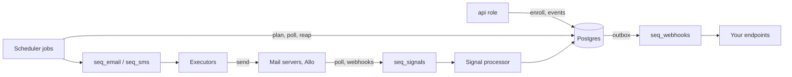

This page describes the machinery behind [How it works](/docs/get-started/how-it-works): which process does what, how often, and what happens when one of them crashes. Read it before you run OpenSequence in production or size its replicas.

## One rule: the database is the truth

All state lives in Postgres, in the `seq` schema. Queue messages carry only an id (`run_id`, `signal_id` or `delivery_id`) and are hints. A lost message costs a delay, because a job finds the work again in the tables. A duplicate costs a no-op, because every handler re-reads the row and checks its state first.

## Roles

One image runs every role. `SEQ_ROLES` picks what a process does:

| `SEQ_ROLES` | Serves the API | Runs the scheduler and the queue consumers |
|---|---|---|
| `api` | Yes | No |
| `worker` | Only `/healthz` and `/readyz` are meant to be reached | Yes |
| `all` (default) | Yes | Yes |

`/readyz` checks the database and the migrations. On a process that runs workers, it also fails when no scheduler job has run in the last two minutes. On `SIGTERM` a process stops taking work, waits up to 30 seconds for in-flight messages, and exits; anything left unfinished reappears when its queue visibility timeout expires.

## The scheduler

There is no cron and no Postgres extension. Every worker process ticks each job on its own timer and first takes the job's lease row in `seq.job_locks` with one `UPDATE`; if another process holds it, it skips that tick. The lease is released when the job ends, or expires after its TTL if the holder crashed. Plain statements only, so a transaction pooler is fine.

| Job | Every | Lease TTL | What it does |
|---|---|---|---|
| `plan` | 5 s | 20 s | Claim due enrollments and advance them; resume pauses whose end date has passed |
| `signals` | 30 s | 2 min | Re-queue signals still unprocessed two minutes after they were recorded |
| `poll` | 60 s | 5 min | Read every active inbox over IMAP from the stored cursor; check the connection's health every 15 minutes |
| `reap` | 60 s | 5 min | Release planner claims older than 10 minutes; re-queue runs recorded over 2 minutes ago and never queued; fail runs stuck for 2 hours; re-queue webhook deliveries that are due |
| `webhooks` | 30 s | 2 min | Re-queue webhook deliveries due for more than two minutes |
| `retention` | 1 day | 1 h | Delete dead queue messages and delivered webhook deliveries older than 30 days |

With several worker replicas, each one ticks every job, so a job can run more often than its period, but never twice at the same time. Every job is safe to repeat.

## The planner

The `plan` job claims due enrollments in one statement: status `active`, `next_run_at` in the past, no owner. It takes at most 50 per sender and 500 in total per tick, enrollments that have already been touched first, with `FOR UPDATE SKIP LOCKED`, and stamps them with a claim token.

Each claimed enrollment is advanced in its own transaction, up to 25 logic steps at a time (`start`, `wait`, `wait_for`, `condition`, `task`, `end`); a `crm.*` condition calls Attio inside its step. At an `outreach` step the planner inserts a `running` run, sends its id to `seq_email` or `seq_sms`, and sets the enrollment's `owner_run_id` to it. From then on only that run's executor may move the enrollment.

## Queues

`SEQ_QUEUE` picks the backend. All three have the same behavior: a read hides a message for a visibility timeout, and a message read too many times goes to a dead list.

| Backend | Use it for | Notes |
|---|---|---|
| `postgres` (default) | Most installs | Tables `seq.queue_messages` and `seq.queue_dead`. Reads use `FOR UPDATE SKIP LOCKED`. A send joins the caller's transaction, so "run recorded" and "message queued" commit together. |
| `redis` | More throughput than one table gives | Needs `SEQ_REDIS_DSN`. Sends cannot join a Postgres transaction; the `reap`, `signals` and `webhooks` jobs re-queue anything that was recorded but not queued. |
| `memory` | Tests and a single local process | Lives inside one process and is lost on restart. Does not work across replicas. |

Each worker process runs one consumer loop per queue, with up to `SEQ_CONCURRENCY` messages in flight per queue (default 8). An empty queue is polled again after 250 ms, backing off to 5 seconds.

| Queue | Visibility timeout | Retries |
|---|---|---|
| `seq_email`, `seq_sms` | 120 s | Email: 5 attempts, backing off from 1 minute (doubling, capped at 30 minutes). Text: never retried after an error |
| `seq_signals` | 60 s | 10 reads, backing off by a minute per read, capped at 10 minutes |
| `seq_webhooks` | 30 s | The delivery's own schedule: 9 attempts over about a day and a half |

## Executors

An executor takes one run, re-reads it, and works only if the run is still `running` and still owns its enrollment. It checks its gates at the last moment, then sends:

- **Gates** that can never pass skip the step (`no_email`, `suppressed`, `no_consent`, `country_not_allowed`, `no_timezone`, an inactive channel). The flow follows `skipped`.
- **Gates** that will pass later defer it (`kill_switch` 5 minutes, `daily_limit` 1 hour, `min_gap`, `send_window`, `quiet_hours` for texts outside 08:00 to 21:00 contact time, `credentials_needed` 1 hour, `provider_quota` 1 hour for texts). The enrollment goes back to the planner with a new due time.

Then the executor sends, stores the message, records the run as `done` with the branch `sent`, and advances the enrollment itself, without waiting for the next planner tick.

**Idempotency.** Every run has an idempotency key derived from the enrollment and the node. An email uses it as its `Message-ID`; on a retry the executor first asks the mailbox whether that `Message-ID` already went out. A text has no such key at the provider, so a retry first searches the last ten minutes of texts to that number; any error with an unknown outcome puts the run in `needs_review` instead of retrying, because a double text is worse than a missing one.

## Signals

Everything that comes from outside (a polled email, an Allo webhook, a completed task, an event you report) is recorded as a signal row, unique per project, source and external id, together with a `seq_signals` message (in the same transaction with the `postgres` queue; the `signals` job covers a lost message). The signal processor then marks the contact suppressed if needed, and for each enrollment the signal can touch, in its own transaction: credits the step that earned it, exits, pauses or wakes the enrollment, and records the effect. A signal processed twice finds its effect already recorded and does nothing.

## The webhook outbox

Domain events (`enrollment.exited`, `run.done`, `signal.received` and the others) are raised inside the same transaction as the change that caused them. Before that transaction commits, each event becomes one delivery row per subscribed endpoint, and, with the `postgres` queue, one `seq_webhooks` message. So an event can never be lost or sent for a change that rolled back.

A delivery is locked while it is attempted, so two workers never post it twice. Deliveries for the same endpoint and enrollment go one at a time, in order. An endpoint whose deliveries have all failed for three days is disabled, and raises `endpoint.disabled`.

## Scaling

- **API**: run more `api` replicas behind a load balancer. They keep no state.
- **Workers**: raise `SEQ_CONCURRENCY` first, then add `worker` replicas. Queues give each message to one reader and leases keep jobs from overlapping.
- **Postgres**: each process opens up to `SEQ_DB_POOL` connections (default 10); size the database for the sum.
- **Sends** are limited by the senders' mailboxes and numbers, not by the service: daily limits and minimum gaps hold however many workers run.

Start with one `all` process and split into `api` and `worker` when you want to deploy or scale them apart. See [Scaling](/docs/self-hosting/scaling) and [Queues](/docs/self-hosting/queues).
