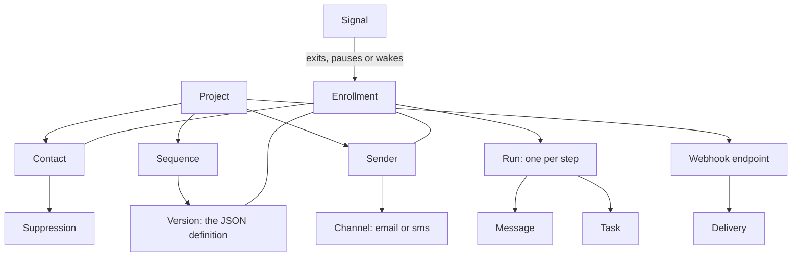

This page names the objects you meet in the API and says how they fit together. Read it once before you build on OpenSequence, and come back when an id prefix or a status puzzles you.

In one sentence: a **project** has **senders** and **contacts**; an **enrollment** runs one contact through one **version** of a **sequence** as one sender; every step it takes is a **run**; what comes back from the outside world is a **signal**; and **webhooks** tell your app about all of it.

## The setup objects

### Project

A project is one tenant (`prj_`). Everything else belongs to exactly one project, and a key from one project never sees another project's data. The operator creates projects with the `SEQ_ADMIN_TOKEN`. A project holds its API keys, its provider credentials (a Google OAuth client, an Allo key, an Attio key, all write-only) and its settings, such as the countries texts may go to.

API keys have one of three scopes, each including the ones before it:

| Scope | Can |
|---|---|
| `read` | Read senders, contacts, sequences, journeys, tasks and analytics |
| `enroll` | Also upsert contacts, enroll them, pause and resume enrollments, report contact events |
| `admin` | Also manage senders, sequences, webhooks, keys, SMS consent and project settings |

### Sender and channel

A sender (`snd_`) is the person outreach comes from: a name, an email, an IANA time zone and free `attrs`. You address it by your own id, as in `PUT /v1/senders/u_42`.

A sender sends through **channels** (`chn_`), at most one per kind:

| Channel | Comes from | Default limits |
|---|---|---|
| `email` | A Gmail account connected with OAuth ([Email via Gmail](/docs/sending/email-gmail)), or a mailbox reached over SMTP and IMAP ([Email via SMTP and IMAP](/docs/sending/email-smtp)) | 30 a day, 60 seconds apart |
| `sms` | An Allo number and the sender's Allo user ([SMS and calls via Allo](/docs/sending/sms-and-calls-allo)) | 100 a day |

A channel has a status. Only an `active` channel sends; the others are `pending`, `paused`, `credentials_needed` (the sender must reconnect), `restricted` and `disconnected`.

### Contact and suppression

A contact (`ctc_`) is the person who receives a sequence: name, email, phone in E.164, country, time zone, SMS consent and free `attrs` JSON. You address it by your own id too, as in `PUT /v1/contacts/p_7`. Each upsert merges `attrs` one level deep.

A **suppression** says "do not contact this person on this channel" (or on all channels). The service adds one on an opt-out, a hard bounce or a spam complaint, and you can add one yourself. Suppressions are checked when you enroll and again right before every send.

### Sequence and version

A sequence (`seq_`) is a named container. The flow itself lives in a **version** (`ver_`): one JSON document called the **definition**, made of **nodes** (steps) joined by named transitions.

A version is a `draft` while you edit it, `published` once it passes validation (after that it never changes), and `archived` when you stop new enrollments into it. Publishing makes the version the one new enrollments use. To change a live flow, you publish a new version; contacts already enrolled keep the version they started on.

The node types are `start`, `outreach` (send an email or a text), `wait`, `wait_for` (wait for a reply, a connected call or a meeting, with a timeout), `condition`, `task` and `end`. See [Nodes](/docs/sequences/nodes).

## The runtime objects

### Enrollment

An enrollment (`enr_`) is one contact going through one version as one sender. It knows which node it is on and when it is next due. Its status is one of:

| Status | Meaning |
|---|---|
| `active` | Moving through the flow, or waiting for a timer or an event |
| `paused` | Stopped by you, by an out-of-office reply or by a step that failed |
| `waiting_limit` | Held back by the sender's daily limit, retried later |
| `completed` | Reached an `end` node |
| `exited` | Left early, with a reason such as `replied`, `meeting_booked`, `opt_out` or `bounced` |

A contact can be in **one active enrollment per project**. Enrolling a contact who already is returns `409 ALREADY_IN_SEQUENCE`.

### Run

A run (`run_`) records one execution of one node for one enrollment. Runs are append-only, so together they are the enrollment's history: which branch a condition took and the facts it read, the values a template rendered, the message a send produced, or why a step was skipped or deferred. [The journey](/docs/contacts/journey) is this list.

### Message

A message (`msg_`) is one email or text, sent or received. It carries the addresses, the subject, the rendered body and the thread reference a reply is matched against. Inbound bodies are stored only if the project opts in.

### Task

A task (`tsk_`) is a step for a human, such as a call. A `task` node creates it with a title, a due date and an expiry on the sender's calendar. Your app shows it to the sender and completes it with an outcome, and the outcome picks the next branch. Its status is `open`, `done`, `expired` or `cancelled`. See [Call tasks](/docs/sending/call-tasks).

### Signal

A signal (`sig_`) is a fact from outside the flow: a `reply`, a `bounce`, a `complaint`, an `opt_out`, an out-of-office (`ooo`), a `meeting_booked`, a `call_connected`, a `task_completed`. Signals come from mailbox and calendar polling, Allo webhooks, task completions and the events you report with `POST /v1/contacts/{id}/events`.

Each signal is stored once per source and external id, so the same webhook twice changes nothing. It is credited to the step that earned it, then applied to the contact's enrollments: it can exit them (opt-out, bounce, or a reply when the definition says so), pause them (out of office) or wake a step that waits for it.

### Webhook endpoint and delivery

A webhook endpoint (`wep_`) is a URL of yours that subscribes to event types such as `enrollment.exited` or `signal.received`. Each event becomes one delivery (`wdl_`) per endpoint, signed with [Standard Webhooks](https://www.standardwebhooks.com) headers and tried up to nine times over about a day and a half. Deliveries about the same enrollment arrive in order. See [Receiving webhooks](/docs/webhooks/overview).

## Ids

Every object has a prefixed id (`prj_`, `snd_`, `chn_`, `ctc_`, `seq_`, `ver_`, `enr_`, `run_`, `msg_`, `tsk_`, `sig_`, `wep_`, `wdl_`). Senders and contacts also accept your own id in the URL, so you never have to store ours.

<Cards>
  <Card title="How it works" href="/docs/get-started/how-it-works">Follow one contact through one sequence.</Card>
  <Card title="Architecture" href="/docs/get-started/architecture">The scheduler, the queues and the workers behind it.</Card>
</Cards>
