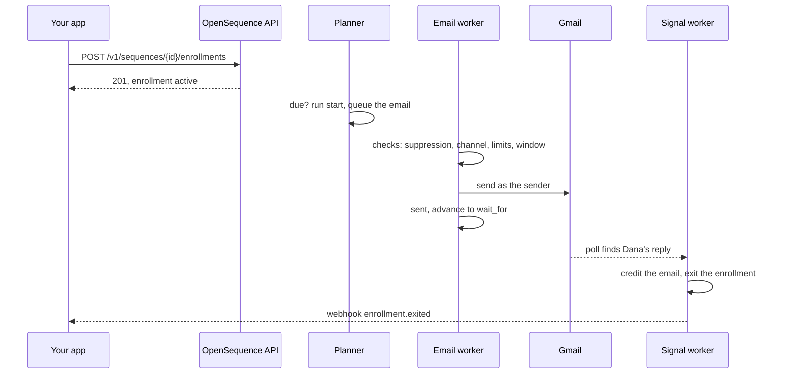

This page follows one contact, Dana, through one sequence: an email, then a wait of up to three days for a reply. Read it to know what the service does between your enroll call and the webhook that tells you Dana replied.



## 1. You enroll the contact

```bash
curl -X POST $SEQ/v1/sequences/$SEQ_ID/enrollments -H "Authorization: Bearer $KEY" \
  -H "Content-Type: application/json" -d '{"contacts":["p_7"],"sender":"u_42"}'
```

The API checks the request before it writes anything:

- If any contact in the request is already in an active sequence in this project, the whole call fails with `409 ALREADY_IN_SEQUENCE` and nobody is enrolled.
- Contacts that are suppressed, re-enrolled too soon, or that have no usable channel for the first step are left out and listed in `skipped`. The rest go ahead.

Each accepted contact gets an enrollment with status `active`, sitting on the `start` node, with a due time (`next_run_at`). When you enroll many contacts at once, the due times are spread over days to fit the sender's daily limit, and each one is moved into the sequence's send window if it has one. The response's `first_touch_at` and `capacity` tell you when the first touches will go out.

## 2. The planner picks it up

Every five seconds the planner looks for enrollments that are due and not busy. It takes them fairly, up to 50 per sender, so one busy sender cannot starve the others.

For each one, it runs the definition from the current node. Logic steps happen right away, in one database transaction: `start` moves on, a `condition` reads its facts and picks a branch, a `wait` sets the next due time, a `task` creates a task. When the flow reaches a step that talks to the outside world (an email or a text), the planner records a run for it, puts a message on that channel's queue, and hands the enrollment to that worker. Until the worker finishes, the planner cannot touch the enrollment again.

## 3. The email worker checks, then sends

The checks happen at the last moment, just before the send, because things change while a contact waits:

| Check | If it fails |
|---|---|
| The contact has an email address | Skip (`no_email`) |
| The contact is not suppressed for email | Skip (`suppressed`) |
| The email channel is not switched off for the project | Try again in 5 minutes |
| The sender has an email channel and it is `active` | Skip (for example `sender_channel_credentials_needed`) |
| Fewer than the daily limit sent in the last 24 hours | Try again in an hour, status `waiting_limit` |
| The minimum gap since the sender's last email has passed | Try again when it has |
| Now is inside the sequence's send window | Try again when the window opens |

A skipped step follows the `skipped` transition of the node and the flow goes on. A deferred step goes back to the planner with a new due time.

When every check passes, the worker renders the subject and body, adds a one-click unsubscribe header, and sends through the sender's own mailbox. The email carries a `Message-ID` built from the run, so a retry after a crash first asks the mailbox whether that email already left. The worker stores the message, marks the run `done` with the branch `sent`, and moves the enrollment on.

Texts go through the same steps with stricter checks: SMS consent, a phone number, an allowed country, a known time zone for the contact, and the hours of 08:00 to 21:00 in the contact's time zone. See [Deliverability and compliance](/docs/sending/deliverability-and-compliance).

## 4. The enrollment waits

The next node is `wait_for` with `events: ["reply"]` and `timeout: "3d"`. The enrollment records what it waits for and when the timeout falls due. Nothing runs in the meantime: the wait is a row in the database, not a timer in a process, so a restart loses nothing.

If three days pass with no reply, the planner finds the enrollment due again and follows the `timeout` branch.

## 5. Dana replies

Every minute, the poll job reads each active Gmail mailbox from where it last stopped, looking only at threads the service started in the last 30 days. It finds Dana's reply in the thread of the email that went out and stores it as a `reply` **signal**. A Calendar booking would become a `meeting_booked` signal the same way, and Allo sends call and text events to the service as webhooks.

The signal worker then:

1. **Credits** the reply to the step that earned it: the last email to Dana before the reply (`direct`), or the last touch on any channel (`assisted`).
2. **Exits** the enrollment with the reason `replied`, because the definition's `exit_on` lists `reply`. Without that, the reply would instead **wake** the `wait_for` step and the flow would take its `reply` branch.
3. Records what it did, so the same signal arriving twice changes nothing.

Some signals always exit, whatever the definition says: an opt-out, a hard bounce, a spam complaint and a suppression you report. An out-of-office reply pauses the enrollment until the date it gives, or for seven days.

## 6. Your app hears about it

Every change above raises an event: `enrollment.created`, `run.done`, `signal.received`, `enrollment.exited` and more. Each event is written as a delivery for every webhook endpoint that subscribed to it, in the same transaction as the change itself, then posted to your URL with a signature. Deliveries for one enrollment arrive in order, and a failed delivery is tried nine times over about a day and a half.

```json
{
  "id": "evt_...",
  "type": "enrollment.exited",
  "project": "prj_...",
  "occurred_at": "2026-10-16T10:02:11.000Z",
  "data": {
    "enrollment": { "id": "enr_...", "status": "exited", "exit_reason": "replied", "touch_count": 1 },
    "exit_reason": "replied",
    "signal": "sig_..."
  }
}
```

You can also read the whole story at any time with `GET /v1/enrollments/{id}` (the [journey](/docs/contacts/journey)): every run, every message, every signal and every task.

## What you never have to do

Your app never calls Gmail or Allo, never runs a timer, never retries a send and never reads the service's database. It upserts contacts, enrolls them, and listens.

<Cards>
  <Card title="Architecture" href="/docs/get-started/architecture">The jobs, queues and workers that run each of these steps.</Card>
  <Card title="Receiving webhooks" href="/docs/webhooks/overview">Subscribe, verify signatures and handle retries.</Card>
</Cards>
