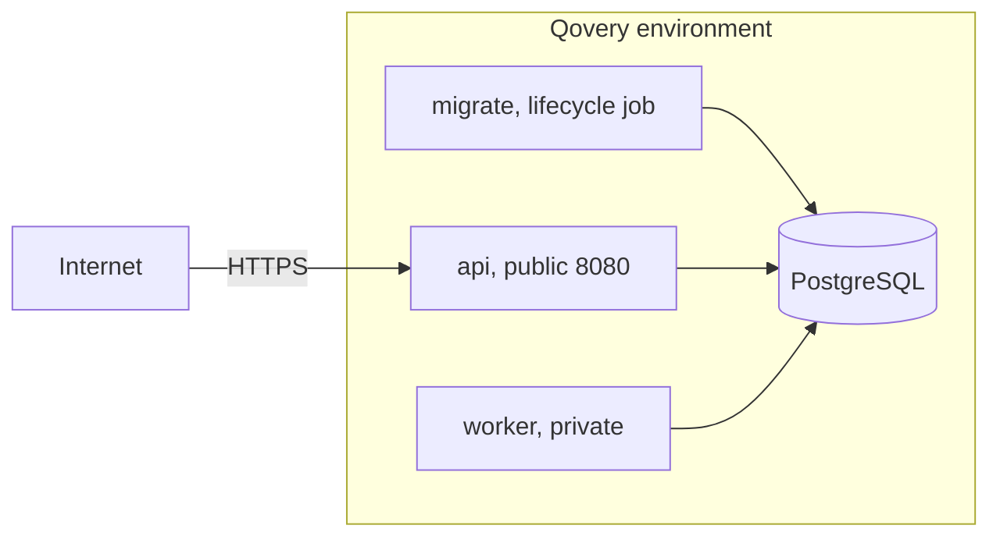

This guide sets up OpenSequence in one Qovery environment. You get a managed Postgres, a job that migrates on every deploy, a public `api` application and a private `worker` application, all from the published image `ghcr.io/lguerberg/open-sequence`.



## What you create

| Service | Type | Source | Key settings |
|---|---|---|---|
| `postgres` | Database, PostgreSQL 14 or newer | managed by Qovery | private |
| `migrate` | Lifecycle job, runs on deploy | `ghcr.io/lguerberg/open-sequence`, one pinned tag | command `node dist/cli.js migrate` |
| `api` | Application | `ghcr.io/lguerberg/open-sequence`, one pinned tag | `SEQ_ROLES=api`, port 8080 public |
| `worker` | Application | `ghcr.io/lguerberg/open-sequence`, one pinned tag | `SEQ_ROLES=worker`, port 8080 private |

No cronjob is needed. The scheduler runs inside the worker and coordinates replicas with lease rows in the database.

## Variables

Generate the two secrets once, on your machine or in any built image:

```bash
docker run --rm ghcr.io/lguerberg/open-sequence:main node dist/cli.js secrets new-key   # SEQ_ENCRYPTION_KEYS
openssl rand -base64 32                                                # SEQ_ADMIN_TOKEN
```

Set shared values at the environment level so all three services read them, and role values on each service:

| Variable | Scope | Secret | Value |
|---|---|---|---|
| `SEQ_DB_DSN` | environment | yes | an alias of the database's internal connection URL (a built-in variable named like `QOVERY_POSTGRESQL_Z…_DATABASE_URL_INTERNAL`) |
| `SEQ_ENCRYPTION_KEYS` | environment | yes | the `id:base64` entry from `secrets new-key` |
| `SEQ_PUBLIC_URL` | environment | no | the api's public HTTPS URL, such as `https://sequences.example.com` |
| `SEQ_ADMIN_TOKEN` | `api` | yes | the operator token |
| `SEQ_ROLES` | `api` and `worker` | no | `api` on one, `worker` on the other |

Every other variable has a working default. See [Configuration](/docs/self-hosting/configuration). Do not set `SEQ_RUN_MIGRATIONS`: the job migrates.

<Warning>Copy `SEQ_ENCRYPTION_KEYS` somewhere outside Qovery as well. A database backup restored without it has unreadable credentials.</Warning>

## Steps

<Steps>
<Step title="Create the database">

In the environment, add a PostgreSQL database, version 14 or newer, in managed mode for production. Keep it private.

</Step>
<Step title="Connect the registry">

In the organization settings, add a container registry of type GitHub Container Registry, with the URL `https://ghcr.io` and a GitHub classic personal access token with the `read:packages` scope.

Pick one tag for all three services. `main` follows every push to `main`; `sha-<commit>` pins a build; a release adds `<version>`, `<major>.<minor>` and `latest` (amd64 and arm64). Pin `sha-<commit>` or a version in production.

</Step>
<Step title="Create the migration job">

Add a lifecycle job from that registry, image `lguerberg/open-sequence` and your tag:

- Trigger it on the environment's start (deploy) event, with the command `node dist/cli.js migrate`.

<Tip>To run your own changes, build from your fork instead: the Dockerfile at `apps/server/Dockerfile`, root path `/` (it copies the whole workspace), for the job and both applications. Every other setting on this page stays the same.</Tip>

The command applies the `seq` and `auth` migrations and exits. It is safe to run on every deploy: an up-to-date database prints `already up to date`.

</Step>
<Step title="Create the api application">

Add an application from the same registry, image and tag.

- Port `8080`, publicly exposed. Add your custom domain and set `SEQ_PUBLIC_URL` to it.
- Liveness probe: HTTP `GET /healthz` on 8080.
- Readiness probe: HTTP `GET /readyz` on 8080.
- Resources to start: 500 mCPU and 512 MB. Two instances for availability.
- `SEQ_ROLES=api` and `SEQ_ADMIN_TOKEN` as a secret.

</Step>
<Step title="Create the worker application">

Clone the api application, then change:

- `SEQ_ROLES=worker`, and remove `SEQ_ADMIN_TOKEN`.
- Port 8080 not publicly exposed. The worker answers the API routes on it too, so it must stay private.
- Keep the same probes: on the worker, `/readyz` also fails when the scheduler has not run a job in 2 minutes.
- One instance to start.
- A termination grace period of at least 40 seconds, in the advanced settings. The worker finishes in-flight messages for up to 30 seconds after `SIGTERM`.

</Step>
<Step title="Order the deployment">

In the environment's deployment pipeline, put the services in stages: database first, then `migrate`, then `api`, then `worker`. A failed migration then stops the deploy before any application changes. Deploy the environment.

</Step>
<Step title="Create the first project">

```bash
curl -X POST https://sequences.example.com/v1/admin/projects \
  -H "Authorization: Bearer $SEQ_ADMIN_TOKEN" -H "Content-Type: application/json" \
  -d '{"slug":"acme","name":"Acme CRM"}'
```

The response holds the project's first `admin` key, shown once. Continue with [Install](/docs/self-hosting/install), from "Register the providers".

</Step>
</Steps>

## Check it

```bash
curl https://sequences.example.com/readyz
# {"ok":true}
curl https://sequences.example.com/v1/admin/engine/health -H "Authorization: Bearer $SEQ_ADMIN_TOKEN"
# "jobs": { "plan": "…", … }   recent timestamps mean the worker is running
```

## Notes

- **Scaling.** Add api instances on CPU. Add worker instances when queue depth grows; replicas are safe. See [Scaling](/docs/self-hosting/scaling).
- **Webhook receivers.** OpenSequence only delivers webhooks to public HTTPS addresses. A receiver in the same Qovery environment needs a public domain; its internal address is refused.
- **Upgrades.** Change the tag on the three services (or let `main` move) and redeploy: the pipeline runs migrate, api, worker in order. For a release that removes something, read [Upgrades](/docs/self-hosting/upgrades) first.
