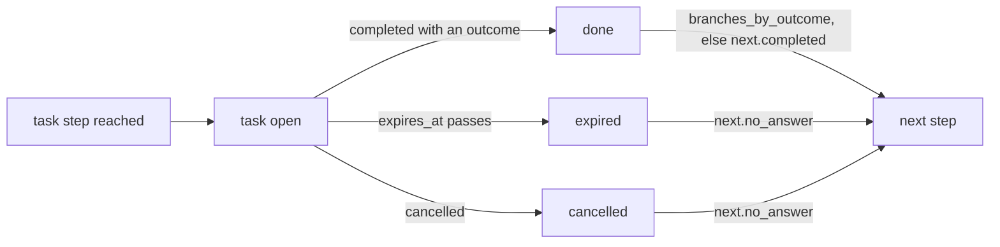

A `task` step hands work to the sender and waits for its outcome: a call, a handwritten note, a demo, anything a person does. Use it when a touch needs a human, then build a small inbox in your app where reps see their tasks and mark them done.



## The step

```json
"call_1": {
  "type": "task",
  "params": {
    "kind": "call",
    "title": "Call {{ contact.first_name | \"them\" }}",
    "body": "They opened a proposal for {{ attrs.company.name | \"their company\" }}.",
    "link": "https://crm.acme.com/people/{{ attrs.crm_id | \"\" }}",
    "due": "1bd",
    "expire": "3bd",
    "connected_outcomes": ["connected", "meeting_set"],
    "dialer": false,
    "auto_complete": true
  },
  "next": { "completed": "wait_3d", "no_answer": "email_2" },
  "branches_by_outcome": { "connected": "end_connected", "meeting_set": "end_booked", "voicemail": "sms_follow" }
}
```

| Param | Meaning |
|---|---|
| `kind` | Required. Lowercase letters, digits and `_`, up to 32 characters. `call` gets the Allo behaviour below; any other kind is yours to render. |
| `title` | Required, up to 200 characters. A template, rendered once when the task is created. |
| `body`, `link` | Optional templates, rendered the same way (up to 4,000 and 2,000 characters). |
| `due` | Required. A duration on the **sender's** calendar: `2h`, `1d`, or `1bd` for one business day (Monday to Friday in the sender's zone). |
| `expire` | When the task expires if nobody completes it. Default: seven days after `due`. |
| `connected_outcomes` | Outcomes that count as a conversation. Default `["connected"]`. |
| `dialer` | Marks the task for the sender's Allo power dialer. Default `false`. See the warning below. |
| `auto_complete` | Lets Allo's `call.completed` complete a `call` task. Default `true`. |

Templates can read `contact.*`, `attrs.*`, `sender.*` and `sequence.name` ([Templates](/docs/sequences/templates)). A task is not a touch: it does not count in `touch_count`.

## Outcomes and branches

The outcome is free text, 1 to 32 characters, that your app or Allo sends when the task is done. The flow then goes:

| What happened | Next step |
|---|---|
| Completed, and the outcome is a key of `branches_by_outcome` | that node |
| Completed with any other outcome | `next.completed` |
| Expired, or cancelled | `next.no_answer` |
| No matching branch is wired | the enrollment completes |

Completing a task always records a `task_completed` signal. When the outcome is in `connected_outcomes`, it also records a `call_connected` signal, which counts as a reply: it is credited to the task's own run, it exits the enrollment when `exit_on` lists `reply`, and it wakes a `wait_for` on `call_connected` or `reply`. Completion moves the enrollment on at once, without waiting for the planner. Completing or cancelling a task that is no longer open returns it unchanged, so a double click is harmless.

## The task API

<CodeGroup>

```bash title="curl"
curl "$SEQ/v1/tasks?sender=u_42&status=open" -H "Authorization: Bearer $KEY"
curl "$SEQ/v1/senders/u_42/tasks" -H "Authorization: Bearer $KEY"          # open tasks by default
curl $SEQ/v1/tasks/tsk_01J9… -H "Authorization: Bearer $KEY"
curl -X POST $SEQ/v1/tasks/tsk_01J9…/complete -H "Authorization: Bearer $KEY" -H "Content-Type: application/json" \
  -d '{"outcome":"voicemail","note":"Left a message, try Thursday."}'
curl -X POST $SEQ/v1/tasks/tsk_01J9…/cancel -H "Authorization: Bearer $KEY"
```

```ts title="TypeScript"
const { items: open } = await oseq.senders.tasks('u_42', { status: 'open' });
await oseq.tasks.complete(open[0].id, { outcome: 'voicemail', note: 'Left a message, try Thursday.' });
await oseq.tasks.cancel(open[1].id);
```

</CodeGroup>

| Field | Meaning |
|---|---|
| `id`, `kind`, `title`, `body`, `link` | What to show. |
| `dueAt`, `expiresAt` | When it is due, and when it expires and takes `no_answer`. |
| `status` | `open`, `done`, `expired` or `cancelled`. |
| `outcome`, `note`, `completedAt` | Set on completion. When Allo completed the task, the note is the call summary. |
| `dialer`, `dialerPushedAt` | Whether the task is marked for the dialer, and when it was pushed (always null today). |
| `enrollmentId`, `contactId`, `senderId` | The links. Join with `GET /v1/contacts/{id}` for the contact card. |

`GET /v1/tasks` needs a `read` key and filters by `sender`, `status`, `kind`, `contact` and `updated_since`, with cursor pagination. `GET /v1/senders/{id}/tasks` does the same for one sender, `status=open` by default. `complete` takes an `outcome` and an optional `note` (up to 4,000 characters); `complete` and `cancel` need an `enroll` key.

When a reply, an opt-out or a bounce exits the enrollment, its open task is cancelled and `task.expired` is delivered. Exiting an enrollment through the API leaves its task open today: cancel the task yourself.

## Calls through Allo

The sender's `sms` channel holds their Allo user and number ([SMS and calls via Allo](/docs/sending/sms-and-calls-allo)). When Allo reports `call.completed` for an **outbound** call from that number to the contact's phone, and the sender has an open `call` task for that contact with `auto_complete: true`, the task is completed with this outcome and Allo's summary as the note:

| Allo result | Outcome |
|---|---|
| `ANSWERED`, `TRANSFERRED_AI`, `TRANSFERRED_EXTERNAL` | `connected` |
| `VOICEMAIL` | `voicemail` |
| anything else | `no_answer` |

Change the mapping with `settings.allo.outcome_map`, for example `PUT /v1/project/settings` with `{ "allo": { "outcome_map": { "VOICEMAIL": "no_answer" } } }`. Whichever completion arrives first wins, from Allo or from your app; the later one finds the task closed and changes nothing.

<Warning>`dialer: true` is stored on the task, and the engine has the code to push marked tasks into the sender's Allo power-dialer queue, but nothing runs it yet. Today the number does not reach the dialer by itself: the rep dials from Allo or from the task's `link`, and auto-completion still closes the task. Completing a call task from Allo's queue state, when a webhook was missed, is not wired either.</Warning>

## Building a task inbox

1. Subscribe a webhook endpoint to `task.created` and `task.expired`, or poll `GET /v1/tasks?updated_since=…`.
2. Store each task's id, kind, title, body, link, due date, contact and sender. Show each `kind` with your own label and icon.
3. Offer the outcomes the step defines (the `branches_by_outcome` keys plus a generic "done") and call `complete`. Offer "skip" and call `cancel`.
4. For calls, let the rep dial from Allo and let auto-completion do the rest; show the note Allo wrote.
5. Listen for `signal.received` with `kind: "task_completed"` to update a row that was completed elsewhere.

`task.created` carries a `task` object with `id`, `kind`, `title`, `body`, `link`, `due_at`, `expires_at`, `status`, `outcome`, `dialer`, `enrollment`, `contact` and `sender`. `task.expired` carries the same object when the task was cancelled, but only the task id (`task: "tsk_…"`) when it expired by time, so look the task up by id in both cases. More in [Webhook recipes](/docs/webhooks/recipes).
