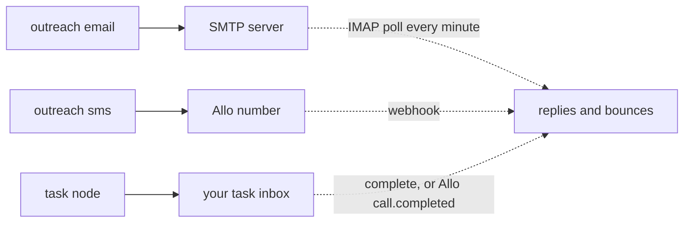

A sequence step reaches a contact by email, by text, or by handing the work to a person as a task. Read this page to pick the right step for each touch; the definition names the channel, and the provider behind it is a property of the sender.

## The comparison

| | Email | SMS via Allo | Call task | Plain task |
|---|---|---|---|---|
| Step | `outreach`, `channel: "email"` | `outreach`, `channel: "sms"` | `task`, `kind: "call"` | `task`, any `kind` |
| Set up with | `PUT /v1/senders/{id}/channels/email` with the mailbox's SMTP and IMAP settings | the project's Allo key, then `PUT /v1/senders/{id}/channels/sms` | the sender's `sms` channel | nothing |
| Who sends | the sender's mail server (Gmail, Google Workspace or any other) | the sender's Allo number | the sender, from Allo | the sender, by hand |
| Replies found by | reading the IMAP inbox every minute, only replies to emails the service sent | Allo's `sms.received` webhook, matched by the two numbers | Allo's `call.completed` for an outbound call to the contact completes the task | your app completes the task |
| Bounces | read from the inbox; a hard bounce suppresses email and exits | none | none | none |
| Opt-out | `{{ unsubscribe_url }}` and `List-Unsubscribe` headers | a reply made only of `STOP` or a similar word | none | none |
| Meetings | none: report them with [contact events](/docs/contacts/events) | none | none | none |
| Default caps | 30 a day, 60 s apart | 100 a day | none | none |
| A retry never sends twice because | the service sets the `Message-ID` and looks for it in the Sent folder, then the inbox | it searches recent texts, then stops for review | the task id | the task id |
| Counts as a touch | yes | yes | no | no |

## Gates every send passes

The executor checks these just before it sends. A failed check either skips the step (the flow takes `skipped`, or `sent` when `skipped` is not wired) or defers it to a later time.

| Gate | Email | SMS | When it fails |
|---|---|---|---|
| The contact has an address | `email` | `phone` | skip: `no_email`, `no_phone` |
| SMS consent | | `sms_consent` is true | skip: `no_consent` |
| Allowed country | | `country` is in `settings.sms_countries`, default `["US"]` | skip: `country_not_allowed` |
| Not suppressed | no `email` or `all` suppression | no `sms` or `all` suppression | skip: `suppressed` |
| Kill switch | `SEQ_DISABLED_CHANNELS`, flags `global` and `channel:email` | the same with `channel:sms` | defer five minutes |
| The sender's channel | exists and is `active` | the same | skip: `no_email_channel`, `no_sms_channel`, `sender_channel_<status>` |
| Daily limit | `daily_limit` in a rolling 24 hours | the same | defer one hour, enrollment `waiting_limit` |
| Minimum gap | `min_gap_seconds` since the last send | the same | defer to the end of the gap |
| Send window | the definition's `send_window` | the same | defer to the next opening |
| Recipient time zone | | known from `timezone`, the phone number or a one-zone country | skip: `no_timezone` |
| Quiet hours | | 08:00 to 21:00 in the recipient's zone, every day | defer to 08:00 |

The SMS gates are legal requirements in most places texts are sent, so they cannot be turned off. [Deliverability and compliance](/docs/sending/deliverability-and-compliance) explains each one. Tasks pass no gates: a person decides when to act.

## Choosing

- **Email** is the default first touch. It is cheap, a follow-up can stay in the same thread (`reply_in_thread: true`), and replies are detected without your help.
- **SMS** reaches people who do not read email, but only with recorded consent, in allowed countries and during the day. Treat it as a follow-up, not an opener.
- **Calls** are tasks with help: the rep gets a title, a body and a link, and Allo closes the task when the call ends. Use `branches_by_outcome` so a connected call and a voicemail go different ways.
- **Plain tasks** carry anything else a person does: a handwritten note, a demo, a message typed in another app. Your application decides how to show each `kind`.

## Next

<Cards>
  <Card title="Email via SMTP and IMAP" href="/docs/sending/email-smtp">Connect any mailbox, Gmail included, with its server settings.</Card>
  <Card title="SMS and calls via Allo" href="/docs/sending/sms-and-calls-allo">One Allo key, then a number per sender.</Card>
  <Card title="Call tasks and the task inbox" href="/docs/sending/call-tasks">Task steps, outcomes and building an inbox.</Card>
</Cards>
