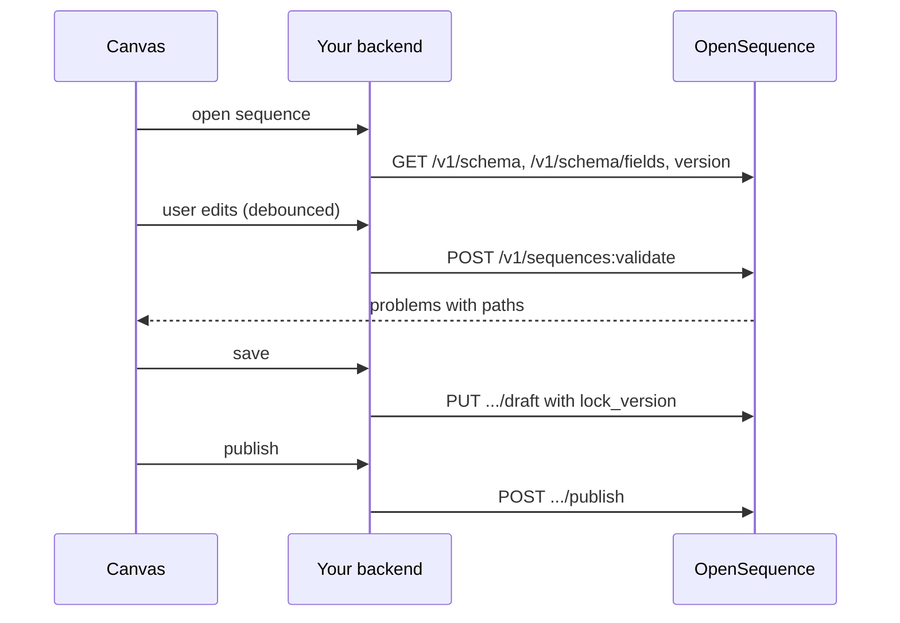

A canvas is a visual editor for the [definition](/docs/sequences/definition): boxes for nodes, arrows for transitions, a form per node. Read this page when you want your users to build sequences inside your product instead of writing JSON.

Everything a canvas needs comes from five calls. Nothing about node types is hardcoded on your side: the catalogue tells you what exists.

| Call | Key | What the canvas does with it |
|---|---|---|
| `GET /v1/schema` | `read` | the node types, channels, their params as JSON Schema, and their transition keys |
| `GET /v1/schema/fields` | `read` | the field picker for condition rules |
| `POST /v1/sequences:validate` | `read` | problems with a JSON path, while the user edits |
| `PUT /v1/sequences/{id}/versions/{vid}/draft` | `admin` | save the draft under an optimistic lock |
| `POST /v1/sequences/{id}/versions/{vid}/publish` | `admin` | freeze it and make it the default version |

`GET /v1/schema/events` is the webhook event catalogue, for a page where users subscribe an endpoint. It is not the list of events a `wait_for` node waits on.

<Warning>The API sends no CORS headers, and an API key must never reach a browser. The canvas calls your backend, and your backend calls OpenSequence with the key.</Warning>

## The edit loop



<Steps>
<Step title="Load the catalogue and the draft">

```ts
const [catalogue, fields] = await Promise.all([oseq.schema.definition(), oseq.schema.fields()]);
const { version, problems } = await oseq.sequences.versions.get(seqId, versionId);
// version.definition, version.lockVersion, version.status ("draft" | "published" | "archived")
```

`POST /v1/sequences` creates a sequence and its `v1` draft in one call; without a definition the draft is `start` wired to `end`.

</Step>
<Step title="Validate while the user edits">

Send the whole definition on every change, debounced (300 ms is plenty). Validation is pure and saves nothing.

```ts
const { ok, problems } = await oseq.sequences.validate(definition);
```

</Step>
<Step title="Save the draft">

```ts
const saved = await oseq.sequences.versions.saveDraft(seqId, versionId, { definition, lock_version: lockVersion });
lockVersion = saved.version.lockVersion; // keep the new one for the next save
```

A save goes through even when the definition has errors, and returns the problems. Two cases fail with `409`:

- `STALE_LOCK`: someone saved this draft after you loaded it. Reload, then reapply or discard the user's change.
- `VERSION_NOT_EDITABLE`: the version is published or archived. Create a new draft from it with `POST /v1/sequences/{id}/versions` and a `tag` like `v2`.

</Step>
<Step title="Publish">

```ts
await oseq.sequences.versions.publish(seqId, versionId);
```

Errors block a publish with `422 INVALID_DEFINITION`; the problems are in `error.details.problems`. Warnings do not block. Publishing an already published version returns it unchanged. See [Versions](/docs/sequences/versions) for what happens to people already enrolled.

</Step>
</Steps>

## Rendering nodes from the catalogue

`GET /v1/schema` returns `{ definition, nodes, channels }`:

```json
{
  "nodes": [
    { "type": "wait", "label": "Wait", "transitions": { "keys": ["then"], "required": ["then"] },
      "params": { "type": "object", "properties": { "duration": { "type": "string", "pattern": "^(\\d+)(m|h|d|bd)$" } }, "required": ["duration"], "additionalProperties": false } }
  ],
  "channels": [
    { "name": "email", "label": "Email", "actions": [
      { "action": "send", "label": "Send an email", "touch": true, "transitions": { "keys": ["sent", "skipped", "failed"], "required": [] },
        "params": { "type": "object", "properties": {
          "subject": { "type": "string", "minLength": 1, "maxLength": 300 },
          "format": { "default": "text", "type": "string", "enum": ["text", "html"] },
          "reply_in_thread": { "default": false, "type": "boolean" } } } } ] }
  ]
}
```

- **The palette** is `nodes` (use `label`), with `outreach` expanded into one entry per channel action ("Send an email", "Send a text").
- **The form** is built from `params`, a JSON Schema: a text input for a string, a checkbox for a boolean, a select for an `enum`. A property with a `default` is optional even when it appears in `required`; prefill it. For an `outreach` node the node-level `params` accept anything; use the channel action's `params` instead.
- **The ports** (outgoing arrows) are `transitions.keys`, in the order given. Keys in `required` must be wired. Any other key may stay unwired: an enrollment that takes it completes there.
- **An `end` node** has no ports.

Three node types need a rule on top of the catalogue:

| Node | Ports to draw |
|---|---|
| `wait_for` | one per event in `params.events`, plus `timeout` when `params.timeout` is set. Each listed event must be wired (`BAD_EVENT`) |
| `task` | `completed` and `no_answer`, plus one per key of `branches_by_outcome` (an outcome string such as `connected`). The node's `branches_by_outcome` sits beside `next`, not inside it |
| `outreach` | the channel action's `transitions.keys`: `sent`, `skipped`, `failed` |

The definition stores no layout. Compute positions from `entry` and `next` with a tree or layered layout (dagre and elkjs both work), or keep positions in your own storage keyed by version and node id. Node ids are yours to choose: `lower_snake_case`, up to 64 characters. Generate them from the label (`email_intro`, `email_intro_2`) and keep them stable, since runs and analytics refer to them.

## The condition field picker

`GET /v1/schema/fields` returns the registry's sources and your project's `attrs_schema`:

```json
{
  "sources": [
    { "prefix": "history", "label": "History", "open": false, "fields": [
      { "field": "history.touches", "label": "Touches so far", "type": "number" },
      { "field": "history.last_reply_channel", "label": "Last reply channel", "type": "enum", "values": ["email", "sms", "call"] } ] },
    { "prefix": "attrs", "label": "Contact attributes", "open": true, "fields": [] }
  ],
  "attrs": [{ "field": "attrs.plan", "label": "Plan", "type": "enum", "values": ["free", "pro"] }]
}
```

Group the picker by source. A source with `open: true` (`attrs`, `crm`) also accepts any path under its prefix, so offer a free-text input there. Declare `attrs_schema` with `PUT /v1/project/settings` to give your attributes labels and enum values in the picker.

The operators are not in the API. Offer them by the field's type:

| Type | Operators |
|---|---|
| `text` | `is`, `is_not`, `contains`, `is_empty`, `is_not_empty` |
| `number` | `eq`, `ne`, `gt`, `gte`, `lt`, `lte` |
| `bool` | `is_true`, `is_false` (no value) |
| `enum` | `is`, `is_not`, with a select of `values` |
| `date` | `before`, `after` |

<Note>The validator types every `attrs.*` field and every undeclared `crm.*` path as text, whatever `attrs_schema` says. Offer text operators for them, or the rule fails validation with `BAD_OPERATOR`.</Note>

A condition holds 1 to 20 rules and a `mode` of `all` or `any`. Its ports are `yes` and `no`, both required.

## Showing problems on the right node

Every problem is `{ path, code, message, severity }`. The path is a dotted path into the definition, so the second segment of `nodes.<id>.…` is the node:

```ts
function problemsByNode(problems: Problem[]) {
  const byNode: Record<string, Problem[]> = {};
  const global: Problem[] = [];
  for (const p of problems) {
    const [root, id] = p.path.split('.');
    if (root === 'nodes' && id) (byNode[id] ??= []).push(p);
    else global.push(p); // entry, settings, exit_on, the whole document
  }
  return { byNode, global };
}
```

Show `message` as written: it is a sentence meant for the user. Mark nodes with an `error` in red and those with only a `warning` in amber, and disable Publish while any error remains. A path that continues (`nodes.check.params.rules.0.op`) points at the form field to highlight; `nodes.<id>.next.<key>` points at a port. The full list of codes and fixes is on [Validation](/docs/sequences/validation).

## Beyond editing

- **A contact's path**: `GET /v1/enrollments/{id}` returns the version's definition and one run per node executed. Highlight the run's `nodeId` and `branch` on the canvas. See [The journey](/docs/contacts/journey).
- **Counts per node**: `GET /v1/sequences/{id}/analytics/nodes` gives per-node numbers to overlay. See [Analytics endpoints](/docs/analytics/endpoints).

Next: [a minimal React canvas](/docs/sequences/canvas-react-example) that puts this page together.
