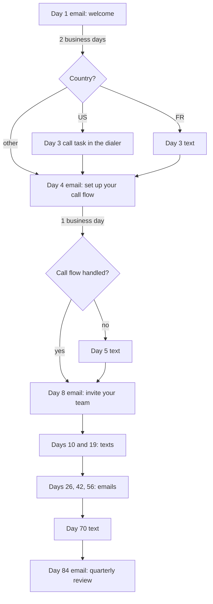

A new customer gets a planned run of emails, texts and one call from their account owner, so the first months feel personal without anyone keeping a calendar. Use this page when your backend knows the moment a deal is won and you want the activation plan to start, adapt and stop on its own.

The example is a phone-system company. The account owner sends from their own mailbox and their own Allo number; replies end the plan; a cancelled contract ends it from your backend.



## The schedule

Every wait is relative to the step before it and counts **business days** (`bd`: Monday to Friday in the contact's time zone, no holidays). Day 1 is the day of the first email. The gaps below were computed so each step lands on the business day the plan names.

| Business day | Calendar day, if day 1 is a Monday | Step | Channel |
|---|---|---|---|
| 1 | 1 | Welcome | Email |
| 3 | 3 | Check-in call (US) or check-in text (FR) | Call task or text |
| 4 | 4 | Set up your call flow | Email |
| 5 | 5 | Call flow nudge, only if not handled | Text |
| 8 | 10 | Invite your team | Email |
| 10 | 12 | How are the first calls going | Text |
| 19 | 25 | Tip: missed-call texts | Text |
| 26 | 36 | One month in: call analytics | Email |
| 42 | 58 | Connect your CRM | Email |
| 56 | 78 | Advanced routing | Email |
| 70 | 96 | Check-in | Text |
| 84 | 116 | Quarterly review | Email |

<Warning title="Business days stretch the calendar">84 business days is about 16.5 weeks, so the last email goes out around calendar day 116, not inside 90 days. If your plan means calendar days, replace every `bd` with `d` (the gaps are the same numbers). Weekend sends then wait for Monday because the send window allows weekdays only, and each later step shifts by those days.</Warning>

## The definition

<Accordion title="customer-onboarding.json (29 nodes)">

```json title="customer-onboarding.json"
{
  "schema_version": 1,
  "entry": "start",
  "settings": {
    "send_window": { "days": ["mon", "tue", "wed", "thu", "fri"], "from": "09:00", "to": "18:00", "tz": "contact" },
    "reenroll": "never"
  },
  "exit_on": ["reply"],
  "nodes": {
    "start": { "type": "start", "next": { "then": "email_d1" } },
    "email_d1": {
      "type": "outreach", "channel": "email", "action": "send",
      "params": {
        "subject": "Welcome aboard, {{ contact.first_name | \"there\" }}",
        "body": "Hi {{ contact.first_name | \"there\" }},\n\nI'm {{ sender.name }}, your account owner. Your lines are live. Over the next weeks I'll send you a few short notes, one thing at a time, so your team gets the most out of the phone system.\n\nFirst step: reply to this email with the best time for a 15-minute setup call.\n\n{{ sender.signature }}\n\nPrefer fewer emails? {{ unsubscribe_url }}"
      },
      "next": { "sent": "wait_to_d3", "skipped": "wait_to_d3" }
    },
    "wait_to_d3": { "type": "wait", "params": { "duration": "2bd" }, "next": { "then": "is_us" } },
    "is_us": {
      "type": "condition",
      "params": { "mode": "all", "rules": [{ "field": "contact.country", "op": "is", "value": "US" }] },
      "next": { "yes": "call_d3", "no": "is_fr" }
    },
    "call_d3": {
      "type": "task",
      "params": {
        "kind": "call",
        "title": "Day-3 check-in call with {{ contact.first_name | \"the customer\" }}",
        "body": "Ask whether the call flow is set up and offer to build it together.",
        "due": "4h",
        "expire": "1bd",
        "dialer": true
      },
      "next": { "completed": "wait_to_d4", "no_answer": "email_d4" }
    },
    "is_fr": {
      "type": "condition",
      "params": { "mode": "all", "rules": [{ "field": "contact.country", "op": "is", "value": "FR" }] },
      "next": { "yes": "sms_d3", "no": "wait_to_d4" }
    },
    "sms_d3": {
      "type": "outreach", "channel": "sms", "action": "send",
      "params": { "body": "Hi {{ contact.first_name | \"there\" }}, {{ sender.name }} here, your account owner. How is the setup going? Reply here if you want a hand with your call flow. Reply STOP to opt out." },
      "next": { "sent": "wait_to_d4", "skipped": "wait_to_d4" }
    },
    "wait_to_d4": { "type": "wait", "params": { "duration": "1bd" }, "next": { "then": "email_d4" } },
    "email_d4": {
      "type": "outreach", "channel": "email", "action": "send",
      "params": {
        "subject": "Set up your call flow in 10 minutes",
        "body": "Hi {{ contact.first_name | \"there\" }},\n\nThe call flow decides who rings when a customer calls: business hours, the welcome message, and where missed calls go. It is the one setting that changes the most for your callers.\n\nThe guide walks through it in 10 minutes. If you would rather do it together, reply and I'll set up a call.\n\n{{ sender.signature }}\n\nPrefer fewer emails? {{ unsubscribe_url }}"
      },
      "next": { "sent": "wait_to_d5", "skipped": "wait_to_d5" }
    },
    "wait_to_d5": { "type": "wait", "params": { "duration": "1bd" }, "next": { "then": "flow_handled" } },
    "flow_handled": {
      "type": "condition",
      "params": { "mode": "all", "rules": [{ "field": "attrs.call_flow_handled", "op": "is", "value": "true" }] },
      "next": { "yes": "wait_to_d8", "no": "sms_d5" }
    },
    "sms_d5": {
      "type": "outreach", "channel": "sms", "action": "send",
      "params": { "body": "Hi {{ contact.first_name | \"there\" }}, it's {{ sender.name }}. Your call flow isn't set up yet. Want me to build it with you this week? Just reply with a time. Reply STOP to opt out." },
      "next": { "sent": "wait_to_d8", "skipped": "wait_to_d8" }
    },
    "wait_to_d8": { "type": "wait", "params": { "duration": "3bd" }, "next": { "then": "email_d8" } },
    "email_d8": {
      "type": "outreach", "channel": "email", "action": "send",
      "params": {
        "subject": "Bring your team in",
        "body": "Hi {{ contact.first_name | \"there\" }},\n\nThe phone system pays off when everyone who takes calls is on it. Invite your team from the settings page; each person gets the desktop and mobile apps and their own line or a shared one.\n\n{{ sender.signature }}\n\nPrefer fewer emails? {{ unsubscribe_url }}"
      },
      "next": { "sent": "wait_to_d10", "skipped": "wait_to_d10" }
    },
    "wait_to_d10": { "type": "wait", "params": { "duration": "2bd" }, "next": { "then": "sms_d10" } },
    "sms_d10": {
      "type": "outreach", "channel": "sms", "action": "send",
      "params": { "body": "Hi {{ contact.first_name | \"there\" }}, {{ sender.name }} here. How are the first calls going? Anything that feels off, reply and I'll look into it. Reply STOP to opt out." },
      "next": { "sent": "wait_to_d19", "skipped": "wait_to_d19" }
    },
    "wait_to_d19": { "type": "wait", "params": { "duration": "9bd" }, "next": { "then": "sms_d19" } },
    "sms_d19": {
      "type": "outreach", "channel": "sms", "action": "send",
      "params": { "body": "Tip from {{ sender.name }}: turn on the automatic text for missed calls, so nobody who calls you is left without an answer. Reply STOP to opt out." },
      "next": { "sent": "wait_to_d26", "skipped": "wait_to_d26" }
    },
    "wait_to_d26": { "type": "wait", "params": { "duration": "7bd" }, "next": { "then": "email_d26" } },
    "email_d26": {
      "type": "outreach", "channel": "email", "action": "send",
      "params": {
        "subject": "Your first month in numbers",
        "body": "Hi {{ contact.first_name | \"there\" }},\n\nOne month in, the analytics page shows who answers, how long callers wait and when you miss the most calls. Five minutes there usually points to one change worth making.\n\n{{ sender.signature }}\n\nPrefer fewer emails? {{ unsubscribe_url }}"
      },
      "next": { "sent": "wait_to_d42", "skipped": "wait_to_d42" }
    },
    "wait_to_d42": { "type": "wait", "params": { "duration": "16bd" }, "next": { "then": "email_d42" } },
    "email_d42": {
      "type": "outreach", "channel": "email", "action": "send",
      "params": {
        "subject": "Calls in your CRM, automatically",
        "body": "Hi {{ contact.first_name | \"there\" }},\n\nConnect your CRM and every call, recording and summary lands on the right contact without anyone typing notes. It takes two clicks from the integrations page.\n\n{{ sender.signature }}\n\nPrefer fewer emails? {{ unsubscribe_url }}"
      },
      "next": { "sent": "wait_to_d56", "skipped": "wait_to_d56" }
    },
    "wait_to_d56": { "type": "wait", "params": { "duration": "14bd" }, "next": { "then": "email_d56" } },
    "email_d56": {
      "type": "outreach", "channel": "email", "action": "send",
      "params": {
        "subject": "Routing that follows your day",
        "body": "Hi {{ contact.first_name | \"there\" }},\n\nNow that the basics run, a few teams like yours add time-based routing and a fallback for busy hours. Reply if you want me to look at your setup and suggest one change.\n\n{{ sender.signature }}\n\nPrefer fewer emails? {{ unsubscribe_url }}"
      },
      "next": { "sent": "wait_to_d70", "skipped": "wait_to_d70" }
    },
    "wait_to_d70": { "type": "wait", "params": { "duration": "14bd" }, "next": { "then": "sms_d70" } },
    "sms_d70": {
      "type": "outreach", "channel": "sms", "action": "send",
      "params": { "body": "Hi {{ contact.first_name | \"there\" }}, {{ sender.name }} checking in. Is the phone system doing what you need? A one-word reply is plenty. Reply STOP to opt out." },
      "next": { "sent": "wait_to_d84", "skipped": "wait_to_d84" }
    },
    "wait_to_d84": { "type": "wait", "params": { "duration": "14bd" }, "next": { "then": "email_d84" } },
    "email_d84": {
      "type": "outreach", "channel": "email", "action": "send",
      "params": {
        "subject": "Time for a quarterly review?",
        "body": "Hi {{ contact.first_name | \"there\" }},\n\nIt's been a quarter. I'd like to spend 20 minutes with you on what works, what doesn't, and what your team needs next. Reply with a time that suits you.\n\n{{ sender.signature }}\n\nPrefer fewer emails? {{ unsubscribe_url }}"
      },
      "next": { "sent": "end", "skipped": "end" }
    },
    "end": { "type": "end", "params": { "label": "Onboarding finished" } }
  }
}
```

</Accordion>

How the plan maps onto the definition:

- **Business-day waits**: `"duration": "2bd"`. Waits start when the previous step finishes (an email starts its wait once it is sent).
- **Send window**: `settings.send_window` with `"tz": "contact"`. Emails and texts outside 09:00 to 18:00 on a weekday wait for the window to open. Texts also obey the fixed 08:00 to 21:00 quiet hours; the send window is narrower, so it decides. A French customer's time zone comes from their country (France has one zone), so their window follows Paris time even without a `timezone`.
- **Day 3 by country**: `contact.country` holds a two-letter ISO code, upper-cased on save, and `is` compares without case. A contact with no country takes `no` on both conditions and goes straight to the day-4 wait.
- **The call task**: `"kind": "call"` creates a task for the account owner and `"dialer": true` puts the number in their Allo power dialer within a minute ([Call tasks](/docs/sending/call-tasks)). When the call happens in Allo, the task completes on its own. The step waits for the task. A finished call (any outcome) waits one business day before the day-4 email. An unfinished task expires after `"expire": "1bd"`, which is already day 4, so `no_answer` goes straight to the email.
- **Day-5 condition**: `attrs.*` fields compare as text. `is "true"` matches the boolean `true` or the string `"true"`; a missing attribute never matches, so the text goes out until your backend sets the flag.
- **Signature**: `{{ sender.signature }}` renders the account owner's `signature_text` in these text emails (the HTML version in `"format": "html"` emails).
- **Exit**: `"exit_on": ["reply"]` ends the enrollment on an email reply, a text reply, or a connected call.

## The integration

<Steps>
<Step title="Set up the project once">

Allo sends the texts and runs the dialer. A text goes only to a contact whose `country` is in `sms_countries`. The default is `["US"]`, so add `FR` or every text to a French customer is skipped with `country_not_allowed`.

```ts title="TypeScript"
import { OpenSequence } from '@opensequence/sdk';

const oseq = new OpenSequence({ baseUrl: process.env.SEQ_URL!, apiKey: process.env.SEQ_ADMIN_KEY! });

await oseq.project.setProvider('google', { client_id: process.env.GOOGLE_CLIENT_ID!, client_secret: process.env.GOOGLE_CLIENT_SECRET! });
await oseq.project.setProvider('allo', { api_key: process.env.ALLO_API_KEY! });
await oseq.project.updateSettings({ sms_countries: ['US', 'FR'] });
```

</Step>
<Step title="Register each account owner as a sender">

The sender is the account owner: their mailbox, their Allo user and number, their signature.

```ts title="TypeScript"
await oseq.senders.upsert(owner.id, {
  name: owner.name,
  email: owner.email,
  timezone: owner.timezone, // IANA, like "America/New_York"
  signature_html: owner.signatureHtml,
});

// The owner opens this URL once to connect Gmail.
const google = await oseq.senders.connectGoogle(owner.id, { return_url: 'https://app.example.com/settings' });
if ('auth_url' in google) sendToOwner(google.auth_url);

// Their Allo user and number: texts go out from it and the dialer queue is theirs.
await oseq.senders.setSms(owner.id, { allo_user_id: owner.alloUserId, number: owner.alloNumber });
```

An owner whose mailbox is not on Google connects it through [SMTP and IMAP](/docs/sending/email-smtp) instead.

</Step>
<Step title="Create and publish the sequence">

```ts title="TypeScript"
import definition from './customer-onboarding.json';

const { sequence, version, problems } = await oseq.sequences.create({
  name: 'Customer onboarding',
  external_id: 'customer-onboarding',
  definition,
});
if (problems.some((p) => p.severity === 'error')) throw new Error(JSON.stringify(problems));
await oseq.sequences.versions.publish(sequence.id, version.id);
```

</Step>
<Step title="Enroll when the deal is won">

Your backend already hears about the CRM stage change. Upsert the customer, record SMS consent if they gave it at signup, and enroll them as their account owner.

```ts title="TypeScript"
export async function onDealWon(deal: WonDeal) {
  const c = deal.primaryContact;
  await oseq.contacts.upsert(c.id, {
    first_name: c.firstName,
    last_name: c.lastName,
    email: c.email,
    phone: c.phone, // E.164
    country: c.country, // "US", "FR"
    timezone: c.timezone,
    attrs: { plan: deal.plan, call_flow_handled: false },
  });
  if (c.smsConsent) await oseq.contacts.setSmsConsent(c.id, { consent: true, source: 'signup_form' });

  await oseq.sequences.enroll('customer-onboarding', { sender: deal.ownerId, contacts: [c.id] });
}
```

When the customer finishes their call flow, set the flag so the day-5 condition reads it:

```ts title="TypeScript"
await oseq.contacts.patch(customerId, { attrs: { call_flow_handled: true } });
```

</Step>
<Step title="React to webhooks">

Register one endpoint, keep the secret, and verify every delivery against the raw body.

```ts title="TypeScript"
import express from 'express';
import { verifyWebhook, WebhookVerificationError } from '@opensequence/sdk';

const { secret } = await oseq.webhooks.create({
  url: 'https://app.example.com/hooks/opensequence',
  event_types: ['enrollment.exited', 'run.skipped', 'task.expired'],
});

const app = express();
app.post('/hooks/opensequence', express.raw({ type: 'application/json' }), async (req, res) => {
  let event;
  try {
    event = verifyWebhook<Record<string, any>>({ secret: process.env.SEQ_WEBHOOK_SECRET!, headers: req.headers, body: req.body });
  } catch (err) {
    if (err instanceof WebhookVerificationError) return res.status(400).send(err.code);
    throw err;
  }
  if (event.type === 'enrollment.exited' && event.data.exit_reason === 'replied') {
    await notifyOwner(event.data.enrollment.sender, 'Your customer replied to onboarding');
  }
  if (event.type === 'run.skipped') {
    console.warn('onboarding step skipped', event.data.run.node_id, event.data.reason);
  }
  res.sendStatus(204);
});
```

</Step>
<Step title="Exit on cancellation">

```ts title="TypeScript"
export async function onContractCancelled(customerId: string) {
  await oseq.enrollments.exitMany({ contact: customerId, label: 'contract_cancelled' });
}
```

Exiting needs an `admin` key. The enrollment ends with `exit_reason: "manual"` and your label.

</Step>
</Steps>

## What to watch

- **A connected call counts as a reply.** A US customer who picks up the day-3 call leaves the sequence, like one who replies. If they should keep the rest of the plan, set the task's `connected_outcomes` to an outcome your team never records, and accept that the call then gets no reply credit.
- **Texts need consent, a known time zone and an allowed country.** A text without consent, without a phone, outside `sms_countries`, or to a contact whose time zone cannot be worked out (from `timezone`, the phone number, or a single-zone country) is skipped, and the flow moves on. See [Deliverability and compliance](/docs/sending/deliverability-and-compliance).
- **The owner needs an sms channel for the dialer.** The dialer push uses the Allo user on the owner's sms channel. An owner without one keeps the task, but the number does not reach their dialer until the channel exists; open tasks are listed by `GET /v1/senders/{id}/tasks?status=open`.
- **Templates have no logic.** All texts after day 3 are in one language. For French customers in French, run a second sequence and choose it when you enroll.
- **One active enrollment per contact.** A customer still in a sales sequence gets `409 ALREADY_IN_SEQUENCE`; exit the sales enrollment first.
- **Failures pause.** `failed` is not wired, so a step that fails for good pauses the enrollment with `step_failed` instead of skipping it. Watch for `enrollment.paused`.

Related: [Waits](/docs/sequences/wait-for), [Conditions](/docs/sequences/conditions), [Call tasks](/docs/sending/call-tasks), [Senders](/docs/sending/senders).
