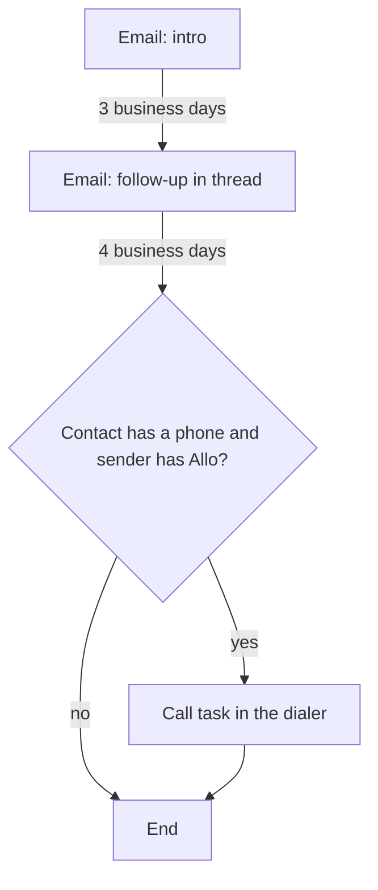

Your product offers sequences to its own customers: each customer workspace has its own sequences, each of its users sends as themselves, and your UI holds the editor, the enroll button and the contact's journey. Use this page when you build OpenSequence into a multi-tenant app instead of running it for one team.

The pieces map like this:

| In your app | In OpenSequence |
|---|---|
| A customer workspace (tenant) | A **project**, with its own API key, provider keys, settings and webhooks |
| A user of that workspace | A **sender**, keyed by your user id |
| A person they reach out to | A **contact**, keyed by your record id |
| A sequence the user builds on your canvas | A **sequence** and its versions |

## Why one project per workspace

Everything that must not leak between your customers lives on the project: the provider keys (each customer brings their own), the contacts and their suppressions, the rule that a contact is in one active sequence at a time, `sms_countries`, `attrs_schema`, the kill switches and the webhook endpoints. One project per workspace keeps those apart without any filtering on your side.

```ts title="TypeScript"
import { OpenSequenceAdmin, OpenSequence } from '@opensequence/sdk';

const admin = new OpenSequenceAdmin({ baseUrl: process.env.SEQ_URL!, adminToken: process.env.SEQ_ADMIN_TOKEN! });

export async function onWorkspaceCreated(ws: Workspace) {
  // A slug is 3 to 48 lowercase letters, digits and dashes.
  const { project, api_key } = await admin.projects.create({ slug: `ws-${ws.id}`, name: ws.name });
  await db.workspaces.update(ws.id, { seqProjectId: project.id, seqApiKey: encrypt(api_key) }); // shown once

  const oseq = new OpenSequence({ baseUrl: process.env.SEQ_URL!, apiKey: api_key });
  const { secret } = await oseq.webhooks.create({ url: `https://app.example.com/hooks/opensequence/${ws.id}`, event_types: ['*'] });
  await db.workspaces.update(ws.id, { seqWebhookSecret: encrypt(secret) });
}

export const seqFor = (ws: Workspace) => new OpenSequence({ baseUrl: process.env.SEQ_URL!, apiKey: decrypt(ws.seqApiKey) });
```

The first key is `admin`; create narrower keys with `oseq.project.apiKeys.create({ name, scopes: ['enroll'] })` for code paths that only enroll.

## Each user is a sender

```ts title="TypeScript"
export async function onUserJoined(ws: Workspace, user: User) {
  const oseq = seqFor(ws);
  await oseq.senders.upsert(user.id, {
    name: user.name,
    email: user.email,
    timezone: user.timezone,
    signature_html: user.signatureHtml,
    attrs: { booking_link: user.bookingLink },
  });
}

// "Connect your mailbox" form on the user's settings page. A 422 names the login that failed.
await seqFor(ws).senders.setSmtp(user.id, { provider: 'smtp', smtp: form.smtp, imap: form.imap });

// "Text and call from Allo": list what the workspace's Allo key can see, let the user pick.
const numbers = await seqFor(ws).project.alloNumbers(); // [{ address, capabilities, users: [{ id, name, email }] }]
await seqFor(ws).senders.setSms(user.id, { allo_user_id: picked.userId, number: picked.address });
```

Show `oseq.senders.readiness(user.id)` next to the canvas so users see which steps they can run before they enroll anyone. When a user leaves, `oseq.senders.disable(user.id)` blocks new enrollments with them (`SENDER_DISABLED`). It does not stop their running enrollments: exit those with `oseq.enrollments.exitMany({ ... })` or move the contacts to another user.

## The starter sequence

Seed every new workspace with a sequence the user can open and edit. This one sends two emails and, if the user has Allo and the contact has a phone, ends with a call.



<Accordion title="starter.json (8 nodes)">

```json title="starter.json"
{
  "schema_version": 1,
  "entry": "start",
  "settings": {
    "send_window": { "days": ["mon", "tue", "wed", "thu", "fri"], "from": "08:00", "to": "18:00", "tz": "contact" },
    "jitter": "15m",
    "reenroll": "never"
  },
  "exit_on": ["reply", "meeting_booked"],
  "nodes": {
    "start": { "type": "start", "next": { "then": "email_intro" } },
    "email_intro": {
      "type": "outreach", "channel": "email", "action": "send",
      "params": {
        "subject": "Quick question, {{ contact.first_name | \"there\" }}",
        "body": "Hi {{ contact.first_name | \"there\" }},\n\nEdit this email to say why you are reaching out.\n\nBook a time: {{ sender.attrs.booking_link | \"just reply to this email\" }}\n\n{{ sender.signature }}\n\nUnsubscribe: {{ unsubscribe_url }}"
      },
      "next": { "sent": "wait_3bd", "skipped": "wait_3bd" }
    },
    "wait_3bd": { "type": "wait", "params": { "duration": "3bd" }, "next": { "then": "email_follow_up" } },
    "email_follow_up": {
      "type": "outreach", "channel": "email", "action": "send",
      "params": {
        "subject": "Quick question, {{ contact.first_name | \"there\" }}",
        "body": "Hi {{ contact.first_name | \"there\" }},\n\nFollowing up on my note below.\n\n{{ sender.signature }}\n\nUnsubscribe: {{ unsubscribe_url }}",
        "reply_in_thread": true
      },
      "next": { "sent": "wait_4bd", "skipped": "wait_4bd" }
    },
    "wait_4bd": { "type": "wait", "params": { "duration": "4bd" }, "next": { "then": "can_call" } },
    "can_call": {
      "type": "condition",
      "params": { "mode": "all", "rules": [
        { "field": "contact.has_phone", "op": "is_true" },
        { "field": "sender.has_sms", "op": "is_true" }
      ] },
      "next": { "yes": "call", "no": "end" }
    },
    "call": {
      "type": "task",
      "params": { "kind": "call", "title": "Call {{ contact.first_name | \"the contact\" }}", "due": "4h", "expire": "2bd", "dialer": true },
      "next": { "completed": "end", "no_answer": "end" }
    },
    "end": { "type": "end" }
  }
}
```

</Accordion>

```ts title="TypeScript"
const { sequence, version } = await seqFor(ws).sequences.create({ name: 'My first sequence', created_by: user.id, definition: starter });
// Leave it as a draft: the user publishes from your editor.
```

## Build the canvas on the schema

Never hard-code node types or fields. Read them, so your editor follows the server when node types or fields change.

| Call | What your editor gets from it |
|---|---|
| `oseq.schema.definition()` (`GET /v1/schema`) | Every node type with its `label`, `transitions` (`keys` in display order, and which are `required`) and its `params` as JSON Schema; every channel with its actions, their params and transitions; the JSON Schema of the whole definition |
| `oseq.schema.fields()` (`GET /v1/schema/fields`) | The condition picker: each source (`contact`, `attrs`, `sender`, `history`, `crm`) with its fields and types, plus the project's `attrs_schema` |
| `oseq.sequences.validate(definition)` | Problems with a JSON path, a code and a sentence, as the user edits |

```ts title="TypeScript"
const { nodes, channels } = await oseq.schema.definition();
const palette = [
  ...nodes.filter((n) => n.type !== 'outreach').map((n) => ({ type: n.type, label: n.label })),
  ...channels.flatMap((c) => c.actions.map((a) => ({ type: 'outreach', channel: c.name, action: a.action, label: a.label }))),
];

// While the user edits: map each problem path (nodes.<id>.params.<field>) to a node and a field.
const { problems } = await oseq.sequences.validate(draftDefinition);

// Save under the optimistic lock, then publish when they press "Publish".
const saved = await oseq.sequences.versions.saveDraft(sequence.id, version.id, { definition: draftDefinition, lock_version: version.lockVersion });
await oseq.sequences.versions.publish(sequence.id, saved.version.id, { published_by: user.id });
```

A save that lost a race fails with `STALE_LOCK`: reload and merge. A published version is frozen; to edit it, copy it into a new draft with `oseq.sequences.versions.create(sequence.id, { tag: 'v2' })`. The definition has no place for node positions: store them in your database by version and node id, or lay the graph out from `entry` and `next`. [Building a canvas](/docs/sequences/building-a-canvas) goes further.

<Note>The validator treats every `attrs.*` and `crm.*` field as text, whatever `attrs_schema` says. Offer `is`, `is_not`, `contains`, `is_empty` and `is_not_empty` for those fields, or publishing fails with `BAD_OPERATOR`.</Note>

## Enroll from your UI

```ts title="TypeScript"
const body = { sender: user.id, contacts: selectedRecordIds, enrolled_by: user.id, enrolled_by_kind: 'user' as const };

const preview = await oseq.sequences.previewEnrollment(sequence.id, body);
// Show: preview.accepted[].first_touch_at, preview.skipped[].reason, preview.capacity.days_to_first_touches

try {
  await oseq.sequences.enroll(sequence.id, body);
} catch (err) {
  if (err instanceof OpenSequenceError && err.code === 'ALREADY_IN_SEQUENCE') {
    // err.details.conflicts: who, which sequence, which sender. Offer "exit them first".
  } else throw err;
}
```

Contacts must exist first (`oseq.contacts.batch`), or pass them inline as `{ external_id, ...fields }` in `contacts`. For "in a sequence" badges on your record lists, call `oseq.contacts.statuses(ids)` with up to 500 ids.

## Show the journey

`oseq.enrollments.get(id)` returns everything to draw one contact's path on the same canvas: the pinned version's definition, every run, and the messages, signals and tasks.

```ts title="TypeScript"
const journey = await oseq.enrollments.get(enrollmentId);
for (const run of journey.runs) {
  canvas.mark(run.nodeId, run.status); // done, waiting, skipped, deferred, failed, needs_review
  if (run.branch) canvas.highlightEdge(run.nodeId, run.branch); // the transition it took
  if (run.nodeType === 'condition') canvas.explain(run.nodeId, run.result.facts); // what the decision read
}
canvas.current(journey.enrollment.currentNodeId, journey.enrollment.status);
```

## Webhooks per workspace

Each project sends to its own endpoint, signed with its own secret. Route by the workspace id in the URL and verify with that workspace's secret.

```ts title="TypeScript"
import { verifyWebhook } from '@opensequence/sdk';

app.post('/hooks/opensequence/:ws', express.raw({ type: 'application/json' }), async (req, res) => {
  const ws = await db.workspaces.get(req.params.ws);
  const event = verifyWebhook<Record<string, any>>({ secret: decrypt(ws.seqWebhookSecret), headers: req.headers, body: req.body });
  await activityFeed.push(ws.id, event); // replies, exits, tasks: show them where users work
  res.sendStatus(204);
});
```

## What to watch

- **Provider keys are per workspace.** Each customer's provider keys go on their project with `oseq.project.setProvider`. A user's number is checked against their workspace's SMS provider key when they connect it.
- **Kill switches per workspace.** `oseq.project.flags.set('global', { value: false })` stops all sending in one workspace, and `channel:sms` stops one channel; set them back to `true` to resume.
- **Limits per sender.** Each user sends at most 30 emails a day by default. Expose `oseq.senders.patchChannel(user.id, 'email', { daily_limit })` in your settings if users may raise it.

Related: [Senders](/docs/sending/senders), [Validation](/docs/sequences/validation), [The journey](/docs/contacts/journey).
