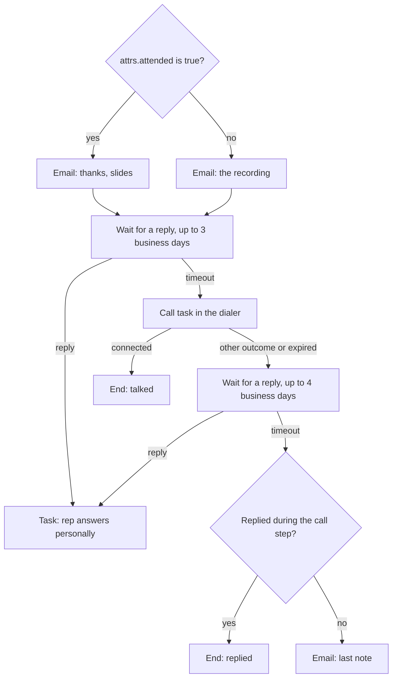

After a webinar or an event, every registrant gets a follow-up that depends on what they did: attended or not, replied or stayed quiet. Use this page when you want the sequence to wait for a reaction for a set time and take a different path when it comes than when it does not.

The tool for that is the `wait_for` step: it waits for one of a few events (`reply`, `reply:email`, `reply:sms`, `call_connected`, `meeting_booked`) and takes `timeout` when the time runs out.



A meeting booked at any point ends the enrollment through `exit_on`.

## The definition

<Accordion title="event-follow-up.json (13 nodes)">

```json title="event-follow-up.json"
{
  "schema_version": 1,
  "entry": "start",
  "settings": {
    "send_window": { "days": ["mon", "tue", "wed", "thu", "fri"], "from": "08:30", "to": "18:00", "tz": "contact" },
    "jitter": "15m",
    "reenroll": "always"
  },
  "exit_on": ["meeting_booked"],
  "nodes": {
    "start": { "type": "start", "next": { "then": "attended" } },
    "attended": {
      "type": "condition",
      "params": { "mode": "all", "rules": [{ "field": "attrs.attended", "op": "is", "value": "true" }] },
      "next": { "yes": "email_thanks", "no": "email_recording" }
    },
    "email_thanks": {
      "type": "outreach", "channel": "email", "action": "send",
      "params": {
        "subject": "Slides from {{ attrs.event_name | \"the session\" }}",
        "body": "Hi {{ contact.first_name | \"there\" }},\n\nThanks for joining {{ attrs.event_name | \"the session\" }}. The slides and the recording are here: {{ attrs.recording_url | \"https://example.com/events\" }}\n\nWhat was the one question you didn't get to ask? Reply and I'll answer it.\n\n{{ sender.signature }}\n\nNo more emails: {{ unsubscribe_url }}"
      },
      "next": { "sent": "wait_reply_1", "skipped": "wait_reply_1" }
    },
    "email_recording": {
      "type": "outreach", "channel": "email", "action": "send",
      "params": {
        "subject": "The recording of {{ attrs.event_name | \"the session\" }}",
        "body": "Hi {{ contact.first_name | \"there\" }},\n\nSorry we missed you. The recording is here, and the demo starts at minute 12: {{ attrs.recording_url | \"https://example.com/events\" }}\n\nIf you'd rather see it live on your own setup, reply and I'll find a time.\n\n{{ sender.signature }}\n\nNo more emails: {{ unsubscribe_url }}"
      },
      "next": { "sent": "wait_reply_1", "skipped": "wait_reply_1" }
    },
    "wait_reply_1": {
      "type": "wait_for",
      "params": { "events": ["reply"], "timeout": "3bd" },
      "next": { "reply": "task_reply", "timeout": "call_1" }
    },
    "task_reply": {
      "type": "task",
      "params": {
        "kind": "follow_up",
        "title": "{{ contact.first_name | \"A registrant\" }} replied after {{ attrs.event_name | \"the event\" }}",
        "body": "Answer personally and offer a demo.",
        "due": "2h",
        "expire": "2bd"
      },
      "next": { "completed": "end_replied", "no_answer": "end_replied" }
    },
    "call_1": {
      "type": "task",
      "params": {
        "kind": "call",
        "title": "Call {{ contact.first_name | \"the registrant\" }} about {{ attrs.event_name | \"the event\" }}",
        "due": "4h",
        "expire": "2bd",
        "dialer": true
      },
      "branches_by_outcome": { "connected": "end_talked" },
      "next": { "completed": "wait_reply_2", "no_answer": "wait_reply_2" }
    },
    "end_talked": { "type": "end", "params": { "label": "Talked on the phone" } },
    "wait_reply_2": {
      "type": "wait_for",
      "params": { "events": ["reply"], "timeout": "4bd" },
      "next": { "reply": "task_reply", "timeout": "replied_check" }
    },
    "replied_check": {
      "type": "condition",
      "params": { "mode": "all", "rules": [{ "field": "history.replied_since_enrollment", "op": "is_true" }] },
      "next": { "yes": "end_replied", "no": "email_last" }
    },
    "email_last": {
      "type": "outreach", "channel": "email", "action": "send",
      "params": {
        "subject": "The recording of {{ attrs.event_name | \"the session\" }}",
        "body": "Hi {{ contact.first_name | \"there\" }},\n\nOne last note: the next session is open for registration, and the recording stays online. Reply any time if you want a walkthrough.\n\n{{ sender.signature }}\n\nNo more emails: {{ unsubscribe_url }}",
        "reply_in_thread": true
      },
      "next": { "sent": "end_done", "skipped": "end_done" }
    },
    "end_replied": { "type": "end", "params": { "label": "Replied" } },
    "end_done": { "type": "end" }
  }
}
```

</Accordion>

## How the waits behave

| Step | Waits for | Takes | When |
|---|---|---|---|
| `wait_for` | the listed events | the event's own key (`reply`) | the first matching event arrives |
| `wait_for` | the listed events | `timeout` | the `timeout` duration passes first |
| `task` | the task to be completed | `branches_by_outcome[outcome]`, else `completed` | a rep or Allo completes it |
| `task` | the task to be completed | `no_answer` | it expires (`expire`, default 7 days after `due`) |

Three rules shape this definition:

- **`exit_on` wins over `wait_for`.** A reply is checked against `exit_on` before it wakes a waiting step. With `"exit_on": ["reply"]` the `reply` branches would never run, so this sequence lists only `meeting_booked`.
- **A `wait_for` only hears events while it waits.** A reply that arrives during the call task is recorded but wakes nothing. `replied_check` reads `history.replied_since_enrollment` so that contact does not get the last email.
- **A connected call also wakes `reply`.** Inside a `wait_for`, a `call_connected` event matches `reply` too. Use `reply:email` or `reply:sms` to wait for one channel only.

Waits and timeouts use the same durations: `m`, `h`, `d`, or `bd` for business days in the contact's time zone.

## The integration

<Steps>
<Step title="Set up the host as a sender">

The host of the event, or each attendee's owner, sends the follow-up. Connect their mailbox and Allo number as in [Senders](/docs/sending/senders).

```ts title="TypeScript"
import { OpenSequence } from '@opensequence/sdk';

const oseq = new OpenSequence({ baseUrl: process.env.SEQ_URL!, apiKey: process.env.SEQ_ADMIN_KEY! });

const { sequence, version } = await oseq.sequences.create({ name: 'Event follow-up', external_id: 'event-follow-up', definition });
await oseq.sequences.versions.publish(sequence.id, version.id);
```

</Step>
<Step title="Enroll registrants when the event ends">

Your event tool tells your backend who registered and who attended. Contacts are upserted inline when you enroll them, `attrs` included.

```ts title="TypeScript"
export async function onEventEnded(event: EventSummary) {
  const result = await oseq.sequences.enroll('event-follow-up', {
    sender: event.hostId,
    contacts: event.registrants.map((r) => ({
      external_id: r.id,
      first_name: r.firstName,
      email: r.email,
      phone: r.phone,
      country: r.country,
      attrs: { attended: r.attended, event_name: event.title, recording_url: event.recordingUrl },
    })),
  });
  log.info({ accepted: result.accepted.length, skipped: result.skipped }, 'event follow-up enrolled');
}
```

`"reenroll": "always"` lets someone who came to an earlier event be enrolled again. Anyone still in another sequence makes the whole call fail with `409 ALREADY_IN_SEQUENCE`; filter them first with `oseq.contacts.statuses(ids)`.

</Step>
<Step title="Send reply tasks to the rep">

A `follow_up` task is not a call, so it does not go to the dialer. Push it where the rep works, and complete it when they answer.

```ts title="TypeScript"
import { verifyWebhook } from '@opensequence/sdk';

app.post('/hooks/opensequence', express.raw({ type: 'application/json' }), async (req, res) => {
  const event = verifyWebhook<Record<string, any>>({ secret: process.env.SEQ_WEBHOOK_SECRET!, headers: req.headers, body: req.body });
  if (event.type === 'task.created' && event.data.task.kind === 'follow_up') {
    await slack.notifyRep(event.data.task.sender, event.data.task.title, event.data.task.id);
  }
  res.sendStatus(204);
});

// When the rep clicks "Done" in your app:
await oseq.tasks.complete(taskId, { outcome: 'answered', note: 'Booked a demo for Thursday' });
```

</Step>
<Step title="Report booked meetings">

The service does not read calendars. A booking ends the sequence when you report it:

```ts title="TypeScript"
await oseq.contacts.reportEvent(registrantId, { id: `booking_${bookingId}`, type: 'meeting_booked' });
```

</Step>
</Steps>

## Trial follow-up

A trial follow-up has the same shape, but the events that matter happen in your product: the user activates, invites a teammate, or upgrades. Those are not `wait_for` events. The service only hears replies, calls and meetings. Two ways to react to product events:

1. **Exit on the event.** When the trial converts, exit the enrollment from your backend:

   ```ts title="TypeScript"
   await oseq.enrollments.exitMany({ contact: userId, label: 'converted' }); // admin key
   ```

2. **Branch on it later.** Write the fact into `attrs` when it happens, and read it in a condition after a timed wait:

   ```ts title="TypeScript"
   await oseq.contacts.patch(userId, { attrs: { activated: true } });
   ```

   ```json
   { "type": "condition", "params": { "mode": "all", "rules": [{ "field": "attrs.activated", "op": "is", "value": "true" }] }, "next": { "yes": "email_next_steps", "no": "email_need_help" } }
   ```

Enroll at trial start, with the trial owner's account manager or a shared sender, and set `"reenroll": "never"` so a user gets one trial sequence.

## What to watch

- **What counts as a reply.** An email counts when it answers, in the thread, an email the sequence sent; a fresh email from the contact counts only with the project setting `match_replies_outside_thread`. A text counts when it comes from the contact's phone to the sender's number. An out-of-office auto-reply does not wake the step: it pauses the enrollment until the date it gives, or for 7 days.
- **Timeouts are business days here.** A `3bd` timeout that starts on a Thursday ends on Tuesday.
- **Unanswered `follow_up` tasks expire.** After `expire` the task takes `no_answer`. Here both paths end the sequence, so nothing else is sent to someone who replied.
- **Texts and calls need the same gates as anywhere.** See [Deliverability and compliance](/docs/sending/deliverability-and-compliance).

Related: [Waits](/docs/sequences/wait-for), [Call tasks](/docs/sending/call-tasks), [Contact events](/docs/contacts/events).
