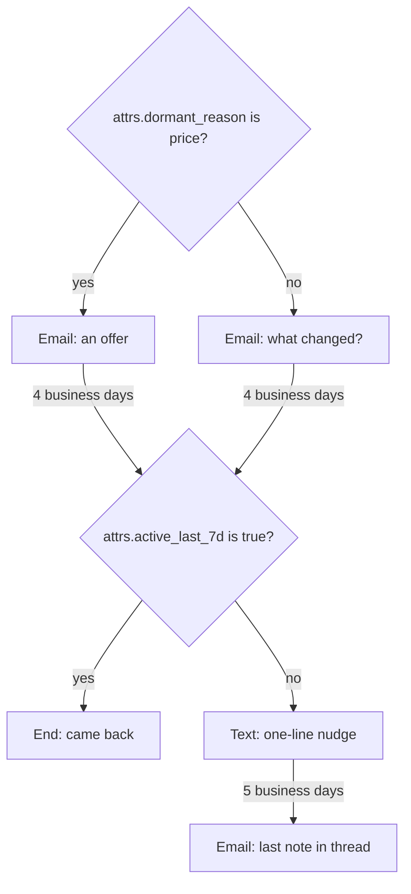

A customer who stopped using your product gets a short, personal sequence from their account manager, shaped by why they went quiet. Use this page when you can tell from your own data who is dormant and why, and you want to reach them without ever writing to someone who opted out.

The service does not watch your product usage. Your backend decides who is dormant, writes the reason into the contact's `attrs`, and enrolls them; the sequence reads those `attrs` at each decision.



## The definition

<Accordion title="re-engagement.json (11 nodes)">

```json title="re-engagement.json"
{
  "schema_version": 1,
  "entry": "start",
  "settings": {
    "send_window": { "days": ["mon", "tue", "wed", "thu", "fri"], "from": "09:00", "to": "17:00", "tz": "contact" },
    "jitter": "30m",
    "reenroll": "after_180d"
  },
  "exit_on": ["reply", "meeting_booked"],
  "nodes": {
    "start": { "type": "start", "next": { "then": "why_dormant" } },
    "why_dormant": {
      "type": "condition",
      "params": { "mode": "all", "rules": [{ "field": "attrs.dormant_reason", "op": "is", "value": "price" }] },
      "next": { "yes": "email_offer", "no": "email_checkin" }
    },
    "email_offer": {
      "type": "outreach", "channel": "email", "action": "send",
      "params": {
        "subject": "A better fit for {{ attrs.company | \"your team\" }}",
        "body": "Hi {{ contact.first_name | \"there\" }},\n\nWhen we last spoke, the price was the sticking point. Since then we added a smaller plan that covers what your team used most: {{ attrs.top_feature | \"the core features\" }}.\n\nWant me to move you over? Reply and I'll set it up.\n\n{{ sender.signature }}\n\nNo more emails: {{ unsubscribe_url }}"
      },
      "next": { "sent": "wait_4bd", "skipped": "wait_4bd" }
    },
    "email_checkin": {
      "type": "outreach", "channel": "email", "action": "send",
      "params": {
        "subject": "Did something change, {{ contact.first_name | \"there\" }}?",
        "body": "Hi {{ contact.first_name | \"there\" }},\n\nI noticed your team hasn't logged in since {{ attrs.last_active_month | \"a while\" }}. If something got in the way, I'd like to hear it, even if the answer is that you moved on.\n\n{{ sender.signature }}\n\nNo more emails: {{ unsubscribe_url }}"
      },
      "next": { "sent": "wait_4bd", "skipped": "wait_4bd" }
    },
    "wait_4bd": { "type": "wait", "params": { "duration": "4bd" }, "next": { "then": "came_back" } },
    "came_back": {
      "type": "condition",
      "params": { "mode": "all", "rules": [{ "field": "attrs.active_last_7d", "op": "is", "value": "true" }] },
      "next": { "yes": "end_back", "no": "sms_nudge" }
    },
    "end_back": { "type": "end", "params": { "label": "Came back" } },
    "sms_nudge": {
      "type": "outreach", "channel": "sms", "action": "send",
      "params": { "body": "Hi {{ contact.first_name | \"there\" }}, {{ sender.name }} here. Sent you a note by email; happy to talk here instead if that's easier. Reply STOP to opt out." },
      "next": { "sent": "wait_5bd", "skipped": "wait_5bd" }
    },
    "wait_5bd": { "type": "wait", "params": { "duration": "5bd" }, "next": { "then": "email_last" } },
    "email_last": {
      "type": "outreach", "channel": "email", "action": "send",
      "params": {
        "subject": "Did something change, {{ contact.first_name | \"there\" }}?",
        "body": "Hi {{ contact.first_name | \"there\" }},\n\nLast note from me. Your account and data are still here whenever you need them. Reply to this thread any time.\n\n{{ sender.signature }}\n\nNo more emails: {{ unsubscribe_url }}",
        "reply_in_thread": true
      },
      "next": { "sent": "end", "skipped": "end" }
    },
    "end": { "type": "end" }
  }
}
```

</Accordion>

Notes on the definition:

- **`attrs` compare as text.** Conditions on `attrs.*` support `is`, `is_not`, `contains`, `is_empty` and `is_not_empty`. `is "true"` matches the boolean `true` and the string `"true"`. Compute buckets in your backend (`dormant_reason: "price"`) rather than numbers to compare.
- **Missing data never matches.** A contact without `dormant_reason` gets the check-in email; one without `active_last_7d` gets the text.
- **`reply_in_thread`** replies under the last email this enrollment sent, so the last note threads under whichever intro went out.
- **`reenroll: "after_180d"`** lets the same customer come back into the sequence 180 days after their previous enrollment in it ended.

## The integration

<Steps>
<Step title="Register the account managers">

Each account manager is a sender with a connected mailbox and, for the text, an Allo number. See [Senders](/docs/sending/senders).

```ts title="TypeScript"
import { OpenSequence } from '@opensequence/sdk';

const oseq = new OpenSequence({ baseUrl: process.env.SEQ_URL!, apiKey: process.env.SEQ_ADMIN_KEY! });

await oseq.senders.upsert(am.id, { name: am.name, email: am.email, timezone: am.timezone, signature_html: am.signatureHtml });
await oseq.senders.setSms(am.id, { allo_user_id: am.alloUserId, number: am.alloNumber });
```

</Step>
<Step title="Create and publish the sequence">

```ts title="TypeScript"
const { sequence, version } = await oseq.sequences.create({ name: 'Re-engagement', external_id: 're-engagement', definition });
await oseq.sequences.versions.publish(sequence.id, version.id);
```

</Step>
<Step title="Pick the dormant customers and write their attrs">

A nightly job in your backend selects customers, writes why they went quiet, and keeps the ones who are not already in a sequence.

```ts title="TypeScript"
const dormant = await db.customersInactiveSince(daysAgo(60)); // your query

await oseq.contacts.batch(
  dormant.map((c) => ({
    external_id: c.id,
    first_name: c.firstName,
    email: c.email,
    phone: c.phone,
    country: c.country,
    attrs: {
      company: c.companyName,
      dormant_reason: c.cancelReason === 'too_expensive' ? 'price' : 'unknown',
      last_active_month: c.lastActiveMonth, // "August"
      top_feature: c.topFeature,
      active_last_7d: false,
    },
  })),
);

// Enrolling fails as a whole if any contact is already in a sequence, so filter first.
const statuses = await oseq.contacts.statuses(dormant.map((c) => c.id));
const free = statuses.filter((s) => s.enrollment === null).map((s) => s.contact.external_id);
```

`contacts.batch` and `contacts.statuses` take up to 500 contacts per call.

</Step>
<Step title="Enroll each customer with their account manager">

```ts title="TypeScript"
// accountManagerOf and groupBy are your own helpers.
for (const [amId, ids] of groupBy(free, accountManagerOf)) {
  const preview = await oseq.sequences.previewEnrollment('re-engagement', { sender: amId, contacts: ids });
  for (const s of preview.skipped) log.info({ contact: s.external_id, reason: s.reason }, 'not enrolled');
  await oseq.sequences.enroll('re-engagement', { sender: amId, contacts: ids });
}
```

The preview runs the same checks without writing. `skipped` lists contacts suppressed on every channel (`suppressed:opt_out`, `suppressed:hard_bounce`, ...) and contacts enrolled too recently (`reenroll_before_180d`).

</Step>
<Step title="Keep attrs fresh, and exit when they come back">

The `came_back` condition reads `attrs.active_last_7d` on day 5. Update it when the customer logs in, and exit them right away if you would rather not wait for the condition.

```ts title="TypeScript"
export async function onLogin(customerId: string) {
  await oseq.contacts.patch(customerId, { attrs: { active_last_7d: true } });
  await oseq.enrollments.exitMany({ contact: customerId, label: 'came_back' }); // admin key
}
```

</Step>
<Step title="Hear about opt-outs">

```ts title="TypeScript"
import { verifyWebhook } from '@opensequence/sdk';

app.post('/hooks/opensequence', express.raw({ type: 'application/json' }), async (req, res) => {
  const event = verifyWebhook<Record<string, any>>({ secret: process.env.SEQ_WEBHOOK_SECRET!, headers: req.headers, body: req.body });
  if (event.type === 'enrollment.exited' && ['opt_out', 'bounced'].includes(event.data.exit_reason)) {
    const contact = await oseq.contacts.get(event.data.enrollment.contact);
    await db.markDoNotContact(contact.externalId, event.data.exit_reason);
  }
  res.sendStatus(204);
});
```

</Step>
</Steps>

## How opt-outs and suppressions are respected

These checks are built in. No definition can turn them off.

| Event | What the service does |
|---|---|
| The contact opens `{{ unsubscribe_url }}` and confirms, or uses the one-click `List-Unsubscribe` header | Suppresses email for the contact and exits the enrollment with `opt_out` |
| The contact texts STOP (also QUIT, END, CANCEL, UNSUBSCRIBE, OPT OUT, STOPALL) | Suppresses SMS and exits with `opt_out` |
| A hard bounce or a complaint | Suppresses email and exits with `bounced` |
| Your app reports `opt_out` on `POST /v1/contacts/{id}/events` | Suppresses every channel, or only the `channel` you name, and exits with `opt_out` |
| Your app reports `suppressed` | Suppresses every channel and exits with `suppressed` |
| Enrolling a contact suppressed on every channel | Skipped, listed in `skipped` |
| A step on a suppressed channel | Skipped when it is about to send; the flow continues |

## What to watch

- **An email opt-out is not a text opt-out.** Someone who unsubscribed from email in an earlier campaign is suppressed for email only. They can still be enrolled, and the text step still goes out if they consented to SMS. For win-back, check `suppressions` on `GET /v1/contacts/{id}` and leave such contacts out, or report `opt_out` without a channel to suppress everything.
- **Consent is separate from opt-out.** A text goes out only with `sms_consent`, a phone, an allowed country and a known time zone. Without them the text is skipped.
- **Your dormant query is the trigger.** The service has no scheduler for picking contacts; run the job on your side.
- **Volume.** A big batch is spread over days by each sender's daily email limit (30 by default). `preview.capacity.days_to_first_touches` tells you how long the first emails take.

## Variations

- **One sender for everyone**: enroll all contacts with a shared "Customer team" sender instead of grouping by account manager.
- **More reasons**: chain conditions on `attrs.dormant_reason` (`is "missing_feature"`, `is "switched_tool"`), each with its own first email, all joining at `wait_4bd`.
- **Last touch from a person**: replace `email_last` with a `task` of `"kind": "call"` and `"dialer": true` for high-value accounts, chosen by a condition on `attrs.plan`.

Related: [Consent and suppressions](/docs/contacts/consent-and-suppressions), [Attributes](/docs/contacts/attrs), [Contact events](/docs/contacts/events).
