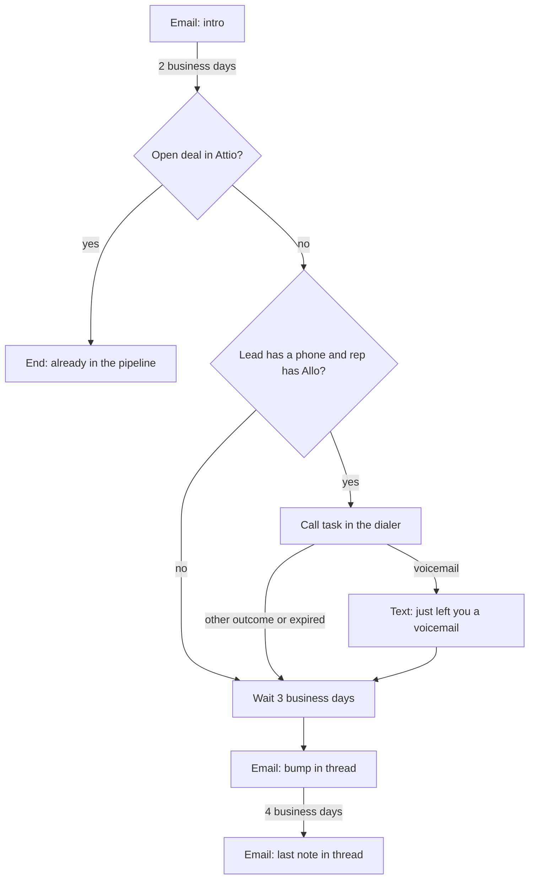

A rep works a list of leads with a mix of emails, a call and a text, and stops the moment a lead replies or books a meeting. Use this page when your app decides who to prospect and which rep owns each lead, and you want the cadence to run on the rep's own mailbox and number.

Before the call, the sequence reads Attio: a lead who already has an open deal leaves the sequence, so nobody cold-calls a live opportunity.



A reply on any channel, a connected call, or a meeting booked ends the enrollment at whatever step it is on.

## The definition

<Accordion title="sales-outbound.json (13 nodes)">

```json title="sales-outbound.json"
{
  "schema_version": 1,
  "entry": "start",
  "settings": {
    "send_window": { "days": ["mon", "tue", "wed", "thu", "fri"], "from": "08:00", "to": "18:00", "tz": "contact" },
    "jitter": "20m",
    "reenroll": "after_90d"
  },
  "exit_on": ["reply", "meeting_booked"],
  "nodes": {
    "start": { "type": "start", "next": { "then": "email_intro" } },
    "email_intro": {
      "type": "outreach", "channel": "email", "action": "send",
      "params": {
        "subject": "Missed calls at {{ attrs.company | \"your team\" }}",
        "body": "Hi {{ contact.first_name | \"there\" }},\n\nMost teams we talk to lose a few inbound calls a day to voicemail, and with them a few deals a month. We route every call to someone who can answer and text back the ones nobody could.\n\nWorth a 15-minute look this week?\n\n{{ sender.signature }}\n\nNot for you? {{ unsubscribe_url }}"
      },
      "next": { "sent": "wait_2bd", "skipped": "wait_2bd" }
    },
    "wait_2bd": { "type": "wait", "params": { "duration": "2bd" }, "next": { "then": "check_crm" } },
    "check_crm": {
      "type": "condition",
      "params": { "mode": "all", "rules": [{ "field": "crm.deal.exists", "op": "is_true" }] },
      "next": { "yes": "end_in_pipeline", "no": "check_phone" }
    },
    "end_in_pipeline": { "type": "end", "params": { "label": "Already in the pipeline" } },
    "check_phone": {
      "type": "condition",
      "params": { "mode": "all", "rules": [
        { "field": "contact.has_phone", "op": "is_true" },
        { "field": "sender.has_sms", "op": "is_true" }
      ] },
      "next": { "yes": "call_1", "no": "wait_3bd" }
    },
    "call_1": {
      "type": "task",
      "params": {
        "kind": "call",
        "title": "Call {{ contact.first_name | \"the lead\" }} at {{ attrs.company | \"their company\" }}",
        "body": "They got the intro email two days ago. Ask about missed inbound calls.",
        "due": "4h",
        "expire": "2bd",
        "dialer": true
      },
      "branches_by_outcome": { "voicemail": "sms_voicemail" },
      "next": { "completed": "wait_3bd", "no_answer": "wait_3bd" }
    },
    "sms_voicemail": {
      "type": "outreach", "channel": "sms", "action": "send",
      "params": { "body": "Hi {{ contact.first_name | \"there\" }}, {{ sender.name }} here. Just left you a voicemail about missed calls. Happy to text instead if that's easier. Reply STOP to opt out." },
      "next": { "sent": "wait_3bd", "skipped": "wait_3bd" }
    },
    "wait_3bd": { "type": "wait", "params": { "duration": "3bd" }, "next": { "then": "email_bump" } },
    "email_bump": {
      "type": "outreach", "channel": "email", "action": "send",
      "params": {
        "subject": "Missed calls at {{ attrs.company | \"your team\" }}",
        "body": "Hi {{ contact.first_name | \"there\" }},\n\nBumping this in case it got buried. One number worth knowing: how many calls went unanswered last week?\n\n{{ sender.signature }}\n\nNot for you? {{ unsubscribe_url }}",
        "reply_in_thread": true
      },
      "next": { "sent": "wait_4bd", "skipped": "wait_4bd" }
    },
    "wait_4bd": { "type": "wait", "params": { "duration": "4bd" }, "next": { "then": "email_last" } },
    "email_last": {
      "type": "outreach", "channel": "email", "action": "send",
      "params": {
        "subject": "Missed calls at {{ attrs.company | \"your team\" }}",
        "body": "Hi {{ contact.first_name | \"there\" }},\n\nI'll stop here. If missed calls become a priority, reply to this thread and I'll pick it up.\n\n{{ sender.signature }}\n\nNot for you? {{ unsubscribe_url }}",
        "reply_in_thread": true
      },
      "next": { "sent": "end", "skipped": "end" }
    },
    "end": { "type": "end" }
  }
}
```

</Accordion>

What each part does:

- **`check_crm`** reads Attio when the step runs, not when the lead was enrolled. `crm.deal.exists` is true when the person or their company has an open deal. See [CRM conditions](/docs/sequences/crm-conditions) for the lookup and every field.
- **`call_1`** gives the rep a call task marked for their Allo power dialer (the push job is not scheduled yet, so today the rep dials from Allo or the task's link). When the rep calls, Allo completes the task with the call's outcome: `voicemail` takes the text, anything else takes `completed`. If nobody calls within two business days, the task expires and takes `no_answer`.
- **`reply_in_thread`** sends the follow-ups as replies to the intro, with `In-Reply-To` and `References` set, so they read as one conversation.
- **`exit_on`** lists both `reply` and `meeting_booked`. Meetings are detected on the rep's Google Calendar (an event with the lead as an attendee), or reported by your app.

## The integration

<Steps>
<Step title="Connect the providers and the rep">

```ts title="TypeScript"
import { OpenSequence } from '@opensequence/sdk';

const oseq = new OpenSequence({ baseUrl: process.env.SEQ_URL!, apiKey: process.env.SEQ_ADMIN_KEY! });

// Once per project. The Allo and Attio keys are checked against the provider before they are stored.
await oseq.project.setProvider('google', { client_id: process.env.GOOGLE_CLIENT_ID!, client_secret: process.env.GOOGLE_CLIENT_SECRET! });
await oseq.project.setProvider('allo', { api_key: process.env.ALLO_API_KEY! });
await oseq.project.setProvider('attio', { api_key: process.env.ATTIO_API_KEY! });

// Once per rep.
await oseq.senders.upsert('rep_maya', { name: 'Maya Chen', email: 'maya@acme.com', timezone: 'America/Chicago', signature_html: mayaSignature });
const google = await oseq.senders.connectGoogle('rep_maya', { return_url: 'https://app.acme.com/settings' });
if ('auth_url' in google) console.log('Maya opens', google.auth_url);
await oseq.senders.setSms('rep_maya', { allo_user_id: 'usr_8f2k', number: '+13125550142' });
```

</Step>
<Step title="Upsert the leads">

```ts title="TypeScript"
await oseq.contacts.batch(
  leads.map((l) => ({
    external_id: l.id,
    first_name: l.firstName,
    last_name: l.lastName,
    email: l.email,
    phone: l.phone, // E.164, or leave it out
    country: l.country,
    attrs: { company: l.companyName, source: 'list_q4' },
  })),
);
```

Up to 500 per call. `attrs` are merged into what is already stored, one level deep.

</Step>
<Step title="Create and publish the sequence">

```ts title="TypeScript"
const { sequence, version } = await oseq.sequences.create({ name: 'Sales outbound', external_id: 'sales-outbound', definition });
await oseq.sequences.versions.publish(sequence.id, version.id);
```

</Step>
<Step title="Enroll a rep's leads">

```ts title="TypeScript"
import { OpenSequenceError } from '@opensequence/sdk';

try {
  const result = await oseq.sequences.enroll('sales-outbound', { sender: 'rep_maya', contacts: leads.map((l) => l.id) });
  console.log(result.accepted.length, 'enrolled;', result.skipped);
} catch (err) {
  if (err instanceof OpenSequenceError && err.code === 'ALREADY_IN_SEQUENCE') {
    // Nobody was enrolled. err.details.conflicts names each lead and the sequence they are in.
  } else throw err;
}
```

Enrolling is all or nothing on conflicts: a lead already in any sequence of the project fails the whole call. Leads suppressed on every channel, and leads whose last enrollment in this sequence ended less than 90 days ago (`reenroll: "after_90d"`), are left out and listed in `skipped`. First touches are spread over days by the rep's daily email limit (30 by default).

</Step>
<Step title="Write outcomes back to your CRM">

Attio is read-only here: the service never writes to it. To record a reply or a meeting in the CRM, listen for `enrollment.exited` and write it yourself.

```ts title="TypeScript"
import { verifyWebhook } from '@opensequence/sdk';

app.post('/hooks/opensequence', express.raw({ type: 'application/json' }), async (req, res) => {
  const event = verifyWebhook<Record<string, any>>({ secret: process.env.SEQ_WEBHOOK_SECRET!, headers: req.headers, body: req.body });
  if (event.type === 'enrollment.exited' && ['replied', 'meeting_booked'].includes(event.data.exit_reason)) {
    const contact = await oseq.contacts.get(event.data.enrollment.contact);
    await crm.logOutcome(contact.externalId, event.data.exit_reason); // your own CRM client
  }
  res.sendStatus(204);
});
```

`verifyWebhook` throws a `WebhookVerificationError` when the signature or the timestamp is wrong; answer 400 then.

</Step>
<Step title="Exit on business events">

When something outside the sequence means the rep should stop, tell the service.

```ts title="TypeScript"
// A meeting booked on a tool the service cannot see: exits through exit_on, credited to the sequence.
await oseq.contacts.reportEvent(leadId, { id: `booking_${bookingId}`, type: 'meeting_booked' });

// The lead asked to be left alone on a call: suppress on every channel and exit.
await oseq.contacts.reportEvent(leadId, { id: `dnc_${leadId}`, type: 'opt_out' });

// Marketing took the lead over: exit without a reason the analytics count as a win.
await oseq.enrollments.exitMany({ contact: leadId, label: 'handed_to_marketing' });
```

</Step>
</Steps>

## What to watch

- **CRM down means `no`.** A failed Attio lookup records the fact as `null`, which never matches, so the lead takes `no` and gets the call. Here that is the safe side; design your own `no` branches the same way.
- **CRM attributes compare as text.** `crm.deal.stage` and any `crm.person.<slug>` support `is`, `is_not`, `contains`, `is_empty` and `is_not_empty`. Numbers are compared as strings.
- **Texts after a voicemail need consent.** Without `sms_consent` the text is skipped and the flow goes on to the bump email. Consent is set with an `admin` key on `PUT /v1/contacts/{id}/sms-consent`.
- **A connected call is a reply.** It exits the enrollment through `exit_on: ["reply"]` and is credited to the call task.
- **Volume.** Each rep sends at most 30 emails in a rolling 24 hours and waits 60 seconds between emails, by default. Raise them per channel with `PATCH /v1/senders/{id}/channels/email`.

## Variations

- **Branch on the deal stage** instead of its existence: `{ "field": "crm.deal.stage", "op": "is", "value": "Lead" }`. Pick which deal counts with `settings.crm.deal_selection` (`newest_open`, `highest_value`, `any_open`).
- **No dialer**: set `"dialer": false`. The task then waits in the rep's task list (`GET /v1/senders/{id}/tasks`) and your UI completes it with `POST /v1/tasks/{id}/complete`.
- **Email only**: drop `check_phone`, `call_1` and `sms_voicemail`, and point `check_crm.no` at `wait_3bd`.

Related: [Call tasks](/docs/sending/call-tasks), [Enrolling](/docs/contacts/enrolling), [Verifying webhooks](/docs/webhooks/verifying).
